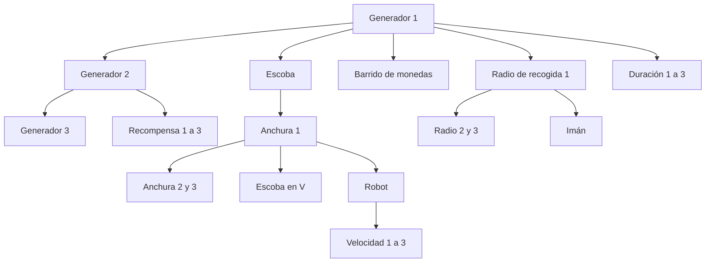

# Árbol de mejoras progresivo

Implementado en `main` como `1720fba` ([PR #12](https://github.com/migdlp/incremental_hole_game/pull/12)), sin cambiar la versión de paquete `0.2.1+3`, los precios ni el esquema v3. El commit distingue este árbol del APK anterior con el mismo número de versión.

## Recorrido del jugador

1. De noche, el pop-up muestra el resumen de la jornada y **Abrir árbol de mejoras**. Ese botón abre una pantalla independiente; el juego sigue detenido.
2. En una partida nueva aparece solo el primer nivel de generador. Pulsar un nodo consulta efecto, valores, porcentaje y coste.
3. Mantener pulsado **3 segundos** en el nodo ya seleccionado o en su ficha para comprar. La compra ocurre al completar el progreso, una sola vez; pulsar brevemente no compra.
4. Soltar antes, mover más de 10 píxeles lógicos, añadir otro dedo, interrumpir/cancelar o pasar a segundo plano cancela el progreso sin gastar.
5. Arrastrar para explorar; pellizcar para zoom o usar Acercar/Alejar. **Centrar selección** devuelve el nodo al centro. Volver desde el árbol al mismo pop-up y pulsar **Comenzar día** para cerrar el resumen e iniciar la siguiente jornada.

Nodos asequibles iluminados, sin saldo oscurecidos y adquiridos con marca verde. La ficha usa descripciones del efecto; los porcentajes se comparan con el nivel anterior. Para generación expresa aumento de frecuencia (`intervaloAnterior / intervaloNuevo - 1`), no reducción porcentual del intervalo. Un desbloqueo sin base no necesita porcentaje.

## Descubrimiento y requisitos

Hay once tipos y 23 nodos, uno por nivel comprable. La visibilidad se deriva de niveles guardados: se muestran compras, sus antecesores y sucesores cuyos padres ya estén comprados. No se guarda un segundo estado de descubrimiento.

El dibujo resume cadenas: cada nivel numérico requiere el anterior. Hay dos capas distintas:

- **CSV/sesión:** requisitos económicos y de compatibilidad originales, comprobados por `purchaseBlock` y `purchase`.
- **Árbol/UI:** además impone descubrimiento. Escoba, barrido y radio inicial requieren generador 1 en la interfaz; recompensa inicial requiere generador 2. El resto conserva dependencias del CSV y cadenas de nivel.

Una compra válida por API de sesión no implica que el nodo esté disponible todavía en la interfaz. No cambiar requisitos históricos solo para dibujar conexiones: se conservan compras antiguas aunque no tengan los nuevos padres comprados. Se muestran sus antecesores sin regalarlos ni descontar saldo.

## Relación con el balance

Con el día base de 15 s, diez de producción a 1,5 bolas/s y valor 2, el máximo inicial es 30 monedas. La primera compra visible cuesta **30** (generador 1): se puede alcanzar tras una jornada perfecta, sin bloqueos ni pérdidas. El desbloqueo de escoba de 20 monedas necesita además ese avance previo en la UI. Los precios siguen provisionales; no garantizar una compra en el primer día ni que el robot llegue en 3–5 días.

## Código y comprobaciones

- [skill_tree.dart](../lib/features/upgrades/domain/skill_tree.dart): `SkillNode`, padres, posiciones y visibilidad; dominio Dart puro.
- [skill_tree_screen.dart](../lib/features/upgrades/presentation/skill_tree_screen.dart): visor, conexiones, ficha, progreso de tres segundos, cancelación, zoom y estados.
- [game_app.dart](../lib/app/game_app.dart): acceso desde la noche; la sesión conserva la operación de compra y guardado.
- [skill_tree_test.dart](../test/features/skill_tree_test.dart): dos pruebas de dominio y cinco de widgets, con descubrimiento, alcance, compras previas, compra única persistente, cancelaciones, saldo y pantalla pequeña.

El árbol necesita revisión en Android físico y aceptación de interacción. Una prueba de widgets a tamaño móvil no certifica experiencia táctil, contraste en dispositivo o rendimiento. La ejecución de CI y el APK exactos están en [CI](ci.md); el número de versión por sí solo no identifica esta entrega.

Evidencia de entrega: [CI 39141075339](https://github.com/migdlp/incremental_hole_game/actions/runs/39141075339) correcta sobre `1720fba`, con 48 pruebas, compilación y firma; [APK con árbol](https://github.com/migdlp/incremental_hole_game/actions/runs/39141075339/artifacts/12142120297). No se ha repetido esta ejecución por el cambio documental.
