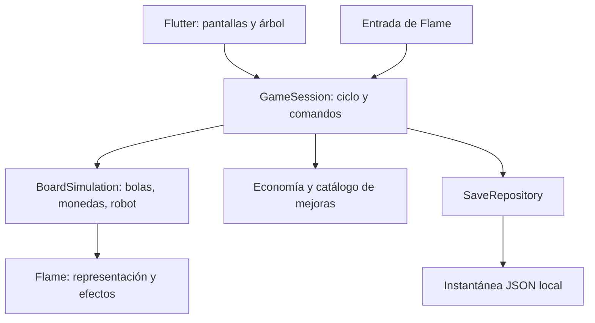

# Arquitectura y stack

Estado: base de implementación propuesta; no describe código ya creado.

## Herramientas

| Área | Elección inicial | Motivo |
| --- | --- | --- |
| Aplicación | Flutter estable y Dart incluido | Pantallas y herramientas móviles |
| Tablero | Flame | Bucle, componentes, entrada y renderizado 2D |
| Física | Simulación sencilla de círculos | Evaluar el gesto antes de añadir Forge2D |
| Estado de interfaz | ChangeNotifier / ValueNotifier de Flutter | Suficiente para el alcance sin otro framework |
| Guardado | Archivo JSON versionado con path_provider | Instantáneas locales completas y control de escritura |
| Audio | flame_audio, si supera la prueba de integración | Efectos breves con concurrencia limitada |
| Validación | flutter_test, integration_test, Flutter DevTools | Economía, ciclo, interacción y rendimiento |
| Automatización | GitHub Actions | Formato, análisis, pruebas y build de Android |

Fijar versión exacta de Flutter al crear el proyecto y registrar la versión de Dart y Flame resueltas. Versionar `pubspec.lock` en la aplicación. No inventar versiones antes de comprobar compatibilidad. La CI debe usar el mismo Flutter que desarrollo. Sin backend, cuentas, inyección de dependencias por framework ni generación de código en la base inicial.

## Responsabilidades



`GameSession` es la única autoridad para iniciar, pausar, comprar y cerrar un día. La simulación entrega eventos de captura y recogida; los efectos visuales no modifican saldo. Flutter observa resúmenes pequeños y no recibe una notificación por objeto en cada fotograma.

Separar datos y reglas puras de componentes Flame para poder probar economía y cierre sin montar una pantalla. Evitar diseñar un motor genérico: implementar solo los sistemas del MVP.

## Estructura propuesta

```text
lib/
  app/                  # arranque, tema, composición de dependencias
  game/domain/          # sesión, economía, mejoras, resultados, instantáneas
  game/simulation/      # movimiento, vecinos, captura, recogida, robot
  game/presentation/    # FlameGame, componentes, entrada y efectos
  game/ui/              # HUD, pausa, noche y árbol
  persistence/          # serialización, validación, migraciones y archivos
assets/
  data/                 # balance validado para la aplicación
  images/
  audio/
test/
integration_test/
```

Crear carpetas al necesitarlas. Un catálogo tipado validado al cargar será la fuente de configuración de ejecución; se deriva de la tabla de balance documentada y se comprueba que conserva precios y efectos. No mantener dos tablas editables independientes.

## Modelo mínimo

- `Progress`: saldo bancado entero, niveles por ID de mejora, siguiente número de día, récord, resultado anterior y ajustes.
- `RunState`: ID de jornada, fase, tiempo restante, ingreso recogido, valor generado, bolas capturadas, configuración efectiva y estado aleatorio.
- `BoardSnapshot`: posiciones, velocidades, IDs y valores de bolas y monedas; estado del robot. La pala no se restaura como pulsación activa.
- `DayResult`: ID, ingreso, recompensa generada, valor perdido y bolas capturadas.
- `UpgradeDefinition`: ID estable, niveles, costes, efectos y requisitos.
- `SaveEnvelope`: versión del formato, progreso y jornada opcional.

Usar enteros para moneda; nunca sumar importes mediante coma flotante. Las compras son comandos validados contra el estado actual y solo se aceptan de noche.

## Saldo y cierre consistente

Durante el día, las recogidas incrementan `RunState.collected`; el saldo bancado no se altera. La UI puede mostrar ambos, claramente etiquetados. En el cierre, una única transición crea el resultado, suma lo recogido al saldo, elimina la jornada y prepara la noche.

La instantánea persistida contiene todo el estado de esa transición. No escribir por separado «sumar saldo» y «marcar día terminado». Una segunda solicitud de cierre del mismo ID no cambia el estado. Invariantes: recompensa generada = ingreso recogido + valor pendiente durante el día; al cerrar, valor perdido = recompensa generada − ingreso recogido.

## Persistencia e interrupciones

Guardar después de compras, al iniciar y terminar una jornada, al entrar en segundo plano y mediante un punto de control periódico propuesto de 5 s. Serializar escrituras en orden; una escritura antigua no puede sobrescribir una nueva. Escribir temporal y sustituir el archivo principal, con copia válida de respaldo. Verificar el comportamiento de reemplazo y recuperación en Android.

Al cargar, validar versión, importes, niveles y referencias; recuperar la copia anterior si el principal está incompleto. Si ambos fallan, informar y ofrecer reiniciar, sin sobrescribir silenciosamente los archivos dañados. Las migraciones se incorporarán cuando cambie el formato.

Pausar al perder foco y ofrecer continuar sin avanzar tiempo real. Guardar objetos en tránsito con su tiempo de aterrizaje. Reiniciar efectos cosméticos al restaurar. Un cierre abrupto puede perder hasta el último punto de control; no se promete guardado perfecto ante una terminación sin aviso. Restaurar una jornada nunca vuelve a sumar ingresos ya bancados.

## Simulación y rendimiento

Paso fijo inicial de 1/60 s con acumulador, límite de recuperación tras una caída y subpasos o barrido para movimientos rápidos. Una pausa por segundo plano no genera tiempo acumulado. En sobrecarga, priorizar estabilidad y tiempo jugable de simulación; no descontar segundos que no se han simulado. Medir el efecto de esta decisión en dispositivos lentos.

Usar rejilla espacial para vecinos y reutilizar objetos donde el perfil muestre presión de memoria. Evitar recorrer todos los pares. Mantener límites explícitos de población y partículas; agrupar monedas conservando el valor. Separar animaciones de la física y usar un generador aleatorio con estado restaurable para generación y robot.

Ensayo inicial: 200 bolas, 100 pilas y 150 partículas simultáneas. Medir en modo profile, dispositivo físico, tres jornadas con carga máxima y tras diez ciclos para detectar crecimiento de memoria. Objetivo provisional: al menos 95 % de fotogramas dentro de 16,7 ms, sin pausas sostenidas perceptibles. Registrar modelo, sistema, carga y tiempos de UI/raster; el objetivo no está validado todavía.

## Calidad y CI

En pull requests: `dart format --output=none --set-exit-if-changed .`, `flutter analyze`, `flutter test` y build Android de depuración. La primera entrega instalable debe probarse en dispositivo. La CI no prueba por sí sola fluidez ni diversión. Configurar CI al disponer del repositorio; no hay publicación automática ni firma de producción en el MVP.

Pruebas prioritarias: conservación del valor al fusionar monedas, recogida única, límite exacto del día, compras inválidas, cierre repetido, guardado/restauración, interrupción de escritura y dependencias del árbol. Prueba de integración de un ciclo con compra y siguiente día. Validación manual del gesto, robot, legibilidad y rendimiento.
