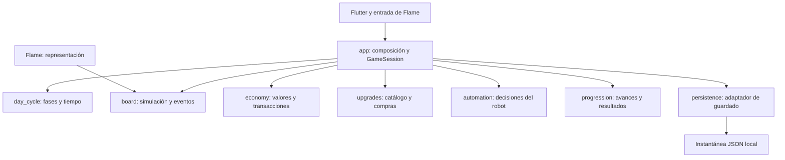

# Arquitectura y stack

Estado: diseño objetivo del MVP. Algunas decisiones ya están aplicadas y otras siguen siendo propuestas. La [implementación actual](implementacion.md) describe el código real; [estado actual](estado-actual.md) enumera diferencias y pendientes. Este documento no acredita por sí solo que existan todas las clases, capas o pruebas que propone.

## Herramientas

| Área | Elección inicial | Motivo |
| --- | --- | --- |
| Aplicación | Flutter estable y Dart incluido | Pantallas y herramientas móviles |
| Tablero | Flame | Bucle, componentes, entrada y renderizado 2D |
| Física | Simulación sencilla de círculos | Evaluar el gesto antes de añadir Forge2D |
| Estado de interfaz | ChangeNotifier / ValueNotifier de Flutter | Suficiente para el alcance sin otro framework |
| Guardado | Archivo JSON versionado con path_provider | Instantáneas locales completas y control de escritura |
| Audio | flame_audio, si supera la prueba de integración | Efectos breves con concurrencia limitada |
| Validación | flutter_test, integration_test, Flutter DevTools | Economía, ciclo, interacción y rendimiento |
| Automatización | GitHub Actions | Formato, análisis, pruebas y build de Android |

Fijar versión exacta de Flutter al crear el proyecto y registrar la versión de Dart y Flame resueltas. Versionar `pubspec.lock` en la aplicación. No inventar versiones antes de comprobar compatibilidad. La CI debe usar el mismo Flutter que desarrollo. Sin backend, cuentas, inyección de dependencias por framework ni generación de código en la base inicial.

## Diseño modular desde el MVP

El alcance del MVP limita las funcionalidades, no la separación de responsabilidades. La base será una sola aplicación y un solo paquete Dart, organizados por módulos funcionales. No se necesitan paquetes independientes, microservicios ni frameworks adicionales para establecer límites claros.

Las reglas y modelos de dominio usan Dart puro: no importan Flutter, Flame, plugins de archivos ni componentes visuales. Los adaptadores traducen entrada, dibujo y almacenamiento a esos modelos. ChangeNotifier y ValueNotifier pertenecen a presentación, no al dominio.

## Responsabilidades



`GameSession`, en `app/`, coordina iniciar, pausar, comprar y cerrar un día. Delega las reglas a cada módulo; no concentra toda la lógica. La simulación entrega eventos de captura y recogida; los efectos visuales no modifican saldo. Flutter observa resúmenes pequeños y no recibe una notificación por objeto en cada fotograma. Las flechas del diagrama indican consumo de contratos o lecturas; los módulos no dependen de la composición que los conecta.

Separar datos y reglas puras de componentes Flame para poder probar economía y cierre sin montar una pantalla. Evitar diseñar un motor genérico: implementar solo los sistemas del MVP.

## Estructura propuesta

```text
lib/
  app/                  # arranque, GameSession, navegación y composición
  core/                 # utilidades técnicas realmente compartidas
  features/
    board/              # bolas, hoyo, mano/escobas, generación y simulación
    day_cycle/          # fases, temporizador, cierre y pausa
    economy/            # recompensa, saldo y transacciones
    upgrades/           # catálogo, requisitos, niveles y compras
    automation/         # decisiones y comportamientos de robots
    progression/        # progreso, récord y resultados entre jornadas
  persistence/          # archivos, serialización y migraciones
assets/
  data/                 # balance validado para la aplicación
  images/
  audio/
test/                   # refleja módulos y añade pruebas de coordinación
integration_test/
```

Dentro de cada módulo, crear `domain/` para reglas y datos, `application/` cuando haya casos de uso que coordinar y `presentation/` para Flutter o Flame cuando corresponda. Incorporar `data/` solo si el módulo necesita un adaptador propio. No crear todas las capas, carpetas vacías, repositorios o interfaces por defecto. La simulación pura vive dentro de `board/domain/`; los componentes Flame dentro de `board/presentation/`.

`core/` no será un contenedor de código de juego compartido. Los conceptos como moneda, mejora o robot pertenecen al módulo que los controla. Extraer utilidades comunes solo cuando exista reutilización real.

Un catálogo tipado validado al cargar será la fuente de configuración de ejecución; se deriva de la tabla de balance documentada y se comprueba que conserva precios y efectos. No mantener dos tablas editables independientes.

## Propiedad y dependencias entre módulos

| Módulo | Controla | No controla |
| --- | --- | --- |
| board | Posiciones, colisiones, IDs de objetos, captura y recogida física | Saldo bancado y compras |
| day_cycle | Fase, tiempo restante y condiciones de transición | Premios y escritura de archivos |
| economy | Reglas de recompensa, contabilidad diaria y saldo bancado | Movimiento y presentación |
| upgrades | Definiciones, niveles, requisitos y efectos derivados | Mutación directa del saldo |
| automation | Selección de objetivos y órdenes del robot | Cobrar recompensas o cerrar el día |
| progression | Número de día, historial resumido y récord | Otra copia del saldo o de los niveles |
| persistence | Codificación, recuperación y migración de instantáneas | Decidir ingresos o avance del juego |

La simulación puede conservar el valor asignado a una moneda para preservar recompensas al fusionar o restaurar; no recalcula el valor con mejoras posteriores. `RunState` y `Progress` son vistas compuestas de estados de módulos, no copias mutables adicionales de la contabilidad.

Dependencias permitidas: presentación consume aplicación/dominio; aplicación consume dominio; dominio no consume presentación ni adaptadores. Entre módulos se usan contratos públicos pequeños y explícitos; no se importan componentes, almacenamiento ni detalles internos de otro módulo. Los archivos de entrada públicos deben exportar solo esos contratos.

La composición conecta módulos mediante constructores y llamadas explícitas. Evitar un singleton global, localizador de servicios o bus genérico de eventos. Si aparece una dependencia circular, mover la coordinación a `GameSession` o aclarar qué módulo es dueño del concepto, en lugar de trasladarlo todo a `core/`.

Ejemplos de colaboración:

- Una captura de `board` lleva ID de bola y tipo; la sesión solicita a `economy` su recompensa con la configuración del día y ordena crear la moneda. Marcar y retirar la bola evita una segunda captura.
- Una recogida física lleva ID e importe; se valida y contabiliza una sola vez. Ni el robot ni el efecto de recogida acceden al saldo.
- Una compra hace validar requisitos y coste en `upgrades`, comprobar saldo en `economy` y aplicar ambos cambios en una única operación de sesión. Si falla una condición, ninguno cambia.
- `automation` recibe una vista de objetivos y devuelve órdenes; `board` aplica movimiento y colisiones. No necesita importar componentes Flame ni modificar objetos ajenos directamente.
- El cierre compone los cambios de ciclo, economía y progreso y los entrega juntos al guardado.

## Crecer sin implementar contenido futuro

Usar IDs estables para tipos de bola, mejoras y comportamientos; mantener referencias del guardado por ID, no por posición en una lista. Los catálogos contienen costes, efectos y requisitos, validados al cargar. Añadir niveles o variantes con comportamiento existente debe ser un cambio de datos localizado. Una mecánica nueva puede requerir código y pruebas; no se promete resolver todo mediante configuración.

Antes de un sistema genérico de efectos o robots, implementar los casos reales del MVP. Introducir estrategias o interfaces cuando haya comportamientos distintos que lo justifiquen, no una clase por cada hipótesis futura. Mantener compatibilidad o migraciones explícitas cuando se renombren IDs o cambie el formato.

Extraer un módulo a un paquete Dart solo si necesita reutilizarse, versionarse o aislarse de forma independiente. Revisar el framework de estado cuando la coordinación de UI resulte difícil de mantener; no condicionar las reglas a esa elección. Considerar isolates únicamente si un perfil demuestra carga de CPU relevante y compensa su coste de comunicación. El crecimiento de contenido no implica por sí mismo añadir backend.

## Modelo mínimo

- `Progress`: vista compuesta del saldo de economy, niveles de upgrades, número de día y resultados de progression, y ajustes.
- `RunState`: vista compuesta del ID de jornada, fase y tiempo de day_cycle, contabilidad diaria de economy, estadísticas del tablero, configuración efectiva y estado aleatorio.
- `BoardSnapshot`: posiciones, velocidades, IDs y valores de bolas y monedas. El comportamiento del robot se guarda en una instantánea de automation asociada. La herramienta elegida se conserva; puntero y agarre no se restauran activos. El formato real v3 y la versión de balance se describen en [persistencia](persistencia.md).
- `DayResult`: ID, ingreso, recompensa generada, valor perdido y bolas capturadas.
- `UpgradeDefinition`: ID estable, niveles, costes, efectos y requisitos.
- `SaveEnvelope`: versión del formato, progreso y jornada opcional.

Los estados de dominio y sus contratos pertenecen a sus módulos. La composición de vistas e instantáneas de sesión pertenece a `app/`; los detalles JSON y de archivos, a `persistence/`. Un contrato mínimo de carga/guardado junto a la aplicación permite sustituir el adaptador por memoria en pruebas sin introducir un framework.

Usar enteros para moneda; nunca sumar importes mediante coma flotante. Las compras son comandos validados contra el estado actual y solo se aceptan de noche.

## Saldo y cierre consistente

Durante el día, las recogidas incrementan `RunState.collected`; el saldo bancado no se altera. La UI puede mostrar ambos, claramente etiquetados. En el cierre, una única transición crea el resultado, suma lo recogido al saldo, elimina la jornada y prepara la noche.

La instantánea persistida contiene todo el estado de esa transición. No escribir por separado «sumar saldo» y «marcar día terminado». Una segunda solicitud de cierre del mismo ID no cambia el estado. Invariantes: recompensa generada = ingreso recogido + valor pendiente durante el día; al cerrar, valor perdido = recompensa generada − ingreso recogido.

## Persistencia e interrupciones

Guardar después de compras, al iniciar y terminar una jornada, al entrar en segundo plano y mediante un punto de control periódico propuesto de 5 s. Serializar escrituras en orden; una escritura antigua no puede sobrescribir una nueva. Escribir temporal y sustituir el archivo principal, con copia válida de respaldo. Verificar el comportamiento de reemplazo y recuperación en Android.

Al cargar, validar versión, importes, niveles y referencias; recuperar la copia anterior si el principal está incompleto. Si ambos fallan, informar y ofrecer reiniciar, sin sobrescribir silenciosamente los archivos dañados. Las migraciones se incorporarán cuando cambie el formato.

Pausar al perder foco y ofrecer continuar sin avanzar tiempo real. Guardar objetos en tránsito con su tiempo de aterrizaje. Reiniciar efectos cosméticos al restaurar. Un cierre abrupto puede perder hasta el último punto de control; no se promete guardado perfecto ante una terminación sin aviso. Restaurar una jornada nunca vuelve a sumar ingresos ya bancados.

## Simulación y rendimiento

Paso fijo inicial de 1/60 s con acumulador, límite de recuperación tras una caída y subpasos o barrido para movimientos rápidos. Una pausa por segundo plano no genera tiempo acumulado. En sobrecarga, priorizar estabilidad y tiempo jugable de simulación; no descontar segundos que no se han simulado. Medir el efecto de esta decisión en dispositivos lentos.

Usar rejilla espacial para vecinos y reutilizar objetos donde el perfil muestre presión de memoria. Evitar recorrer todos los pares. Mantener límites explícitos de población y partículas; agrupar monedas conservando el valor. Separar animaciones de la física y usar un generador aleatorio con estado restaurable para generación y robot.

Ensayo inicial: 200 bolas, 100 pilas y 150 partículas simultáneas. Medir en modo profile, dispositivo físico, tres jornadas con carga máxima y tras diez ciclos para detectar crecimiento de memoria. Objetivo provisional: al menos 95 % de fotogramas dentro de 16,7 ms, sin pausas sostenidas perceptibles. Registrar modelo, sistema, carga y tiempos de UI/raster; el objetivo no está validado todavía.

## Calidad y CI

La [CI actual](ci.md) ejecuta formato sobre `lib test`, análisis, pruebas y build Android de depuración únicamente al lanzarla manualmente, por decisión del usuario. No se activa con pushes o pull requests. La primera entrega instalable debe probarse en dispositivo; la CI no acredita fluidez ni diversión. No hay publicación automática en tiendas ni firma de producción en el MVP.

Pruebas prioritarias: conservación del valor al fusionar monedas, recogida única, límite exacto del día, compras inválidas, cierre repetido, guardado/restauración, interrupción de escritura y dependencias del árbol. Prueba de integración de un ciclo con compra y siguiente día. Validación manual del gesto, robot, legibilidad y rendimiento.

En revisión de código, comprobar ausencia de dependencias circulares, imports de Flutter/Flame en dominio y accesos a detalles internos de otro módulo. Probar reglas de cada módulo con Dart y fixtures pequeños; probar por separado las colaboraciones de compra y cierre. Al añadir contenido, comprobar IDs/requisitos y que una partida guardada anterior siga cargando. No introducir infraestructura de pruebas de arquitectura adicional hasta que la revisión resulte insuficiente.
