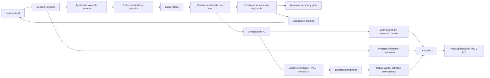
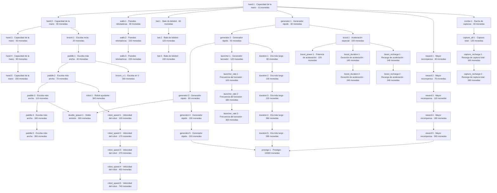

# Feed the Hole — AUD01: auditoría completa

> **Nota de publicación:** auditoría histórica de **0.23.0+36** (`0778d13`). La rama avanzó después a **0.23.1+37** con cambios de cuotas; este informe no evalúa esos cambios posteriores.

**Versión:** 0.23.0+36 · **Fecha:** 27/10/2026.  
**Commit auditado:** `0778d139d4a85124e0af2a9f89d595dc19159430`.

**Hallazgo principal:** `hand:1` tiene **6 vecinos** y supera el máximo de 4. El árbol consta de 55 nodos y 57 aristas; se han inventariado también 15 niveles retirados. No se ha modificado el juego.

Este documento reúne los cuatro informes de auditoría para poder compartirlos en un único Markdown. El ZIP adjunto incluye además los CSV, el grafo, los hashes y la verificación reproducible.

## Contenido

1. Informe técnico, fuentes y árbol completo.
2. Catálogo de mejoras normales, P02, E03 y otras mecánicas.
3. Economía: producción, captura, monedas, estrellas, cuotas y prestigio.
4. Divergencias, riesgos, métricas faltantes y pruebas.

**Validación documental:**193 comprobaciones de extracción y consistencia correctas. Esto no equivale a193 pruebas Flutter ni a mediciones de gameplay. No se ha ejecutado una nueva pipeline ni se ha medido Android en esta auditoría.


---

# AUD01 — Informe técnico verificable

**Proyecto:** Feed the Hole · **Versión:** 0.23.0+36 · balance v 20 · JSON v 16  
**Fuente auditada:** `0778d139d4a85124e0af2a9f89d595dc19159430` · rama `build/apk-0.6.0+13`  
**Fecha:** 27/10/2026 · auditoría estática; sin cambios de gameplay o balance.

## Resultado principal

**El árbol no cumple la regla de máximo cuatro vecinos:** `hand:1` tiene **6**: `hand:2`, `generator:1`, `reward:1`, `walls:1`, `bat:1`, `combo:1`. Los otros **54 nodos** sí cumplen. No se ha reconectado ninguno.

Se han inventariado **22 familias, 55 nodos de nivel y 57 aristas dibujadas**. Existe una sola componente conectada, sin nodos aislados, IDs duplicados, aristas duplicadas ni referencias rotas en esta versión. Todos son alcanzables por requisitos con recursos ilimitados; esto **no demuestra viabilidad económica antes de la derrota**. También se registran **15 niveles históricos retirados de 5 familias**, que no pertenecen al grafo actual.

La economía distingue tres monedas/progresos: **monedas normales**, **estrellas cobradas** y **niveles permanentes E03**. Las bolas capturadas alimentan cuotas por cantidad, no por valor. Hay derrota real al cuarto cierre de cada cuota activa. P02, E03, C01 y AJ-008A tienen código e integración; la tasa humana de captura y el rendimiento Android no están medidos en esta auditoría.

## Evidencia, alcance y método

- **VERIFICADO EN CÓDIGO:** lectura del código del commit indicado y extracción Python de `docs/balance.csv`, `UpgradeCatalog.labels` y `SkillTree` (sin ejecutar Dart). Los números de nodos, costes y posiciones provienen de estos archivos.
- **OBSERVADO EN EJECUCIÓN:** aquí se ejecutaron la reconstrucción estática, comprobaciones de consistencia de entregables, conservación aritmética y hashes. No se ejecutó el juego ni se midieron capturas humanas.
- **REFERENCIA DE EJECUCIÓN PREVIA:** documentación publicada de CI con 486 pruebas correctas y un benchmark AOT. Se identifica expresamente como previa, no como pruebas nuevas de AUD01.
- **INFERIDO:** fórmulas analíticas ideales y riesgos derivados, etiquetados como tales. No se presentan como tasas observadas.
- **DEFINIDO PERO NO IMPLEMENTADO:** tiers individuales, potenciadora y futuras mecánicas CF. No se extrapolan reglas incompletas.
- **DESCONOCIDO:** medición en Android real, captura según habilidad humana, rotura real de burbujas, balance final.

No había `flutter` ni `dart` disponibles en PATH al revisar. No se instaló SDK, no se lanzó pipeline, no se generó APK ni se modificaron fuentes del juego: no son necesarios para entregar esta auditoría documental. La evidencia de 486 pruebas está en `docs/estado-actual.md` y la [pipeline previa](https://github.com/migdlp/incremental_hole_game/actions/runs/40327063421), fuente compilada `a385b8592d37b88121c87f72abf1ced21a876204` (HEAD auditado añade documentación posterior).

Fuentes de diseño disponibles: `docs/e03-cartas-evolucion-especificacion.md`, `docs/s03-aj005b-cuotas-4-jornadas.md`, `docs/p02-tienda-permanente.md`, `docs/aj009-coleccion-monedas.md`, documentos de C01/AJ-008A presentes y los requisitos de AUD01 adjuntos. No hay imagen aprobada original de AJ-008A en el adjunto AUD01: no se certifica fidelidad píxel a píxel a esa imagen. El historial documental contiene reglas sustituidas; manda la implementación actual para este inventario.

## Entregables

- `AUD01_informe_tecnico.md`: este informe, tabla de cada nodo y grafo completo.
- `AUD01_nodos.csv`: 55 nodos actuales + 15 niveles obsoletos, con todos los campos solicitados, rutas, costes, efectos y persistencia.
- `AUD01_conexiones.csv`: 57 filas de aristas dibujadas y 53 filas de requisitos CSV. **Filtrar naturaleza antes de contar conexiones**: la segunda clase no añade líneas al mapa.
- `AUD01_habilidades.md`: árbol, P02, E03, eventos, herramientas y sistemas ajenos al árbol.
- `AUD01_economia.md`: producción, captura, ingresos, costes, estrellas, cuotas y fórmulas.
- `AUD01_desconocidos_y_riesgos.md`: divergencias, mediciones y propuestas sin implementar.
- `AUD01_constantes.csv`: todos los parámetros base del CSV, incluidas constantes históricas inertes. Interpretación de uso en economía/riesgos.
- `AUD01_grafo_verificacion.json`, `AUD01_arbol.mmd`, `AUD01_fuentes_sha256.csv`: resultados procesables y trazabilidad.
- `AUD01_completo.md`: documento único con todos los informes Markdown, para compartir.

## Arquitectura y fuentes de verdad

| Subsistema | Fuente / símbolo | Responsabilidad |
|---|---|---|
| Configuración | `docs/balance.csv`; `UpgradeCatalog.fromCsv/settings` | Precio, requisitos y valor absoluto por nivel; snapshot de ajustes por jornada; balances históricos para partidas interrumpidas |
| Grafo | `lib/features/upgrades/domain/skill_tree.dart`, `SkillTree/SkillNode` | Un nodo por nivel, padres y posiciones; rutas de líneas evitan otros nodos |
| Compra normal | `GameSession.purchaseBlock/purchase`; `SkillTreeScreen._canBuy` | Saldo, nivel previo, requisitos, compra nocturna, confirmación de prestigio |
| Simulación | `lib/features/board/domain/board.dart`, `Board.update` | Emisión, física propia en Dart, captura y recompensa por bola |
| Tiempo | `GameSession.tick/_step`; `DayCycle` | Pasos de 1/60 s y subpasos físicos de ≤1/240 s; pausa/cierre exacto |
| Saldo | `Economy`; `RewardDelivery`; `GameSession._step/finishDay` | Crédito registrado una vez, cobro diferido y liquidación completa antes del cierre |
| Monedas visuales | `planCoins`, `RewardVisuals`, `DailyCoinCollection` | Desglose de microlotes, emisor secuencial y pilas; sin autoridad económica |
| Cuotas | `FeedingProgress.creditBalls/expiresAt` | 100×10^n bolas, excedentes y plazo de cuatro jornadas |
| Estrellas | `StarConfig/StarLedger/StarBubbles`; `_changeStars` | Recompensa pendiente por cuota, física y cobro único por rotura |
| Meta | `MetaProgress`; `PermanentSkill/PermanentRun`; `EvolutionSkill/EvolutionRun` | P02 y E03 permanentes separados de contadores temporales |
| Persistencia | `GameSession.snapshot/restore/_drainSaves`; `FileSaveStore` | JSON16, checkpoints de meta, archivos temporales y renombrado, copia de recuperación |

**Flame renderiza/integra la pantalla; la física no es una simulación de cuerpos Forge 2D.** Las colisiones e impulsos están calculados en `Board`, `Launcher` y `StarBubbles`. Es relevante para BAL01 y para presupuestar nuevas mecánicas.



## Reconstrucción y validación del grafo

El grafo usa **IDs por nivel** (`hand:1`), no solo IDs de familia (`hand`). En cada nivel `i+1`, `parents` es la unión de nivel anterior, si existe, y requisitos nuevos respecto al nivel anterior. Los requisitos repetidos permanecen en la validación de compra, pero no generan la misma arista en cada nivel.

Las aristas se almacenan una sola vez padre→hijo; para vecinos se toma su cierre **no dirigido**, contando cada par una vez en cada extremo. La ausencia de la lista inversa en Dart **no es una asimetría errónea**: el modelo es explícitamente dirigido y el dibujado itera los padres. No hay un segundo catálogo de aristas bidireccionales que deba coincidir.

| Grado | Nodos | Regla 0–4 |
|---:|---:|---|
| 0 | 0 | Permitido; ninguno encontrado |
| 1 | 11 | Cumple |
| 2 | 34 | Cumple |
| 3 | 7 | Cumple |
| 4 | 2 | Cumple |
| 6 | 1 | **Incumple: hand:1** |

No se han encontrado ciclos de requisitos ni componentes aisladas. `prestige:1` depende de tres hojas (`generator:5`, `reward:5`, `duration:5`), es visible desde el inicio del **árbol**, pero el árbol entero permanece inaccesible hasta terminar jornada 1. El resto se descubre con compras y disponibilidad inmediata; nodos ocultos por descubrimiento también están inventariados. Con cero compras solo se revelan `hand:1` y `prestige:1` al poder abrir la tienda. DEBUG muestra todos.

Posiciones reales de centros: `spacing=64`, `canvasSize=864`; `line(x,y,dx,dy,n)` produce `(48+(x+dx·i+2)·64,48+(y+dy·i+2)·64)`. Prestigio tiene centro `(48,48)` y representación mayor girada 45°. La forma no añade vecinos.

### Todos los nodos actuales

Costes en monedas normales. Niveles anteriores de la misma familia son obligatorios; todas las compras normales se pierden al terminar la partida, se aplican al siguiente snapshot de jornada, excepto prestigio, que actúa inmediatamente. Efectos, acumulación y evidencia detallada por fila en `AUD01_nodos.csv` y por familia en habilidades.

| ID | Nombre | Coste | Efecto absoluto | Requisito CSV | Padres dibujados | Vecinos distintos (grado) | Posición x,y |
|---|---|---:|---|---|---|---|---|
| `prestige:1` | Prestigio | 10000 | `prestige_action=1` | generator:5, reward:5, duration:5 | generator:5, reward:5, duration:5 | duration:5, generator:5, reward:5 **(3)** | 48,48 |
| `hand:1` | Capacidad de la mano | 13 | `hand_capacity=2` | — | — | bat:1, combo:1, generator:1, hand:2, reward:1, walls:1 **(6)** | 496,368 |
| `hand:2` | Capacidad de la mano | 30 | `hand_capacity=3` | — | hand:1 | broom:1, hand:1, hand:3 **(3)** | 560,432 |
| `hand:3` | Capacidad de la mano | 50 | `hand_capacity=4` | — | hand:2 | hand:2, hand:4 **(2)** | 624,496 |
| `hand:4` | Capacidad de la mano | 90 | `hand_capacity=5` | — | hand:3 | hand:3, hand:5 **(2)** | 688,560 |
| `hand:5` | Capacidad de la mano | 150 | `hand_capacity=6` | — | hand:4 | hand:4 **(1)** | 752,624 |
| `walls:1` | Paredes rebotadoras | 40 | `wall_restitution=1.1` | hand:1 | hand:1 | hand:1, walls:2 **(2)** | 496,432 |
| `walls:2` | Paredes rebotadoras | 100 | `wall_restitution=1.35` | hand:1 | walls:1 | walls:1, walls:3 **(2)** | 496,496 |
| `walls:3` | Paredes rebotadoras | 220 | `wall_restitution=1.6` | hand:1 | walls:2 | walls:2 **(1)** | 496,560 |
| `bat:1` | Bate de béisbol | 60 | `bat_power=1` | hand:1 | hand:1 | bat:2, hand:1 **(2)** | 304,560 |
| `bat:2` | Bate de béisbol | 120 | `bat_power=1.35` | hand:1 | bat:1 | bat:1, bat:3 **(2)** | 304,624 |
| `bat:3` | Bate de béisbol | 240 | `bat_power=1.7` | hand:1 | bat:2 | bat:2 **(1)** | 368,624 |
| `broom:1` | Escoba recta | 20 | `broom_unlocked=1` | hand:2 | hand:2 | hand:2, paddle:1 **(2)** | 560,496 |
| `paddle:1` | Escoba más ancha | 40 | `paddle_radius=24` | broom:1 | broom:1 | broom:1, broom_v:1, paddle:2 **(3)** | 560,560 |
| `paddle:2` | Escoba más ancha | 70 | `paddle_radius=28` | broom:1 | paddle:1 | paddle:1, paddle:3, robot:1 **(3)** | 560,624 |
| `paddle:3` | Escoba más ancha | 110 | `paddle_radius=32` | broom:1 | paddle:2 | double_spawn:1, paddle:2, paddle:4 **(3)** | 560,688 |
| `paddle:4` | Escoba más ancha | 180 | `paddle_radius=36` | broom:1 | paddle:3 | paddle:3, paddle:5 **(2)** | 560,752 |
| `paddle:5` | Escoba más ancha | 300 | `paddle_radius=40` | broom:1 | paddle:4 | paddle:4 **(1)** | 560,816 |
| `broom_v:1` | Escoba en V | 160 | `v_unlocked=1` | paddle:1 | paddle:1 | paddle:1 **(1)** | 624,560 |
| `double_spawn:1` | Doble emisión | 500 | `balls_per_spawn=2` | generator:3, paddle:3 | generator:3, paddle:3 | generator:3, paddle:3 **(2)** | 48,176 |
| `generator:1` | Generador rápido | 30 | `spawn_interval=0.533333` | hand:1 | hand:1 | boost:1, generator:2, hand:1 **(3)** | 432,304 |
| `generator:2` | Generador rápido | 50 | `spawn_interval=0.426667` | hand:1 | generator:1 | duration:1, generator:1, generator:3, launcher:1 **(4)** | 368,240 |
| `generator:3` | Generador rápido | 80 | `spawn_interval=0.341333` | hand:1 | generator:2 | double_spawn:1, generator:2, generator:4 **(3)** | 304,176 |
| `generator:4` | Generador rápido | 130 | `spawn_interval=0.273067` | hand:1 | generator:3 | generator:3, generator:5 **(2)** | 240,112 |
| `generator:5` | Generador rápido | 220 | `spawn_interval=0.218453` | hand:1 | generator:4 | generator:4, prestige:1 **(2)** | 176,48 |
| `launcher:1` | Generador lanzador | 120 | `launcher_unlocked=1` | generator:2 | generator:2 | generator:2, launcher_rate:1 **(2)** | 368,112 |
| `launcher_rate:1` | Frecuencia del lanzador | 100 | `launcher_interval=1.8` | launcher:1 | launcher:1 | launcher:1, launcher_rate:2 **(2)** | 304,48 |
| `launcher_rate:2` | Frecuencia del lanzador | 180 | `launcher_interval=1.2` | launcher:1 | launcher_rate:1 | launcher_rate:1, launcher_rate:3 **(2)** | 368,48 |
| `launcher_rate:3` | Frecuencia del lanzador | 300 | `launcher_interval=0.8` | launcher:1 | launcher_rate:2 | launcher_rate:2 **(1)** | 432,48 |
| `reward:1` | Mayor recompensa | 40 | `ball_value=2` | hand:1 | hand:1 | hand:1, reward:2 **(2)** | 496,304 |
| `reward:2` | Mayor recompensa | 70 | `ball_value=3` | hand:1 | reward:1 | reward:1, reward:3 **(2)** | 496,240 |
| `reward:3` | Mayor recompensa | 110 | `ball_value=5` | hand:1 | reward:2 | reward:2, reward:4 **(2)** | 496,176 |
| `reward:4` | Mayor recompensa | 180 | `ball_value=8` | hand:1 | reward:3 | reward:3, reward:5 **(2)** | 496,112 |
| `reward:5` | Mayor recompensa | 300 | `ball_value=13` | hand:1 | reward:4 | prestige:1, reward:4 **(2)** | 496,48 |
| `duration:1` | Día más largo | 80 | `production_duration=18` | generator:2 | generator:2 | duration:2, generator:2 **(2)** | 304,240 |
| `duration:2` | Día más largo | 130 | `production_duration=21` | generator:2 | duration:1 | duration:1, duration:3 **(2)** | 240,240 |
| `duration:3` | Día más largo | 220 | `production_duration=24` | generator:2 | duration:2 | duration:2, duration:4 **(2)** | 176,240 |
| `duration:4` | Día más largo | 360 | `production_duration=27` | generator:2 | duration:3 | duration:3, duration:5 **(2)** | 112,240 |
| `duration:5` | Día más largo | 590 | `production_duration=30` | generator:2 | duration:4 | duration:4, prestige:1 **(2)** | 48,240 |
| `robot:1` | Robot ayudante | 300 | `robot_count=1` | paddle:2 | paddle:2 | paddle:2, robot_speed:1 **(2)** | 432,624 |
| `robot_speed:1` | Velocidad del robot | 100 | `robot_speed=51.75` | robot:1 | robot:1 | robot:1, robot_speed:2 **(2)** | 368,688 |
| `robot_speed:2` | Velocidad del robot | 170 | `robot_speed=59.5125` | robot:1 | robot_speed:1 | robot_speed:1, robot_speed:3 **(2)** | 304,688 |
| `robot_speed:3` | Velocidad del robot | 270 | `robot_speed=68.4394` | robot:1 | robot_speed:2 | robot_speed:2, robot_speed:4 **(2)** | 240,688 |
| `robot_speed:4` | Velocidad del robot | 450 | `robot_speed=78.7053` | robot:1 | robot_speed:3 | robot_speed:3, robot_speed:5 **(2)** | 176,688 |
| `robot_speed:5` | Velocidad del robot | 740 | `robot_speed=90.5111` | robot:1 | robot_speed:4 | robot_speed:4 **(1)** | 112,688 |
| `combo:1` | Racha de capturas | 40 | `combo_unlocked=1` | hand:1 | hand:1 | capture_all:1, hand:1 **(2)** | 560,304 |
| `capture_all:1` | Captura total | 120 | `capture_all_unlocked=1` | combo:1 | combo:1 | capture_recharge:1, combo:1 **(2)** | 624,368 |
| `capture_recharge:1` | Recarga de captura total | 160 | `capture_all_cooldown=10` | capture_all:1 | capture_all:1 | capture_all:1, capture_recharge:2 **(2)** | 688,368 |
| `capture_recharge:2` | Recarga de captura total | 280 | `capture_all_cooldown=8` | capture_all:1 | capture_recharge:1 | capture_recharge:1 **(1)** | 752,368 |
| `boost:1` | Aceleración especial | 100 | `boost_unlocked=1` | generator:1 | generator:1 | boost_duration:1, boost_power:1, boost_recharge:1, generator:1 **(4)** | 368,304 |
| `boost_power:1` | Potencia de aceleración | 220 | `boost_multiplier=3` | boost:1 | boost:1 | boost:1 **(1)** | 304,304 |
| `boost_duration:1` | Duración de aceleración | 140 | `boost_duration=5` | boost:1 | boost:1 | boost:1, boost_duration:2 **(2)** | 368,432 |
| `boost_duration:2` | Duración de aceleración | 240 | `boost_duration=6` | boost:1 | boost_duration:1 | boost_duration:1 **(1)** | 368,496 |
| `boost_recharge:1` | Recarga de aceleración | 140 | `boost_cooldown=8` | boost:1 | boost:1 | boost:1, boost_recharge:2 **(2)** | 368,176 |
| `boost_recharge:2` | Recarga de aceleración | 240 | `boost_cooldown=6` | boost:1 | boost_recharge:1 | boost_recharge:1 **(1)** | 432,176 |

### Grafo completo de aristas dibujadas



### Familias retiradas

`Barrido/sweep` (1 nivel), `Área/collection` (5), `Imán/magnet` (1), `Atracción/attraction` (3) y `Fuerza de agarre/hand_grip` (5): **15 niveles históricos**, no nodos actuales. Conservados en CSV de inventario con costes/requisitos antiguos y sin posición ni vecindad actual. `retiredIds/retiredDefinition` permiten validar y migrar guardados históricos; no son compras ocultas disponibles. Robot actual ya no exige Barrido. No se contabilizan sus aristas antiguas como conexiones del árbol vigente. Los balances v 1–v 19 conservan históricos para restauración; no se mezclan sus catálogos entre sí.


---

# AUD01 — Inventario de habilidades y mecánicas

**Proyecto:** Feed the Hole · **Versión:** 0.23.0+36 · balance v 20 · JSON v 16  
**Fuente auditada:** `0778d139d4a85124e0af2a9f89d595dc19159430` · rama `build/apk-0.6.0+13`  
**Fecha:** 27/10/2026 · auditoría estática; sin cambios de gameplay o balance.

## Convenciones

Salvo indicación contraria, todo este inventario es **VERIFICADO EN CÓDIGO**, en el commit de cabecera. Las tablas son parámetros implementados, no balance final aprobado. Las mejoras normales parten de nivel 0, son secuenciales, cuestan monedas normales, solo se compran tras jornada 1 y entre jornadas; se pierden al terminar partida. Sus valores sustituyen la variable base (no se suman todos los niveles). Se congelan al crear `DaySettings` para la siguiente producción.

## Árbol normal: 22 familias, 55 niveles

Cada nivel y su vecindad aparecen individualmente en el informe/CSV. Aquí se incluyen todos los efectos y tablas:

### `prestige` — Prestigio

- **Estado:** implementado; categoría Prestigio; niveles 0–1.
- **Propósito/efecto:** Finaliza la partida inmediatamente y abre la tienda permanente, tras confirmación.
- **Aplicación:** Acción al comprar; se pierden monedas, árbol, cuotas y burbujas; conserva estrellas/P02/E03.
- **Acumulación/exclusiones:** No añade estrellas; coste y prerrequisitos provisionales heredados S03/BAL01.
- **Fuente:** `lib/app/game_session.dart:purchase/_endRun; lib/features/prestige/domain/meta_progress.dart:end`; `UpgradeCatalog.settings`, `GameSession.purchaseBlock`, `docs/balance.csv`.

| Nivel | Coste | Valor absoluto | Requisitos CSV |
|---:|---:|---|---|
| 1 | 10000 | `prestige_action=1` action | generator:5&reward:5&duration:5 |

### `hand` — Capacidad de la mano

- **Estado:** implementado; categoría Control; niveles 0–5.
- **Propósito/efecto:** Aumenta la cantidad máxima de bolas sujetas; base 1. Fuerza fija ×4, sin niveles de fuerza.
- **Aplicación:** hand_capacity; siguiente jornada.
- **Acumulación/exclusiones:** No cambia valor; arrastre/lanzamiento facilita capturas; no afecta burbujas ni capacidad de bate.
- **Fuente:** `lib/features/board/domain/board.dart:handCapacity/_heldBalls/_moveTool`; `UpgradeCatalog.settings`, `GameSession.purchaseBlock`, `docs/balance.csv`.

| Nivel | Coste | Valor absoluto | Requisitos CSV |
|---:|---:|---|---|
| 1 | 13 | `hand_capacity=2` balls | ninguno |
| 2 | 30 | `hand_capacity=3` balls | ninguno |
| 3 | 50 | `hand_capacity=4` balls | ninguno |
| 4 | 90 | `hand_capacity=5` balls | ninguno |
| 5 | 150 | `hand_capacity=6` balls | ninguno |

### `walls` — Paredes rebotadoras

- **Estado:** implementado; categoría Control; niveles 0–3.
- **Propósito/efecto:** Las cuatro paredes rebotan desde el inicio (×0,4); compra aumenta restitución normal.
- **Aplicación:** wall_restitution; siguiente jornada.
- **Acumulación/exclusiones:** Límite vectorial 380 tras ambas normales; compatible con E03 dirigido; no afecta monedas ni rebote propio P01.
- **Fuente:** `lib/features/board/domain/board.dart:_bounceWalls`; `UpgradeCatalog.settings`, `GameSession.purchaseBlock`, `docs/balance.csv`.

| Nivel | Coste | Valor absoluto | Requisitos CSV |
|---:|---:|---|---|
| 1 | 40 | `wall_restitution=1.10` multiplier | hand:1 |
| 2 | 100 | `wall_restitution=1.35` multiplier | hand:1 |
| 3 | 220 | `wall_restitution=1.60` multiplier | hand:1 |

### `bat` — Bate de béisbol

- **Estado:** implementado; categoría Control; niveles 0–3.
- **Propósito/efecto:** Desbloquea bate y sube exclusivamente bonificación de golpe activo.
- **Aplicación:** bat_power; siguiente jornada; compra selecciona herramienta.
- **Acumulación/exclusiones:** Pasivo ×0,4; activo añade max(0,v_superficie·normal)×1,1×potencia; velocidad de giro incluida; tope 380; nuevos contactos.
- **Fuente:** `lib/features/board/domain/board.dart:_contactBat`; `UpgradeCatalog.settings`, `GameSession.purchaseBlock`, `docs/balance.csv`.

| Nivel | Coste | Valor absoluto | Requisitos CSV |
|---:|---:|---|---|
| 1 | 60 | `bat_power=1` multiplier | hand:1 |
| 2 | 120 | `bat_power=1.35` multiplier | hand:1 |
| 3 | 240 | `bat_power=1.7` multiplier | hand:1 |

### `broom` — Escoba recta

- **Estado:** implementado; categoría Control; niveles 0–1.
- **Propósito/efecto:** Desbloquea escoba recta; uno/dos dedos trasladan/rotan.
- **Aplicación:** broom_unlocked; siguiente jornada; compra selecciona escoba.
- **Acumulación/exclusiones:** No recoge monedas en C01; interactúa bolas y burbujas; dimensiones mejoradas por paddle.
- **Fuente:** `lib/features/board/domain/board.dart:segments/_contactBroom; lib/features/board/domain/tool.dart:broomSegments`; `UpgradeCatalog.settings`, `GameSession.purchaseBlock`, `docs/balance.csv`.

| Nivel | Coste | Valor absoluto | Requisitos CSV |
|---:|---:|---|---|
| 1 | 20 | `broom_unlocked=1` unlock | hand:2 |

### `paddle` — Escoba más ancha

- **Estado:** implementado; categoría Control; niveles 0–5.
- **Propósito/efecto:** Aumenta anchura total de escoba a 4×paddle_radius; base 80 u, niveles 96/112/128/144/160 u.
- **Aplicación:** paddle_radius; siguiente jornada.
- **Acumulación/exclusiones:** Afecta segmentos de escoba recta y V; no longitud del bate.
- **Fuente:** `lib/features/board/domain/board.dart:broomHalfWidth; lib/features/board/domain/tool.dart:broomSegments`; `UpgradeCatalog.settings`, `GameSession.purchaseBlock`, `docs/balance.csv`.

| Nivel | Coste | Valor absoluto | Requisitos CSV |
|---:|---:|---|---|
| 1 | 40 | `paddle_radius=24` broom_width | broom:1 |
| 2 | 70 | `paddle_radius=28` broom_width | broom:1 |
| 3 | 110 | `paddle_radius=32` broom_width | broom:1 |
| 4 | 180 | `paddle_radius=36` broom_width | broom:1 |
| 5 | 300 | `paddle_radius=40` broom_width | broom:1 |

### `broom_v` — Escoba en V

- **Estado:** implementado; categoría Control; niveles 0–1.
- **Propósito/efecto:** Desbloquea geometría de escoba en V.
- **Aplicación:** v_unlocked; siguiente jornada; compra selecciona V.
- **Acumulación/exclusiones:** Anchura usa paddle; no herramienta generadora ni recolectora de monedas.
- **Fuente:** `lib/features/board/domain/tool.dart:broomSegments; lib/features/board/domain/board.dart:canUse`; `UpgradeCatalog.settings`, `GameSession.purchaseBlock`, `docs/balance.csv`.

| Nivel | Coste | Valor absoluto | Requisitos CSV |
|---:|---:|---|---|
| 1 | 160 | `v_unlocked=1` unlock | paddle:1 |

### `double_spawn` — Doble emisión

- **Estado:** implementado; categoría Producción; niveles 0–1.
- **Propósito/efecto:** Cada ciclo normal intenta emitir dos bolas en vez de una.
- **Aplicación:** balls_per_spawn=2; siguiente jornada.
- **Acumulación/exclusiones:** Un ciclo sigue contando una vez para H02/E03; no duplica extras ni lanzador. Intentos bloqueados se consumen.
- **Fuente:** `lib/features/board/domain/board.dart:update/_emitMain`; `UpgradeCatalog.settings`, `GameSession.purchaseBlock`, `docs/balance.csv`.

| Nivel | Coste | Valor absoluto | Requisitos CSV |
|---:|---:|---|---|
| 1 | 500 | `balls_per_spawn=2` balls_per_spawn | generator:3&paddle:3 |

### `generator` — Generador rápido

- **Estado:** implementado; categoría Producción; niveles 0–5.
- **Propósito/efecto:** Reduce intervalo del generador principal; valor absoluto por nivel.
- **Aplicación:** spawn_interval; siguiente jornada.
- **Acumulación/exclusiones:** Frecuencia multiplicada por boost y E03; no modifica intervalo del lanzador.
- **Fuente:** `lib/features/board/domain/board.dart:update`; `UpgradeCatalog.settings`, `GameSession.purchaseBlock`, `docs/balance.csv`.

| Nivel | Coste | Valor absoluto | Requisitos CSV |
|---:|---:|---|---|
| 1 | 30 | `spawn_interval=0.5333333333333333` seconds | hand:1 |
| 2 | 50 | `spawn_interval=0.4266666666666667` seconds | hand:1 |
| 3 | 80 | `spawn_interval=0.3413333333333333` seconds | hand:1 |
| 4 | 130 | `spawn_interval=0.2730666666666667` seconds | hand:1 |
| 5 | 220 | `spawn_interval=0.21845333333333333` seconds | hand:1 |

### `launcher` — Generador lanzador

- **Estado:** implementado; categoría Producción; niveles 0–1.
- **Propósito/efecto:** Desbloquea segundo generador orientable en franja inferior 25%; cuerpo y cañón limitados a zona.
- **Aplicación:** launcher_unlocked; siguiente jornada.
- **Acumulación/exclusiones:** 1 bola por intento, velocidad 280; naturaldorada 1%; no H02, Midas, boost ni E03 ciclos; sin retroceso.
- **Fuente:** `lib/features/board/domain/launcher.dart; lib/features/board/domain/board.dart:_advanceLauncher`; `UpgradeCatalog.settings`, `GameSession.purchaseBlock`, `docs/balance.csv`.

| Nivel | Coste | Valor absoluto | Requisitos CSV |
|---:|---:|---|---|
| 1 | 120 | `launcher_unlocked=1` boolean | generator:2 |

### `launcher_rate` — Frecuencia del lanzador

- **Estado:** implementado; categoría Producción; niveles 0–3.
- **Propósito/efecto:** Reduce intervalo de disparo del lanzador independiente.
- **Aplicación:** launcher_interval; siguiente jornada.
- **Acumulación/exclusiones:** No cambia fuerza; intentos obstruidos se consumen y no se apilan.
- **Fuente:** `lib/features/board/domain/board.dart:_advanceLauncher`; `UpgradeCatalog.settings`, `GameSession.purchaseBlock`, `docs/balance.csv`.

| Nivel | Coste | Valor absoluto | Requisitos CSV |
|---:|---:|---|---|
| 1 | 100 | `launcher_interval=1.8` seconds | launcher:1 |
| 2 | 180 | `launcher_interval=1.2` seconds | launcher:1 |
| 3 | 300 | `launcher_interval=0.8` seconds | launcher:1 |

### `reward` — Mayor recompensa

- **Estado:** implementado; categoría Valor; niveles 0–5.
- **Propósito/efecto:** Valor global de cada bola capturada; base 1, no tiers individuales.
- **Aplicación:** ball_value; siguiente jornada.
- **Acumulación/exclusiones:** ×10 dorada, ×racha normal, ×suerte y ×millonaria; alimentación sigue +1.
- **Fuente:** `lib/features/board/domain/board.dart:captureBalls dentro de update`; `UpgradeCatalog.settings`, `GameSession.purchaseBlock`, `docs/balance.csv`.

| Nivel | Coste | Valor absoluto | Requisitos CSV |
|---:|---:|---|---|
| 1 | 40 | `ball_value=2` coins | hand:1 |
| 2 | 70 | `ball_value=3` coins | hand:1 |
| 3 | 110 | `ball_value=5` coins | hand:1 |
| 4 | 180 | `ball_value=8` coins | hand:1 |
| 5 | 300 | `ball_value=13` coins | hand:1 |

### `duration` — Día más largo

- **Estado:** implementado; categoría Tiempo; niveles 0–5.
- **Propósito/efecto:** Amplía producción de 15 hasta 30 segundos activos.
- **Aplicación:** production_duration; siguiente jornada.
- **Acumulación/exclusiones:** Más ciclos/tiempo de control; todos los eventos se cortan al cerrar producción; cuotas siguen 4 jornadas.
- **Fuente:** `lib/app/game_session.dart:startDay; lib/features/day_cycle/domain/day_cycle.dart`; `UpgradeCatalog.settings`, `GameSession.purchaseBlock`, `docs/balance.csv`.

| Nivel | Coste | Valor absoluto | Requisitos CSV |
|---:|---:|---|---|
| 1 | 80 | `production_duration=18` seconds | generator:2 |
| 2 | 130 | `production_duration=21` seconds | generator:2 |
| 3 | 220 | `production_duration=24` seconds | generator:2 |
| 4 | 360 | `production_duration=27` seconds | generator:2 |
| 5 | 590 | `production_duration=30` seconds | generator:2 |

### `robot` — Robot ayudante

- **Estado:** implementado; categoría Automatización; niveles 0–1.
- **Propósito/efecto:** Desbloquea un robot que empuja bolas hacia el hoyo; velocidadbase 45 u/s.
- **Aplicación:** robot_count=1; siguiente jornada.
- **Acumulación/exclusiones:** Requiere solo Escoba anchaII (Barrido retirado). Capturas conservan racha; no cobra monedas manuales.
- **Fuente:** `lib/features/automation/domain/robot.dart; lib/features/board/domain/board.dart:update/_push`; `UpgradeCatalog.settings`, `GameSession.purchaseBlock`, `docs/balance.csv`.

| Nivel | Coste | Valor absoluto | Requisitos CSV |
|---:|---:|---|---|
| 1 | 300 | `robot_count=1` robots | paddle:2 |

### `robot_speed` — Velocidad del robot

- **Estado:** implementado; categoría Automatización; niveles 0–5.
- **Propósito/efecto:** Velocidad del robot:45×1,15^nivel u/s.
- **Aplicación:** robot_speed; siguiente jornada.
- **Acumulación/exclusiones:** Misma IA y cantidad 1; aumenta movilidad, no recompensa directa.
- **Fuente:** `lib/features/automation/domain/robot.dart:direction; lib/features/board/domain/board.dart:update`; `UpgradeCatalog.settings`, `GameSession.purchaseBlock`, `docs/balance.csv`.

| Nivel | Coste | Valor absoluto | Requisitos CSV |
|---:|---:|---|---|
| 1 | 100 | `robot_speed=51.74999999999999` logical_units_per_second | robot:1 |
| 2 | 170 | `robot_speed=59.51249999999999` logical_units_per_second | robot:1 |
| 3 | 270 | `robot_speed=68.43937499999998` logical_units_per_second | robot:1 |
| 4 | 450 | `robot_speed=78.70528124999997` logical_units_per_second | robot:1 |
| 5 | 740 | `robot_speed=90.51107343749997` logical_units_per_second | robot:1 |

### `combo` — Racha de capturas

- **Estado:** implementado; categoría Valor; niveles 0–1.
- **Propósito/efecto:** Desbloquea racha normal: capturas encadenadas con intervalo máximo 1 s.
- **Aplicación:** combo_unlocked; siguiente jornada.
- **Acumulación/exclusiones:** Captura 5 ya×2; captura 10 ya×3; dorada×10 acumulable; robot/Captura total cuentan; independiente E03 millonaria.
- **Fuente:** `lib/features/board/domain/capture_combo.dart:CaptureCombo`; `UpgradeCatalog.settings`, `GameSession.purchaseBlock`, `docs/balance.csv`.

| Nivel | Coste | Valor absoluto | Requisitos CSV |
|---:|---:|---|---|
| 1 | 40 | `combo_unlocked=1` unlock | hand:1 |

### `capture_all` — Captura total

- **Estado:** implementado; categoría Control; niveles 0–1.
- **Propósito/efecto:** Botón recargable marca todas las bolas actuales para captura en siguiente actualización.
- **Aplicación:** capture_all_unlocked; siguiente jornada.
- **Acumulación/exclusiones:** Empieza descargada; base 12 s; no consume carga si tablero vacío; captura individual exacta con todas sus bonificaciones; cada bola+1 cuota.
- **Fuente:** `lib/features/board/domain/board.dart:activateSpecial/update; lib/features/board/domain/special_abilities.dart`; `UpgradeCatalog.settings`, `GameSession.purchaseBlock`, `docs/balance.csv`.

| Nivel | Coste | Valor absoluto | Requisitos CSV |
|---:|---:|---|---|
| 1 | 120 | `capture_all_unlocked=1` unlock | combo:1 |

### `capture_recharge` — Recarga de captura total

- **Estado:** implementado; categoría Control; niveles 0–2.
- **Propósito/efecto:** Reduce tiempo de carga de Captura total.
- **Aplicación:** capture_all_cooldown; siguiente jornada.
- **Acumulación/exclusiones:** Base 12 s; niveles 10/8 s. Carga solo producción activa; no se conserva carga entre jornadas.
- **Fuente:** `lib/features/board/domain/special_abilities.dart:advance/cooldown`; `UpgradeCatalog.settings`, `GameSession.purchaseBlock`, `docs/balance.csv`.

| Nivel | Coste | Valor absoluto | Requisitos CSV |
|---:|---:|---|---|
| 1 | 160 | `capture_all_cooldown=10` seconds | capture_all:1 |
| 2 | 280 | `capture_all_cooldown=8` seconds | capture_all:1 |

### `boost` — Aceleración especial

- **Estado:** implementado; categoría Producción; niveles 0–1.
- **Propósito/efecto:** Botón que acelera temporalmente el generador principal.
- **Aplicación:** boost_unlocked; siguiente jornada.
- **Acumulación/exclusiones:** Empieza descargado; carga 10 s, activo 4 s×2; recarga después del efecto; no lanzador.
- **Fuente:** `lib/features/board/domain/special_abilities.dart; lib/features/board/domain/board.dart:update`; `UpgradeCatalog.settings`, `GameSession.purchaseBlock`, `docs/balance.csv`.

| Nivel | Coste | Valor absoluto | Requisitos CSV |
|---:|---:|---|---|
| 1 | 100 | `boost_unlocked=1` unlock | generator:1 |

### `boost_power` — Potencia de aceleración

- **Estado:** implementado; categoría Producción; niveles 0–1.
- **Propósito/efecto:** Multiplicador de frecuencia durante aceleración: de×2 a×3.
- **Aplicación:** boost_multiplier; siguiente jornada.
- **Acumulación/exclusiones:** Multiplica frecuencia ya aumentada por E03; no cambia velocidad física de lanzamiento.
- **Fuente:** `lib/features/board/domain/board.dart:update`; `UpgradeCatalog.settings`, `GameSession.purchaseBlock`, `docs/balance.csv`.

| Nivel | Coste | Valor absoluto | Requisitos CSV |
|---:|---:|---|---|
| 1 | 220 | `boost_multiplier=3` multiplier | boost:1 |

### `boost_duration` — Duración de aceleración

- **Estado:** implementado; categoría Producción; niveles 0–2.
- **Propósito/efecto:** Amplía duración activa del boost de 4 a 5/6 s.
- **Aplicación:** boost_duration; siguiente jornada.
- **Acumulación/exclusiones:** No alarga jornada ni persiste activo al cerrar; recarga comienza después.
- **Fuente:** `lib/features/board/domain/special_abilities.dart`; `UpgradeCatalog.settings`, `GameSession.purchaseBlock`, `docs/balance.csv`.

| Nivel | Coste | Valor absoluto | Requisitos CSV |
|---:|---:|---|---|
| 1 | 140 | `boost_duration=5` seconds | boost:1 |
| 2 | 240 | `boost_duration=6` seconds | boost:1 |

### `boost_recharge` — Recarga de aceleración

- **Estado:** implementado; categoría Producción; niveles 0–2.
- **Propósito/efecto:** Reduce recarga del boost de 10 a 8/6 s.
- **Aplicación:** boost_cooldown; siguiente jornada.
- **Acumulación/exclusiones:** Recarga no avanza durante boost; carga inicial 0 por jornada.
- **Fuente:** `lib/features/board/domain/special_abilities.dart:advance`; `UpgradeCatalog.settings`, `GameSession.purchaseBlock`, `docs/balance.csv`.

| Nivel | Coste | Valor absoluto | Requisitos CSV |
|---:|---:|---|---|
| 1 | 140 | `boost_cooldown=8` seconds | boost:1 |
| 2 | 240 | `boost_cooldown=6` seconds | boost:1 |

## P02 — Cuatro compras permanentes con estrellas

Fuente: `lib/features/prestige/domain/permanent_skills.dart`, `PermanentSkill.catalogue/PermanentRun`; `MetaProgress.purchase`, `GameSession.beginNewRun/startDay/_step`; `Board.update/_emitExtra`. **Estado: implementado**, excepto garantía absoluta de H04 bajo obstrucción total, descrita aparte.

| ID | Habilidad | Coste ★ | Máximo | Disparador y efecto | Persistencia/exclusiones |
|---|---|---:|---:|---|---|
| H01 | Herencia | 2 | 1 | `beginNewRun` asigna saldo 100 tras reinicio; una vez | No suma ingresos/monedas diarias; restaurar no vuelve a dar 100; no puede gastarse hasta cerrar jornada 1 |
| H02 | Eco de producción | 6 | 1 | Cada 20 ciclos normales principales añade 5 a `pendingEcho`; intenta hasta 5 extras por update | Resto 0–19 y extras pendientes cruzan jornadas; reset por partida; ciclo con 2 bolas cuenta 1; extras y lanzador no cuentan |
| H04 | Fiebre dorada | 8 | 1 | Una extra dorada principal, instante `D×(0,05+0,85×u)`; intervalo [5%,90%) de producción | Estado diario y RNG guardados; no consume ciclo, no sustituye natural; reserva 1 hueco global; si no logra aparecer reintenta solo mientras produce |
| H13 | Lluvia astral | 12 | 1 | Tirada independiente 50% por cuota nueva; duplica número de burbujas con misma categoría/valor | IDs nuevos; no estrellas directas; ledger impide repetir cuota; sin límite activo antiguo para aparición inmediata |

Tienda accesible solo tras finalización por derrota o prestigio voluntario. Las cuatro visibles desde primer acceso, sin otros requisitos. Confirmación antes de compra, cancelación sin efecto, precio exacto, adquisición única y sin reembolso. Revalida saldo/adquisición al confirmar; actualización completa de meta se guarda con revisión/checkpoint; se bloquean nuevas operaciones hasta persistencia coherente. Continuar está permitido con cero estrellas y sin comprar, crea nueva partida y comienza producción 1 tras guardar. Cierre dentro de tienda restaura tienda. Compras P02 y niveles E03 son mapas separados.

**H04: implementación parcial respecto a “exactamente una garantizada”.** Se reserva capacidad, pero `_emitExtra(forceGolden:true)` puede devolverfalse si sus 21 posiciones están bloqueadas por sólidos/bolas/burbujas. Si sucede hasta el último instante, la jornada acaba sin emitirla; `beginDay` reinicia su estado para la siguiente. No hay entrega automática diferida ni captura ficticia. No se corrige en AUD01.

## E03 — Doce cartas permanentes, niveles 0–5

Fuentes: `lib/features/evolution/domain/evolution.dart` (`EvolutionSkill`, `EvolutionEffect`, `EvolutionRun`); `Board.update/_bounceWalls/_emitMain/_collide`; `GameSession.chooseEvolution/_step/snapshot/restore`; selector en `evolution_selector.dart`.

**Coste:** cero monedas/estrellas. Una elección por cuota; 60 subidas posibles entre las doce habilidades. Cada oferta es uniforme entre habilidades no maximizadas, sin repetición dentro de la oferta, hasta 3; cuando quedan 2/1 ofrece 2/1; con todas al 5 no ofrece más ni recompensa alternativa. Las ofertas no se ponderan por nivel y no hay reroll. `cardRandom` separado de RNG de efectos; ambos LCG32 bits y persistidos. Mismas opciones, orden, pendientes y serial tras restauración. Cuotas repetidas en una partida nueva vuelven a ofrecer carta.

Elección tras resolver todas las capturas del paso, crecimiento y P01/H13. Pausa tablero, relojes y producción; elección de un solo toque/serial, incremento de meta y checkpoint antes de reanudar. Si coincide con último instante válido, resuelve cartas antes de resultados sin conceder más tiempo/capturas. El efecto de una subida E03 aplica al reanudar (no espera la siguiente jornada, a diferencia del árbol normal); efectos temporales ya activados conservan el nivel con el que se activaron.

| ID / símbolo | Nombre | Valores por nivel I/II/III/IV/V | Disparador, duración, recarga y exclusiones |
|---|---|---|---|
| E03-01 / whirlpool | Remolino | Alcance 1,5 / 1,75 / 2 / 2,25 / 2,5 ×radio efectivo | 10 capturas en ventana móvil 3 s elegibles; activo 2 s; recarga 10 s al terminar. Aceleración constante 72 u/s² (=40%×180), solo bolas libres dentro alcance |
| E03-02 / hunger | Hambre insaciable | Radio+4 / 6 / 8 / 10 / 12 % | 25 capturas elegibles; activo 4 s; recarga 12 s. Multiplica radio permanente crecido, no área; visual y captura usan mismo radio |
| E03-03 / pulse | Latido | Impulso 4,25 / 8,5 / 12,75 / 17 / 21,25 u/s | Cada 20 s activos de producción, alcance 3×radio efectivo; impulso hacia centro, referencia 85×[5/10/15/20/25%] |
| E03-04 / directed | Rebote dirigido | Probabilidad 10 / 20 / 30 / 40 / 50 % | Por contacto nuevo con cada pared; blend direcciones 75%salida+25%centro normalizado preservando velocidad; esquina prueba por cada pared nueva |
| E03-05 / ram | Bola ariete | Una extra cada 50 / 45 / 40 / 35 / 30 ciclos | Principal; masa 3, tamaño/valor estándar, puede ser dorada por reglas principales; pendientes reintentados; sin ciclos recursivos |
| E03-06 / gravity | Gravedad traviesa | Aceleración 9 / 18 / 27 / 36 / 45 u/s² | Cada 30 s de producción; activo 2 s; hacia centro, solo bolas libres; no inclinación/sensores ni herramientas |
| E03-07 / frenzy | Disparo frenético | Frecuencia+4 / 8 / 12 / 16 / 20 % | Siempre principal; no modifica velocidad física de lanzamiento |
| E03-08 / effort | Último esfuerzo | Frecuencia+10 / 15 / 20 / 25 / 30 % | Último 25% del tiempo de la jornada; suma con frenzy; partición exacta al cruzar 75% |
| E03-09 / ration | Doble ración | Una extra cada 40 / 35 / 30 / 25 / 20 ciclos | Principal, una bola estándar extra; no duplica todas las emisiones; pendientes reintentados, no recursión |
| E03-10 / millionaire | Racha millonaria | Multiplicador 2 / 2 / 2 / 3 / 3; duración 3 / 6 / 7 / 8 / 10 s | 10 capturas en ventana 3 s; la décima ya bonificada; recarga 10 s al terminar, sin acumular capturas activo/recargando; independiente de racha normal |
| E03-11 / midas | Toque de Midas | +0,5 / 1 / 1,5 / 2 / 2,5 puntos porcentuales | Natural principal 1%→1,5/2/2,5/3/3,5%; extras principales incluidas, no lanzador ni dorada H04 forzada |
| E03-12 / luck | Golpe de suerte | Probabilidad 1 / 2 / 3 / 4 / 5 % | Tirada por captura; duplica recompensa monetaria normal y luego aplica millonaria; no duplica alimentación ni estrellas |

**Persistencia temporal:** niveles permanentes sobreviven a muerte/prestigio; tiempos y contadores se reinician por partida. Entre jornadas se conservan `pulseClock/gravityClock`, restos de ciclos y extras pendientes; contador parcial de Hambre se conserva. Ventanas móviles de 3 s se limpian al cambiar jornada. Efectos activos terminan al cerrar producción; si tenían recarga la inician/conservan para jornadas futuras; la recarga solo consume producción activa. Subir nivel no renueva un efecto activo ni resetea contadores. No hay captura acumulable para activar Remolino/Hambre/Millonaria mientras su propio efecto esté activo o en recarga.

## Otros sistemas y mecánicas (catálogo real)

| ID documental | Nombre / estado | Parámetros y activación | Límites, sinergias y código |
|---|---|---|---|
| BASE-BALL | Bola normal, implementada | Radio 6, masa 1, valor global 1–13; velocidad principal `(U(-18,18),-85)` | Sin tier individual; tope 380; `Board.Ball/_emitMain` |
| GOLD | Variante dorada, implementada | Natural 1% por bola emitida, valor×10 | Puede ser también ariete; misma física/radio; Midas solo principal; `Ball.golden`, `CaptureCombo.capture` |
| RAM | Ariete E03, implementado | `Ball.heavy`, masa 3, radio 6 y recompensa normal | No habilidad por tocar pared; colisión bola-bola usa masas; no cuenta como nuevo ciclo |
| HAND | Mano, implementada |1–6 bolas; fuerza 4, radio de atraer otras `2×6+24=36`; muelle 80, amortiguación 14, aceleración 900×fuerza y umbral de rotura 72×(1+0,2×(fuerza−1))=115,2 u con fuerza 4 | Bola principal manual y adicionales con muelle; lanzamiento por historial de gesto; `Board.touch/_moveTool/_releaseVelocity` |
| BROOM | Escoba recta/V, implementada | Segmentos sin cuerpos físicos, grosor 3,5; largo 80–160 | Control uno/dos puntos; V vértice −0,45×semianchura, boca+0,35; `tool.dart`, `TwoPointGrip` |
| BAT | Bate, implementado | Semilargo 36, grosor 6; desplazamiento hasta 900 u/s, giro 3 rad/s | Superficie incluye v+ω×brazo; niveles solo fuerza activa; no monedas; `Board._contactBat` |
| M01 | Paredes, implementadas | Restitución 0,4→1,1→1,35→1,6; tope 380 | Rebota componente normal en cada pared, limita vector una vez en esquina; visual elástico independiente, pool 32 impactos; `Board._bounceWalls` |
| M03 | Lanzador, implementado | Zona y≥420 de tablero 560; radio 18, cañón 30 y radio 7; base 2,4 s, velocidad 280 | Presión por contacto≤120, umbral 400; ≤3 bolas no lo desplazan; masa 12, amortiguación 8, máximo 12 u/s de desplazamiento; solo jugador gira; `Launcher.applyPressure` |
| ROBOT | Robot, implementado | Un robot; base 45 u/s×1,15^nivel; decide cada 0,25 s | Va detrás de bola y empuja hacia hoyo; cambia objetivo si estanca>1 s; `Robot.direction`, `Board._push` |
| E01 | Objeto Gravedad, implementado | Tirada 5% por jornada si sensor real disponible; máximo 1; aparición uniforme dentro producción;3–6 toques equiprobables | Deriva 8 u/s; activo≤10 s; inclinación filtrada respuesta 6, aceleración 180; bolas/herramientas libres, no monedas; retira al cierre; `gravity_event.dart`, `android_motion_input.dart` |
| E02 | Objeto Agujero negro, implementado | Tirada 5% cada 3 s estrictamente antes de fin;3–6 toques; deriva 8; varios coexistentes | Activo 10 s, reactivación reinicia 10; alcance 180; aceleración 420×(1−d/180)^2; no cambia radio captura; solo bolas libres en normal; retira al cierre; `black_hole_event.dart` |
| P01 | Burbujas de estrellas, implementadas |1 burbuja/cuota, categorías por pares de cuotas; impacto pared/herramienta normal relativo≥110 rompe | Radio 12×1,12^categoría, flotación 12, amortiguación 0,3, rebote 0,65; lanzamiento 100; recobro por ledger; `star_rewards.dart`, `star_bubbles.dart`, `Board._stepBubbles` |
| C01/BUG001/002 | Cobro y lluvia de monedas, implementados | Microlotes 0,2 s, valores 1/10/50/100/500, emisor único secuencial, salto+1 s quieta+vuelo curvo | Pool 192 y pendientes agrupables 1024, exactitud económica independiente; no cuerpos físicos, no colisiones; `coin_plan.dart`, `reward_delivery.dart` |
| AJ009 | Pilas diarias, implementadas | Óvalos 16×8,8, desplazamiento vertical 2,5, paso columna 17;1–10 capas según alto | Reserva por llegada, identidad run:día; sin saldo total en gameplay, sin compactación de exceso; `daily_coin_collection.dart`, `collection_painter.dart` |
| AJ008A | Resultados, integrado | Monedas por denominación→hoyo→Tienda;0,22 s apertura,1,2 s por denominación,1,4 s hoyo | Máximo 6 iconos de vuelo por denominación; salto por fases con bloqueo 0,25 s/serial; saldo visual sin nueva acreditación; `results_sequence.dart/results_data.dart/results_overlay.dart` |
| AJ007 | Audio/háptica/absorción, integrado | Gestor central, sonidos offline, agrupación y límites; volumen y vibración persistentes separados | No altera economía; monedas aisladas usan cascada también; sin calibración física certificada; `feedback_controller.dart`, `feedback_config.dart`, `assets/audio/feedback.json` |
| DEBUG | Pruebas aisladas, implementado | BotónDEBUG en tienda; snapshots de partida real, compras/desbloqueos y eventos forzables | No interpretar +1000 debug ni capturas inyectadas como producción real; `GameSession.enableDebug/debugPurchase/debugAddCoins/disableDebug` |

**Precisión sobre la masa ariete:** la respuesta ponderada por masa está en `_collide` para bola-bola. Robot, herramientas y colisión burbuja-bola usan sus reglas específicas de velocidad, sin resolver una masa global uniforme en todos los pares. No prometer una simulación rígida de masa 3 en todas las interacciones.

**P01 frente a eventos:** en modo normal `bubbleGravity=false` y `bubbleBlackHole=false`; las opciones experimentales solo DEBUG. E03 no aplica fuerzas a burbujas, herramientas ni monedas. Las burbujas reciben impulsos de bolas, pero solo pared/herramienta provoca rotura, no bola-bola por sí misma. Si entran en el hoyo, se reexpulsan con la misma identidad (cooldown 0,8 s, umbral de cercanía `radioBurbuja+12`, independiente del agujero crecido).

## Definido pero no implementado / retirado

| Propuesta | Estado real y evidencia |
|---|---|
| CF16: tiers individuales | **DEFINIDO PERO NO IMPLEMENTADO**; `Ball` solo id/posición/velocidad/golden/heavy. Valor sigue rama global reward. Cantidades/colores/probabilidades y dorada-tiermáximo abiertos en `docs/cambios-futuros-arbol-mejoras.md` |
| CF17: potenciadora | No existe clase/tipo activable en Ball; depende tiers; reglas abiertas |
| CF20/21: flippers, bumpers, barreras, fábrica | No implementados como nuevas piezas; paredes/bate/lanzador no equivalen a esos sistemas futuros |
| CF22/23: duplicadora/bomba/impulso | Ideas pendientes, sin tipo de bola ni lógica real |
| Ventilador | No aparece como herramienta implementada en `BallTool` ni clase del tablero; solo referencias de diseño futuras |
| CF19: tres habilidades | La propuesta histórica no debe confundirse con una segunda mecánica: E03 sí implementa la especificación posterior de cartas por cuota |
| Barrido/Área/Imán/Atracción/Fuerza de agarre | Retirados del catálogo activo, 15 niveles históricos inventariados en CSV; no sumar a coste/economía actuales |

No hay compras con dinero real, tienda IAP, anuncios que otorguen recursos ni segundo prestigio localizados en `lib`/`pubspec`. **VERIFICADO EN CÓDIGO** como ausencia en el alcance revisado, no como promesa sobre futuras versiones.

## Parámetros audiovisuales activos (AJ-007)

**VERIFICADO EN CÓDIGO:** `assets/audio/feedback.json`, `FeedbackController.priority/cooldown/sample/advance`. Valores de mezcla iniciales; no ingresos ni balance económico.

| Parámetro | Valor |
|---|---:|
| `maxVoices` | 8 |
| `groupWindow` | 0.05 |
| `captureWindow` | 0.5 |
| `frequentRate` | 6 |
| `massRate` | 30 |
| `attack` | 9 |
| `release` | 4 |
| `pitchVariation` | 0.045 |
| `captureGain` | 0.24 |
| `coinGain` | 0.22 |
| `impactGain` | 0.08 |
| `starGain` | 0.3 |
| `upgradeGain` | 0.25 |
| `absorbGain` | 0.065 |
| `rollingGain` | 0.028 |
| `impactThreshold` | 24 |
| `hapticInterval` | 0.18 |
| `sinkDuration` | 0.24 |
| `sinkCapacity` | 1024 |
| `rippleGain` | 0.035 |

Límite de8 voces total: reserva2 para capas continuas, hasta6 efectos individuales. Eventos agrupados cada0,05s; captura tiene cooldown0,045..0,11s según densidad; llegada0,075s; salida0,09s; estrella/compra/cuota0,12s. Prioridades: estrella100, compra90, cuota85, especial75, captura65, bate60, llegada50, salida30, cristal25, lanzador20, choque10. Presupuesto de ganancia individual acumulada0,85×volumen; se retiran voces inferiores antes de saturar. Capturas:6 variantes plop; monedas aisladas usan `coincascade`, múltiples alternan5 tonos `coin0..4`; salida2 variantes. Pitch de llegadas fijo1, otras variación±0,045.

Háptica: un pulso del evento elegible de mayor prioridad por grupo; intervalo mínimo0,18s, multiplicado1,5 si grupo>3; prioridad≥85 usa patrón reward y resto light. No se exige control de amplitud inexistente en dispositivo. Hundimiento0,24s y pool1024, ondas agrupadas0,035. Volumen inicial del controlador0,8 y rango de preferencia0–1; sonido/vibración independientes y persistidos. Validación subjetiva en Android pendiente.


---

# AUD01 — Economía, producción, captura y balance

**Proyecto:** Feed the Hole · **Versión:** 0.23.0+36 · balance v 20 · JSON v 16  
**Fuente auditada:** `0778d139d4a85124e0af2a9f89d595dc19159430` · rama `build/apk-0.6.0+13`  
**Fecha:** 27/10/2026 · auditoría estática; sin cambios de gameplay o balance.

## Qué se puede calcular y qué no

**VERIFICADO EN CÓDIGO:** fórmulas, precios, límites y orden de eventos que siguen. **INFERIDO:** máximos ideales y ejemplos aritméticos etiquetados. **DESCONOCIDO:** porcentajes de captura humana, ingreso típico por minuto, cuotas alcanzables por perfil de jugador y porcentaje de burbujas rotas. Generación no equivale a captura; estrellas potenciales no equivalen a estrellas cobradas; iconos no equivalen a dinero.

## 1. Tiempo de jornada

| Concepto | Valor real | Fuente |
|---|---|---|
| Producción base |15 segundos activos | `docs/balance.csv:production_duration`; `GameSession.startDay` |
| Producción niveles I–V |18/21/24/27/30 s | CSV `duration` |
| Recogida exclusiva |0 s; eliminada | `startDay` fuerza `DayCycle(...closing:0)`; C01 |
| Paso principal |1/60 s; dt entrante se limita a 0,1 s por tick | `GameSession.tick` |
| Física |Subpasos≤1/240 s | `Board.update` |
| Pausa, segundo plano, E03 |Sin avance de producción, simulación, microbatch ni efectos de gameplay | `tick`, `pause/resume`, `evolutionBlocked` |
| Resultados |Apertura 0,22 s +1,2 s por denominación no vacía +1,4 s alimentación; saltables | `ResultsSequence`; hasta 5 denominaciones actuales→7,62 s sin saltar |
| Transición visual residual |Hasta 0,45 s para vuelos ya activos, sin tiempo extra de bolas | `finishDay/_rewardTransitionRemaining` |

La duración medida con reloj real puede diferir de segundos activos si hay pausas o frames muy largos: el código descarta del tick lo que excede 0,1 s. No modelar una jornada como 15 s de reloj real bajo todas las cargas.

## 2. Producción principal

**Base:** intervalo `I0=2/3s`,1 bola por ciclo, velocidad inicial `(U(-18,18),−85)` u/s. El primer ciclo ocurre al acumular el primer intervalo; no hay bola inmediata gratuita al iniciar. Fuente `Board.update/_emitMain`, `EvolutionSkill.standardLaunchSpeed`.

| Nivel generador | Intervalo s | Ciclos/s ideales | Ciclos en 15 s, sin aceleraciones ni bloqueo | Coste incremental | Acumulado |
|---:|---:|---:|---:|---:|---:|
| 0 | 0.666666666667 | 1.5 | 22 | 0 | 0 |
| 1 | 0.533333333333 | 1.875 | 28 | 30 | 30 |
| 2 | 0.426666666667 | 2.34375 | 35 | 50 | 80 |
| 3 | 0.341333333333 | 2.9296875 | 43 | 80 | 160 |
| 4 | 0.273066666667 | 3.66210938 | 54 | 130 | 290 |
| 5 | 0.218453333333 | 4.57763672 | 68 | 220 | 510 |

`I(L)=I0×0,8^L`, L0–5, según las tablas actuales. Esta igualdad describe el catálogo; el runtime lee los valores explícitos, no recalcula una curva libre. Por ciclo intenta `b=1` o `b=2` con Doble emisión. **INFERIDO:** sin bloqueo y con multiplicadores constantes, `ciclos=floor((spawnClockInicial+tiempoEfectivo)/I)`. `spawnClock` comienza 0 cada jornada y persiste al restaurar la misma.

### Aceleraciones y extras

En producción, con nivel E03:

```
f(t) = 1 + frenzy + (t >= 0,75·D ? effort : 0)
b(t) = boostActivo ? boost_multiplier : 1
incremento spawnClock = integral(f(t)·b(t), dt)
```

El código integra el paso que cruza 75% y el final del boost (`EvolutionRun.productionTime`, `Board.update`). Frenzy y Effort **se suman**, el boost **multiplica**. Valores máximos: frecuencia×1,2 al inicio;×1,5 al final; con boost de potencia máxima×3:×3,6 y×4,5 respectivamente. “Disparo” se refiere a frecuencia, no a velocidad de la bola.

| Fuente | Extra | Qué cuenta | Bloqueo/fin |
|---|---|---|---|
| Doble emisión |+1 intento cada ciclo |Ciclo sigue 1 |Si no cabe, intento se pierde; no cola ordinaria |
| H02 |5 extras cada 20 ciclos |Solo principal normal |Pendientes físicos, reintenta; resto y pendientes cruzan jornadas |
| E03 Ariete |1 cada 50/45/40/35/30 |Solo ciclos principales, masa 3 |Pendiente reintentado, hasta 1 por update |
| E03 Doble ración |1 cada 40/35/30/25/20 |Solo ciclos principales |Pendiente reintentado, hasta 1 por update |
| H04 |1 dorada por jornada, si consigue emitirse |No ciclo |Reintenta mientras produce; si totalmente bloqueada no garantizada |
| Lanzador |1 por disparo exitoso |No ciclo principal |Intento fallido consumido |

**INFERIDO**, tasas largas si todas las extras caben: por ciclo principal se obtienen `b +0,25(H02)+1/kRam+1/kRation` bolas. Con todo al máximo y doble emisión: `2+0,25+1/30+1/20=2,333333…` bolas/ciclo. Para jornadas finitas utilizar divisiones enteras y restos guardados, no esa media; H04 y lanzador se suman aparte. Los ciclos normales **sí avanzan H02/E03 aunque una emisión ordinaria falle**: no sustituir ciclos por “bolas realmente emitidas”.

Generador al nivel V, jornada 30 y doble emisión sin boost/cartas: **137 ciclos y 274 intentos de bola** (ideal sin bloqueo, no 274 bolas garantizadas). Principal en base en 15 s:22 intentos; cuatro jornadas sin mejorar ni extras darían 88 intentos, insuficientes para cuota 100 aun con captura 100%. Esto no prueba derrota inevitable: se pueden comprar mejoras desde el primer cierre y las cartas/P02 alteran partidas futuras. Sí señala que BAL01 debe estudiar la progresión temprana y el dinero realmente capturable.

### Azar y doradas

- Principal natural: `p=min(1, max(0, 0.01 + midas))`. AlV de Midas p=0,035. La probabilidad se limita al intervalo 0–1 (0–100%).
- Extras de H02, Ariete y Doble ración pasan por `_emitMain`, mismas reglas naturales, salvo H04 que fuerza dorada.
- Lanzador usa RNG propio y p=0,01 fija; no Midas.
- Bolas no tienen tiers o valor individual guardado. El valor global de jornada aplica a todas, incluso ariete.
- RNG de bolas inicial por jornada `day×7919`; LCG32 bits `(1664525·state+1013904223)&0xffffffff`. El resultado depende también de intentos exitosos y bloqueos, que consumen números en distintos puntos.
- RNG de eventos inicia con `eventSeed` explícito o `math.Random()`; su estado se guarda. E01, E02, lanzador y E03 separan/subderivan sus secuencias; no afirmar independencia estadística perfecta de todos los generadores.

## 3. Segundo generador y población

Fuente `Launcher` y `Board._advanceLauncher/_contactLauncher`.

| Parámetro | Base / niveles |
|---|---|
| Intervalo |2,4 s; mejoras 1,8/1,2/0,8 s |
| Tasa ideal |0,4166667;0,5555556;0,8333333;1,25 bolas/s |
| Disparos ideales en 15 s |6;8;12;18 |
| Velocidad |280 u/s, orientación 360°; no mejora de potencia |
| Aparición |Salida del cañón, comprueba bola/cuerpo/escoba/bate/burbujas y pared |
| Zona |y≥420, todo cuerpo+cañón dentro de 360×560 |
| Resistencia |Stress=min(120, profundidad×3000+cierreNormal); presión vectorial total debe superar 400 |
| Desplazamiento |Masaefectiva 12, respuesta 12/s, damping 8/s, máximo 12 u/s; sin presión se detiene; no giro por impactos |

El límite global es **200 bolas simultáneas**, no 200 generadas al día ni límite conjunto de bolas+burbujas. H04 pendiente reserva 1: otras emisiones usan 199 hasta emitir la dorada. Los cuerpos de estrellas no consumen ese contador pero sí bloquean salidas. Principal no crea si hay bola a≤2,2×radio, burbuja superpuesta o cuerpo del lanzador; extras prueban una cuadrícula 3×7. Lanzador empuja obstrucciones parciales con impulso 100 en eje y consume el intento; nunca libera una ráfaga acumulada de disparos fallidos.

No existe fuente normal que genere bolas por colisionar entre sí ni duplicadora. DEBUG puede inyectar bolas: excluirlas de las tasas de producción.

## 4. Captura real: recorrido y fórmulas

```
Ciclo/intento → validación de salida/población → spawned++ y Ball
→ integración y colisiones → captura → desaparición física inmediata
→ absorción visual0,24s + recompensa/feeding registrados
```

Un intento rechazado **no incrementa `spawned`**. Cada bola física permanece en `balls` hasta que una condición de captura la elimina; no se borra al rebotar. Al cerrar se descartan las bolas no capturadas con el tablero; no se convierten en dinero ni alimentación y no pasan a la siguiente jornada.

Captura confirmada en `captureBalls`, dentro de `Board.update`, si:

1. ID está marcado por Captura total, **o**
2. el segmento de desplazamiento ha cruzado el disco de radio de captura (`segmentDistance`), **o**
3. el centro de la bola está a distancia≤radio efectivo del centro del hoyo.

El disco se compara con el **centro** de la bola, sin sumar su radio 6. Hay comprobación antes y después de colisiones por subpaso; `removeWhere` elimina bola tras el primer cobro. Así una bola rápida no salta el hoyo ni genera dos capturas en el mismo paso. Los agarres son controlados, pero una bola agarrada que alcanza el disco puede capturarse normalmente. Cada captura física incluida en `events.captured` alimenta exactamente+1 en `_step`; los viejos contadores `normalFood/instantFood` son dinero histórico, **no cuotas**.

### Geometría, fuerzas y cuellos de botella

| Parámetro | Fórmula / valor | Fuente |
|---|---|---|
| Centro |(180,560×0,22)=(180,123,2) |`Board.holePosition` |
| Radio permanente tras q cuotas |`22×1,16^(q/2)` |`syncHoleGrowth`; área×1,16 por cuota |
| Saturación de proyección |Distancia al rincón más lejano ≈472,434 |Mismo símbolo; crecimiento persistente sigue contando, proyección física limitada a cobertura total |
| Radio efectivo |Radio permanente×(1+Hambre activa) |`captureRadius`; mismo valor para física y representación |
| Atracción ordinaria |220 u/s² hacia centro dentro de radioefectivo+15 |`Board.update`; no atracción ordinaria global |
| Agujero negro E02 |Dentro 180:420×(1−d/180)^2 |`BlackHoleEvent.accelerationAt`; combina con atracciónbase como máximo, no suma dos veces |
| Fuerzas E03 |Remolino 72 en alcance; Gravedad 9–45; Latido impulso 4,25–21,25 |`Board.update`, `EvolutionSkill` |
| Fricción bolas |Velocidad×exp(−1,6·dt), más damping 0,15 durante E01 real |`Board.update` |
| Tope velocidad |380 u/s vectorial |`maximumSpeed`, contactos y desplazamiento |
| Colisión bola-bola |Restitución implícita 0,3; impulso 1,3·velocidadnormal/(1/masaA+1/masaB) |`_collide`; corrección por masas inversas; sujetos se tratan inmóviles |

**INFERIDO físico, caso aislado ideal:** con velocidadvertical 85 y amortiguación 1,6, el recorrido libre asintótico sin otras fuerzas sería≈53,125 u, frente a unos 326,8 u desde salida principal y=450 hasta hoyo y 123,2. La emisión por sí sola no asegura captura; mano, impactos y fuerzas importan. No asignar un porcentaje de captura a partir de bolas/s.

**Métricas existentes:** `Board.spawned/captured/goldenCaptured`; `DebugDayReport` mantiene hasta 20 jornadas temporales con emitidas/capturadas/doradas/combo e ingresos, copia manual. `DayResult.captured` existe, pero su campo `generated` significa **dinero generado**, no bolas emitidas. `DayResult.lost=generated−income` también es dinero, no bolas perdidas. Para medir captura usar `captured/spawned` del debug, no `captured/DayResult.generated`.

| Métrica pedida | Situación |
|---|---|
| Capturadas/emitidas por jornada |Contadores existentes; ningún conjunto de sesiones humanas aportado en esta tarea |
| Tasa por normal/dorada/ariete/origen |No existe desglose completo; solo capturas doradas, sin denominador de doradas emitidas ni origen individual |
| Por tier |No aplica: tiers no implementados |
| Por radio/mejoras/herramienta |Estado reconstruible, pero no series comparables publicadas |
| Intentos fallidos del principal |No contador explícito; `spawnClock` y niveles permiten estimar intentos, no atribuir motivo exacto |
| Intentos lanzador |`attempts/shots`; sin distribución de todos los motivos |

Instrumentación propuesta como tarea separada: sampler en memoria/CSV de sesiones con semilla, nivel y radio por intervalo; origen e identidad de bolas; intentos/success/causa de rechazo; capturas por variante/origen, presentes al cierre; burbujas creadas/rotas/pendientes, eventos y frametimes. Sin escrituras por fotograma ni efectos de gameplay; no se ha implementado aquí.

## 5. Recompensa monetaria y sumideros

Fuente `CaptureCombo.capture`, `EvolutionRun.capture`, `Board.update`, `GameSession._step`.

```
V = ball_value de jornada: 1,2,3,5,8,13
G = dorada ? 10 : 1
C = racha normal desbloqueada ? (captura>=10 ? 3 : captura>=5 ? 2 : 1) : 1
L = Golpe de suerte acertado ? 2 : 1
M = millonaria activa ? (nivel<=3 ? 2 : 3) : 1
recompensa_bola = V × G × C × L × M
alimentación_bola = 1
```

La racha normal requiere que el intervalo entre capturas sucesivas sea≤1 s de simulación; al caducar vuelve 0. La captura 5 y 10 ya reciben su nuevo multiplicador. E03 Millonaria exige 10 en ventana 3 s y la captura disparadora ya recibe M. Capturas por herramientas, robot, doradas, ariete y Captura total siguen las mismas reglas. Ni tier ficticio ni saldo de monedas afectan alimentación. Orden: racha/dorada→triggersE03→suerte→millonaria. Ejemplo normal 7, suerte y M3:42; con racha 3 y dorada serían 1260. Valor máximo con tablas actuales 13×10×3×2×3=**2340 por bola**, sin cambiar número de capturas.

**INFERIDO estadístico condicional:** sin racha/E03 y entre bolas naturales con dorada 1%, E[recompensa]=`1,09·V`. Con MidasV p 3,5%: `1,315·V`. Con SuerteV, si sus tiradas se modelan uniformes, factor esperado adicional 1,05; no aplicar M×3 constante a toda jornada sin medir su tiempo activo. Doradas garantizadas H04 se suman separadamente. Este cálculo no es ingreso observado.

**Fuentes normales de dinero:** captura válida (incluidas instantáneas y variantes); Herencia 100 al inicio de partida siguiente si comprada. **Fuentes soloDEBUG:** `debugAddCoins`+1000 e inyección de bolas/compra libre; no BAL01. No se localizaron reembolsos, venta de mejoras, anuncios o pagos con dinero real. **Sumideros:** compras normales, precio del nodo de prestigio y pérdida/reset de saldo al morir/prestigiar. Alimentar no descuenta monedas. Comprar P02 gasta exclusivamente estrellas, no dinero normal.

### Contabilidad garantizada vs animación

- `_step` incrementa `economy.generated` por recompensa y crea una obligación `RewardDelivery.register` con ID/rango único.
- `Economy.collected` es la parte presentada/liquidada de jornada; `balance` es el saldo bancado entre jornadas. `Economy.begin` reinicia solo contadores diarios; `bank` añade collected al balance una vez al cierre normal.
- Los plazos del ledger (`delay+jump+hold+flight`) son independientes del presupuesto/cola de sprites. Pueden no coincidir exactamente con cada llegada tras BUG002/AJ009; la llegada visual **no vuelve a cobrar**.
- `finishDay` liquida íntegro el ledger antes del resultado o de determinar derrota. En derrota se reinicia la economía normal conforme S03: liquidar no significa conservar saldo de una partida terminada.
- Guardado/restauración de jornada conserva `generated−collected` como obligación; restaura y liquida directo sin volver a registrar capturas. En esta versión JSON16, bonusE03 queda separado y validado al restaurar.
- JSON/planificador validan importes hasta `0x1fffffffffffff` (2^53−1); cuotas usan BigInt aparte. No existe protección universal de suma de toda moneda en cada operación; riesgo de largo plazo a estudiar sin confundirlo con dinero infinito garantizado.

### Denominaciones y presentación

Valores actuales: **1(bronce),10(plata),50(oro),100(verde),500(rojo)**. No existe sexta denominación morada. `CoinDenomination` es única lista de valores. `planCoins` empieza con greedyexacto y, paraimporte≥50, divide denominaciones conservando suma; objetivo `round(64·ln(importe+1)/ln(51))` limitado 64..192; expansión puede exceder hasta 8 el objetivo, y cantidades ya grandes no se truncan. Stats guardan el desglose de microbatch, no número de iconos.

Microlote inicial 0,2 s: suma capturas de una ventana activa y luego cierra; captura aislada también sale. Para 34 (<50), exacto **3×10+4×1**,7 monedas si hay margen. Para cantidades elevadas se mezclan denominaciones; si se saturan memoria/tiempo/cola se agrupan paquetes de la misma denominación conservando cantidad e importe. Cada paquete ocupa una posición en AJ009.

Emisor único, máximo **1 inicio por frame real**, no 1 por subpaso. Separación adaptable 0,0083..0,075 s con suelo práctico de frame; rotación horaria 2..24 rad/s, variación 0,12; nuevaoleada aleatoria tras silencio>0,6 s; origen interior ligado al radio; salto 0,24..0,348 s, quieta 1 s, vuelo 0,58..0,772 s×escala, extendido para ordenar llegadas. Pool 192, agrupación por pendientes 1024 o tiempo estimado/edad 5 s; calidad adaptativa segúnp 95, umbral 18 ms y recuperación 2 s. El viejoCSV `reward_max_wait=0,4` **no es** el umbral actual `reward_emit_wait` (default 5 s).

En gameplay no hay saldo numérico total; las pilas reflejan paquetes recibidos esa jornada. Reiniciar pilas no resta saldo; gastar no las vacía. En resultados hay monedero propio de presentación: reconstruye saldo anterior y anima hasta final, sin operación económica. `ResultStack.visualCount≤6` y `ResultsSequence` no tienen API de cobro.

## 6. Precios del árbol y oportunidad de compra

Tablas exactas por nodo en informe/CSV. Se compran niveles secuenciales. El campoCSV`cap` es metadato, **no un nivel comprable**; no significa inflación automática. No hay costes exponenciales calculados en runtime ni rebajas por tiempo: son estas tablas fijas.

| Familia | Coste total para todos sus niveles |
|---|---:|
| Prestigio (`prestige`) | 10000 |
| Capacidad de la mano (`hand`) | 333 |
| Paredes rebotadoras (`walls`) | 360 |
| Bate de béisbol (`bat`) | 420 |
| Escoba recta (`broom`) | 20 |
| Escoba más ancha (`paddle`) | 700 |
| Escoba en V (`broom_v`) | 160 |
| Doble emisión (`double_spawn`) | 500 |
| Generador rápido (`generator`) | 510 |
| Generador lanzador (`launcher`) | 120 |
| Frecuencia del lanzador (`launcher_rate`) | 580 |
| Mayor recompensa (`reward`) | 700 |
| Día más largo (`duration`) | 1380 |
| Robot ayudante (`robot`) | 300 |
| Velocidad del robot (`robot_speed`) | 1730 |
| Racha de capturas (`combo`) | 40 |
| Captura total (`capture_all`) | 120 |
| Recarga de captura total (`capture_recharge`) | 440 |
| Aceleración especial (`boost`) | 100 |
| Potencia de aceleración (`boost_power`) | 220 |
| Duración de aceleración (`boost_duration`) | 380 |
| Recarga de aceleración (`boost_recharge`) | 380 |

Suma de mejoras ordinarias sin prestigio: **9493 monedas**. Sumando nodo de prestigio: **19493**. No equivale a dinero mínimo para prestigiar: camino mínimo actual de requisitos **12603** = ManoI13 + GeneradorI–V510 + RecompensaI–V700 + DuraciónI–V1380 + nodo 10000. Esto ignora otras mejoras que puedan necesitarse para conseguir el dinero antes de las cuotas; es un mínimo de requisitos, no una ruta jugable garantizada.

Árbol bloqueado antes de finalizar jornada 1 de **cada partida** (`normalShopAvailable`); tampoco se compra durante producción/pausa. Desde el primer cierre se gasta saldo normal incluyendo Herencia. Los mapas guardan nivel familiar, no IDs de cada nodo por separado; `SkillTree` deriva los 55 nodos. Prestigio aparece como nodo destacado al explorar, pero exige GeneradorV/RecompensaV/DuraciónV y 10000. Coste y dependencias **existen en código**, son configuración provisional heredada; no confundir “pendiente de BAL01” con “sin implementar”. La confirmación indica pérdida de burbujas/partida y conservación de permanentes.

## 7. Cuotas, crecimiento, derrota y prestigio

**Regla actual** `FeedingProgress.initialQuota=100`, `quotaDays=4`, `creditBalls`:

```
objetivo_cuota(k) = 100 × 10^(k−1), k>=1
saldoAlimentación += capturasVálidas
mientras saldoAlimentación >= objetivo:
    saldoAlimentación -= objetivo
    cuotaCompletada++
    siguienteObjetivo = objetivo×10
    quotaStartDay = jornadaActual
```

El excedente permanece una sola vez en siguiente cuota; varias completadas en un paso producen eventos separados. Para completar las primeraskcuotas de una partida desde 0 se necesitan `100·(10^k−1)/9` capturas acumuladas (100,1100,11100…). No confundir 1000 como total desde el origen con 1000 adicional de cuota 2.

Cada cuota comienza con su jornada de activación como primera, aunque a mitad o final de producción; vencimiento al cierre `quotaStartDay+3`. `quotaDay=clamp(day−quotaStartDay+1,1,4)` y futuras=4−quotaDay. Comprobar **después** de todas las capturas válidas, crecimiento, P01/H13 y cartaspendientes; si se completó en el último instante el plazo es el de la siguiente cuota reciénactivada y no se pierde. No hay tiempo extra. En cuarta jornada fallida: `finishDay→_endRun(false)→DERROTA→continuar→P02`; sin resumen normal.

El plazo está en `ResultsOverlay`: JornadaXde 4 y QuedanN jornadas; no enHUD. `FeedingSummary` muestra cuota/bolas sin plazo. Si falla cuarta, no hay resumen que permita comprar para arreglarla después.

Completar cuota: incrementa contador de crecimiento una vez, radio×√1,16, premia burbuja P01, tiradaH13 si adquirida y elecciónE03. No entrega monedas adicionales ni estrellas directas. Los antiguos `feeding_quota_initial=10`, `feeding_quota_step=10` del CSV **no controlan** esta lógica: GameSession consulta `FeedingProgress.initialQuota`, constante 100. No hay amortización de monedas por alimentar.

| Estado | Cruza jornadas | Cruza muerte/prestigio |
|---|---|---|
| Saldo normal/compras normales |Sí |No |
| Bolas, rachas activas, cargas especiales/E01/E02 |No (salvo snapshot de jornada interrumpida) |No |
| Alimentación/cuota/crecimiento permanente de esa partida |Sí |No |
| Burbujas sin romper, identidad y valor |Sí, reexpulsión al empezar jornada |No |
| Estrellas cobradas/sobrantes |Sí |Sí |
| P02 compradas/E03 niveles |Sí |Sí |
| Contadores H02/E03 de partida |Sí según reglas particulares |No |
| Pilas AJ009 |No |No |

## 8. Estrellas P01 y economía permanente

Fuente `StarConfig.category/value/radius`, `StarLedger.award/redeem`, `StarBubbles.impact`, `GameSession._step`.

**Parámetros actuales (provisionales de BAL01):**1 burbuja por cuota;3 categorías; categoría sube cada 2 cuotas; valor base 1 y crecimiento×5; diámetro burbuja más pequeña 2×bola normal; cada categoría diámetro×1,12. Umbralrotura 110 u/s normalrelativa, flotación 12, expulsión 100, damping 0,3 y rebote 0,65. Ver CSV de constantes para límites configurables.

| Cuotas de la partida | Categoría | Valor por burbuja | Radio / diámetro (u) | Cantidad sin/con H13 acertado |
|---|---:|---:|---|---|
|1–2 |0 |1★ |12 /24 |1 /2 |
|3–4 |1 |5★ |13,44 /26,88 |1 /2 |
|5+ |2 |25★ |15,0528 /30,1056 |1 /2 |

Todas las burbujas por cuota tienen su categoría determinada; no hay sorteo de denominación. H13: 50 % por cada cuota no procesada duplica objetos de misma denominación, no valor individual. **INFERIDO:** estrella potencial esperada por cuota con H13 es 1,5×valor; sin H13 es el valor. Cobro real exige romper burbuja, por tanto **no es ingreso permanente garantizado**.

La burbuja no alimenta, no da monedas, no cuenta como bola emitida/capturada ni activa combos. Pared/herramienta a velocidad relativa normal≥110 rompe. En esquina se evalúa máximo de componentes normales de pared, no velocidadvectorialtotal; bolas empujan pero no rompen directamente por bola-burbuja. Las estrellas se acreditan al procesar IDsrotos por ledger y se guardan; vuelo 0,85 s es decorativo, pool 24 sin condicionar pago.

Si quedan pendientes se recrean físicamente al siguienteinicio conservando ID/categoría/valor. Al finalizarpartida pierden sin conversión. El antiguo `star_active_limit=8` y entrada 0,4 s **no limitan** `populateImmediate`: P02 exige materializar todas las pendientes al empezar jornada o nueva cuota. No se elimina valor por rendimiento; sí hay riesgo de máscuerpos, tratado en riesgos. Las reexpulsiones del hoyo llevan 0,8 s de enfriamiento.

PreciosP02 totales:2+6+8+12=**28 ★**. Son compras únicas sin niveles/reembolsos; ordenlibre; no hay conversión monedas→estrellas. No se otorgan estrellas de consolación por morir ni por prestigiar. Para proyecciónBAL01 se necesita tasa real de rotura y costes de oportunidad de tiempo/gestos.

## 9. Constantes y mediciones

`AUD01_constantes.csv` enumera **todos** los registrosbase del balance 20, valor, unidad y capdeclarado. No basta leer unbase para afirmar que controla gameplay: los casos inertes o sustituidos (`feeding_quota_*`, `collection_radius`, `coin_pile_limit`, `reward_max_wait`, `star_active_limit`enaparicióninmediata) se separan en riesgos. Parámetros E03 están en `EvolutionSkill`, P02 en `PermanentSkill`, audio en `assets/audio/feedback.json`; no solo CSV.

Benchmark previo `docs/performance/e03-evolution.json`, AOTLinux, no Android GPU/audio:

| Bolas iniciales | E03 | p 95 CPU simulación ms | Pico ms | Bolas finales |
|---:|---|---:|---:|---:|
|100 |Sin |0,495 |0,519 |113 |
|100 |Máximo |0,395 |0,492 |66 |
|200 |Sin |0,924 |1,008 |200 |
|200 |Máximo |0,946 |1,037 |149 |
|500 |Sin |2,424 |2,546 |493 |
|500 |Máximo |2,746 |2,881 |426 |

**REFERENCIA DE EJECUCIÓN PREVIA**, no repetida enAUD01. `tool/benchmark_evolution.dart`:60 pasos de calentamiento +600 medidos a 1/60, semilla Board 42; paredesIII/bateI/lanzadorI; E03 al nivel 5 en comparación,10%pesadas, colocación determinista. El escenario 500 excede población normal 200 mediante inyección directa. Población final difiere, por tanto no estima sobrecoste E03 a cargaidéntica ni tasa de captura normal ni FPSde Android. RSS final≈10,67–11,64MB del proceso AOT (no memoria de la APK completa). No se midióGPU, audio, háptica ni calidadperceptiva.


---

# AUD01 — Desconocidos, divergencias y riesgos

**Versión auditada:** 0.23.0+36 · commit `0778d139d4a85124e0af2a9f89d595dc19159430`.  
**Fecha:** 27/10/2026. No se han aplicado correcciones ni decisiones de balance.

## Hallazgos que requieren seguimiento

La prioridad expresa impacto estimado de auditoría, no una autorización para implementar. `VERIFICADO EN CÓDIGO` significa lectura estática; los riesgos inferidos no se presentan como bugs reproducidos en móvil.

| ID | Prioridad | Estado de evidencia | Comportamiento definido / esperado | Comportamiento actual y diferencia | Fuentes / propuesta separada |
|---|---|---|---|---|---|
| AUD-F01 | Alta | VERIFICADO EN CÓDIGO | Cada nodo 0–4 vecinos distintos | `hand:1` tiene 6: hand:2, generator:1, reward:1, walls:1, bat:1, combo:1. Único infractor | `SkillTree` + CSV; validar una propuesta de reconexión con usuario, sin aplicarla aquí |
| AUD-F02 | Alta | DESCONOCIDO / INFERIDO | BAL01 debe demostrar rutas jugables antes de cada vencimiento | No hay datos de captura humana; sin mejorar, máximo ideal 22 bolas/jornada×4=88<100. La curva×10 exige fuerte crecimiento; no implica imposibilidad con mejoras/permanentes | `FeedingProgress`, `Board.update`; medir cohortes y estrategias, dinero y compras por cierre |
| AUD-F03 | Alta | VERIFICADO EN CÓDIGO | H04 garantiza exactamente una dorada por jornada | Reserva capacidad, pero las 21 salidas pueden estar bloqueadas hasta fin. En ese caso no aparece y la siguiente jornada reinicia la aparición | `_emitExtra`, `PermanentRun.beginDay`, `startDay`; decidir y probar política de garantía sin atravesar cuerpos |
| AUD-F04 | Media | VERIFICADO EN CÓDIGO | AJ-008A: anillo avanza desde progreso anterior y celebra cuota completada | `_HolePainter` recibe fracción final sin interpolación; `foodBefore` se calcula pero no se usa para el arco. Al consumir cuota inmediatamente, estado normal siempre points<target, así que la etiqueta completada no se activa. Tampoco hay próximo objetivo explícito en ese bloque; presenta cuota activa siguiente | `ResultsData`, `ResultsOverlay._holeCard/_HolePainter`; adaptar presentación a cuotas múltiples manteniendo economía; comparar con referencia aprobada |
| AUD-F05 | Media | VERIFICADO EN CÓDIGO | Configuración de cuotas identificable sin ambigüedad | CSV conserva feeding_quota_initial=10/step=10, pero son inertes para las cuotas actuales 100×10^n y plazo 4 definidos en clase | `catalog.dart`, `GameSession.feedingInitialQuota`, `FeedingProgress`; centralizar después de validar, no balancear desde parámetros muertos |
| AUD-F06 | Media | VERIFICADO EN CÓDIGO / DIFERENCIA DOCUMENTAL | Descripción genérica de “física Flame” o tiers puede interpretarse como funcionalidad actual | Física propia en Dart; solo bola normal/dorada/pesada y valor global. No tiers ni potenciadora, duplicadora, bomba o ventilador jugable | `Board`, `BallTool`, `Ball`; separar roadmap y catálogo real, sin inventar reglas |
| AUD-F07 | Media | VERIFICADO EN CÓDIGO / DISEÑO ABIERTO | AJ-005A: crecer 16% de área; diseño de límite visible pendiente | Fórmula usa crecimiento exponencial hasta proyección que cubre todo el tablero; puede sobrepasar bordes visibles. Hambre multiplica radio efectivo sobre esa proyección | `syncHoleGrowth`, docs de cambios futuros; discutir tope/representación, sin imponer uno en AUD01 |
| AUD-F08 | Alta en saturación | VERIFICADO EN CÓDIGO / MEDICIÓN PENDIENTE | P01 antiguo limita cuerpos; P02 posterior exige aparición inmediata | `populateImmediate` ignora star_active_limit=8 e introduce todas las pendientes, incluso juntas en centro. Es una decisión posterior P02, no un límite 8 operativo. Puede aumentar cuerpos/solapamientos y coste | `StarBubbles`, `_stepBubbles`; medir acumulación extrema/latencia, sin eliminar recompensas |
| AUD-F09 | Media | VERIFICADO EN CÓDIGO / MEDICIÓN PENDIENTE | BUG002 permite lluvia abundante con límitealto y secuencia | Un inicio por frame impone≈60 emisiones/s a 60Hz aunque emitMin 8,3 ms permita más; presupuesto 192 incluye monedas en salto/pausa/vuelo. Agrupación puede activarse por espera estimada 5 s, no solo por GPUmedida | `RewardVisuals._drain`, `tick`; medir percepción y throughput, no eliminar regla secuencial |
| AUD-F10 | Media | VERIFICADO EN CÓDIGO | No confundir sprites con ingreso ni sincronía exacta de cada paquete | Ledger programa cobro por tiempos independientes; cola/emisión/orden de pilas puede retrasar el sprite. No hay doble crédito, pero llegada y recogido interno no están ligados 1:1 | `RewardDelivery`, `_step`; validar sincronía perceptiva sin convertir sprites en fuente económica |
| AUD-F11 | Media | VERIFICADO EN CÓDIGO | Capacidad visual de pilas sin corrupción | Fuera de franja se recorta, no compacta ni sustituye por contador. Reservas lógicas siguen existiendo; la lista no se reduce al número de monedas físicamente visibles | `CollectionGrid`, `collection_painter.dart`; diseño de overflow fuera de alcance, medir cantidad típica |
| AUD-F12 | Alta para BAL01 | DESCONOCIDO | Estimar estrellas realmente disponibles y adquisición P02 | Solo se conoce estrella potencial por cuota; no hay tasa de rotura de burbujas ni tiempo humano invertido/causa de impacto por cohorte | P01 y DebugDayReport; métricas no invasivas separadas, no asumir 100% de cobro |
| AUD-F13 | Media | VERIFICADO EN CÓDIGO / RIESGO INFERIDO | Precisión y guardado en recorridos muy largos | Cuotas BigInt, pero monedas/estrellas/IDs usanint y validaciones 2^53−1 en muchos puntos; no hay garantía arbitrariamente grande compartida por todos los subsistemas | `Economy`, `StarLedger`, `RewardDelivery`, `MetaProgress`; probar límites de enteros/sumas/migraciones antes de extender horizonte |
| AUD-F14 | Media | VERIFICADO EN CÓDIGO | Términos claros de generación/pérdida | `DayResult.generated/lost` miden monedas; `DebugDayReport.spawned/captured` miden bolas. Interpretar generated como emitidas falsea tasa de captura | `progress.dart`, `debug_day_report.dart`; exportar esquema explícito para BAL01 |
| AUD-F15 | Alta para certificar calidad | DESCONOCIDO | Android 60FPS, GPU, sonido agradable y háptica cómoda | No hay dispositivo físico conectado ni nuevas mediciones. Benchmark Linux AOT es solo simulación y cambia población entre escenarios | `docs/performance/e03-evolution.json`, `tool/benchmark_evolution.dart`; perfetto/FrameTiming/CPU/memoria y sesiones auditivas en dispositivo de referencia |
| AUD-F16 | Baja / documentación | VERIFICADO EN CÓDIGO | Parámetros vigentes fáciles de identificar | collection_radius/coin_pile_limit mantienen sentido legacy; reward_max_wait 0,4 no controla espera emisor, ahora reward_emit_wait 5 por default; capCSV no siempre se valida/aplica genéricamente | `catalog.dart`, `RewardVisualConfig`; marcar fuente efectiva por parámetro, no borrar históricos durante auditoría |
| AUD-F17 | Media / integración física | VERIFICADO EN CÓDIGO / INFERIDO | Crecimiento del agujero consistente con interacciones P01 | Captura de bolas usa radio crecido, reexpulsión de burbujas usa distancia fija radioBurbuja+12. No cambia con hole growth | `StarBubbles.integrate`, `Board.captureRadius`; comprobar sensación con agujero grande y confirmar criterio de reentrada |
| AUD-F18 | Media / persistencia | VERIFICADO EN CÓDIGO / LÍMITE DE PRUEBA | Recompensas confirmadas sobreviven a restauración | Se solicita guardado al cambiar ingreso/meta, con cola y checkpoint. Cierre abrupto antes de completarse una escritura aún puede perder el último estado en memoria; no es transacción física por captura en disco síncrona | `tick/save/_drainSaves`, `FileSaveStore`; pruebas de interrupción real, no prometer durabilidad antes de completar I/O |

## Qué está implementado, sin confundir aprobación con ejecución

| Sistema | Integración real | Límites de afirmación |
|---|---|---|
| S03 | Derrota por cuotas 4 jornadas, confirmación de prestigio, reset, tienda y checkpoints | Precio/precondiciones de nodo siguen provisionalesBAL01; no narrativa final |
| C01 | Capturas crean obligación, presentación separada, restauración/liquidación, sin recogida manual en normal | Códigos de monedas físicas y balances previos se conservan para migración; no significa mecánica activa |
| AJ-008A | Dos tarjetas, secuencia monedas por denominación→hoyo→Tienda, saltos, monedero visual sin doble cobro | Parcial en interpolación de anillo/resumen de cuota completada; no comparar fidelidad de mockup sin imagen original |
| P01 | Ledger, burbujas físicas agarrables, umbral de impacto, cobro por rotura, reexpulsión/persistencia y pérdida | Parámetros de categoría/rotura provisionales; límite antiguo sobrepasado por P02 |
| P02 | Cuatro compras únicas, efectos y estados temporales/permanentes, confirmación/guardado y árbol bloqueado jornada 1 | H04 garantía absoluta no resuelta si completamente bloqueado |
| E03 | Doce cartas×5, sorteo/persistencia, pausa y elección por cuota, efectos físicos/económicos | Calibración humana y de dispositivo pendiente; no equivale a implementar tiers o otras CF |
| AJ009 | Pilas 2D por jornada, reservas/orden, restauración y reinicio visual | Overflow intencionadamente sin solución definitiva; saldo sigue independiente |

## Mediciones mínimas para BAL01 — propuestas, no implementadas

1. **Escenarios controlados:** primera partida sin permanentes; H01 solo; H02 solo; H04 solo; H13 solo; todas P02; perfilesE03 representativos y al 5. Guardar versión, semilla, tabla de compras, día, cuota y radio.
2. **Captura:** intentos normales, extras y secundarios, emisiones reales por variante, origen de cada captura, bolas presentes al cierre, fallos por motivo, capturas instantáneas por separado. `capturadas/emitidas` solo con denominador de cuerpos realmente creados.
3. **Interacción humana:** sesiones sin input/control básico/experto; tiempo de agarre, uso de poderes, herramientas y monedas/segundo activos según estrategia. No obtener tasa representativa de pruebas que inyectan bolas dentro del agujero.
4. **Prestigio:** burbujas emitidas/rotas/perdidas por categoría y cuota, impactos normales y fuerza, estrellas gastadas/conservadas; oportunidades reales de adquirir catálogo 28 ★ antes de terminarpartida.
5. **Rendimiento:** dispositivo Android identificado, build profile/release, CPU y GPU porframe,p 50/p 95/p 99/max, pausasGC, memoria, cuerpos/animaciones/voces simultáneas; pruebas 1/10/50/100/500 monedas y olas repetidas; 200 bolas+herramientas+burbujas.
6. **Persistencia:** interrupciones en captura/rotura/cartas/compra/prestigio, disco lleno/error, apertura tras fallo de archivo principal, restauración de opciones y estado último instante. Confirmar ausencia de crédito doble y tratamiento explícito del último snapshot duradero.

Diseño sugerido de exportación: un CSV temporal en memoria por escenario y resumen por jornada, con semilla/config y hashes; sin telemetría remota ni modificaciones de economía. Implementación y alcance deben ser una tarea aparte aprobada, tal como pide AUD01.

## Pruebas disponibles y verificación de esta entrega

- **En esta auditoría:** `AUD01_verificar.py` reconstruye directamente el grafo y contrasta nodos/conexionesCSV, referencias, grados, ciclos, componentes, requisitos, costes y posiciones. Valida aritmética de cuotas/área/denominaciones y hash de fuentes. Su salida se entrega en `AUD01_verificacion.txt`. Es extracción/análisisPython, **no ejecución de la implementaciónDart**.
- **Pruebas Flutter existentes localizadas:** `skill_tree_test`, `balance_test`, `four_day_quotas_test`, `feeding_test`, `hole_growth_test`, `currency_test`, `coin_rain_test`, `sequential_coin_emitter_test`, `daily_coin_collection_test`, `results_redesign_test`, `prestige_test`, `permanent_skills_test`, `star_bubbles_test`, `evolution_test`, `evolution_physics_test`, `evolution_persistence_test` y físicas/controles/audio. No se ejecutaron nuevamente por falta de SDK en PATH.
- **Regresión no cubierta identificada:** `skill_tree_test` verifica separación/descubrimiento/alcance, pero no impone máximo 4 vecinos. El conjunto previo 486 pasó aunque `hand:1` tenga 6.
- **Resultado previo de CI:** 486 correctas, análisis/compilación, [run 40327063421](https://github.com/migdlp/incremental_hole_game/actions/runs/40327063421). Se referencia; no se vende como ejecuciónAUD01.

## Criterios de aceptación de auditoría

- [x] Inventario completo de 55 nodos actuales y 15 nivelesretirados, con niveles/costes/requisitos/efectos/posición/persistencia/fuente.
- [x] Conteo de vecinos para cada nodo, regla 0–4 contrastada y un incumplimiento explícito sin corregir.
- [x] Grafo completo legible y conexionesprocesables distinguiendo arista de requisito.
- [x] Catálogo normal, P02/E03 y mecánicas ajenas; futuros marcados aparte.
- [x] Producción, captura, dinero, estrellas, tiempo, cuotas, derrota y reinicios documentados con fórmulas/fuentes.
- [x] Métricas faltantes e instrumentación propuesta sin inventar tasas.
- [x] Contradicciones y constantes inertes separadas de parámetros activos.
- [x] Entrega enMarkdown/CSV/JSON y documento único compartible.
- [x] Sin cambios en gameplay, balance, precios, dependencias, progresión o topología.
- [ ] Medición Android y captura humana: **no requerida para fingir datos; pendiente y declarada**.

El incumplimiento de diseño descubierto no impide completar AUD01: el objetivo de la auditoría es detectarlo y documentarlo. La corrección requiere otra tarea y discusión de topología con el usuario.


---

# Apéndice — Constantes base y verificación

La tabla incluye parámetros activos y otros heredados; su uso efectivo se aclara en economía/riesgos. No interpretar automáticamente cada valor como una regla activa.

| Clave | Valor CSV | Unidad | Cap declarado | Fuente |
|---|---:|---|---|---|
| `hand_grip_strength` | 4 | multiplier | — | `docs/balance.csv:2` |
| `hole_y_ratio` | 0.22 | ratio | — | `docs/balance.csv:3` |
| `star_count` | 1 | prototype | — | `docs/balance.csv:4` |
| `star_categories` | 3 | prototype | — | `docs/balance.csv:5` |
| `star_value` | 1 | prototype | — | `docs/balance.csv:6` |
| `star_value_growth` | 5 | prototype | — | `docs/balance.csv:7` |
| `star_category_periods` | 2 | prototype | — | `docs/balance.csv:8` |
| `star_diameter_ratio` | 2 | prototype | — | `docs/balance.csv:9` |
| `star_size_growth` | 1.12 | prototype | — | `docs/balance.csv:10` |
| `star_eject_speed` | 100 | prototype | — | `docs/balance.csv:11` |
| `star_buoyancy` | 12 | prototype | — | `docs/balance.csv:12` |
| `star_damping` | 0.3 | prototype | — | `docs/balance.csv:13` |
| `star_restitution` | 0.65 | prototype | — | `docs/balance.csv:14` |
| `star_break_speed` | 110 | prototype | — | `docs/balance.csv:15` |
| `star_active_limit` | 8 | prototype | — | `docs/balance.csv:16` |
| `star_reentry_interval` | 0.4 | prototype | — | `docs/balance.csv:17` |
| `star_color` | 45 | prototype | — | `docs/balance.csv:18` |
| `reward_delay` | 0.2 | seconds | — | `docs/balance.csv:19` |
| `reward_visual_limit` | 192 | objects | — | `docs/balance.csv:20` |
| `reward_ledger_limit` | 128 | records | — | `docs/balance.csv:21` |
| `production_duration` | 15 | seconds | 30 | `docs/balance.csv:22` |
| `closing_duration` | 0 | seconds | 0 | `docs/balance.csv:23` |
| `spawn_interval` | 0.6666666666666666 | seconds | — | `docs/balance.csv:24` |
| `ball_value` | 1 | coins | 13 | `docs/balance.csv:25` |
| `paddle_radius` | 20 | logical_units | 40 | `docs/balance.csv:26` |
| `collection_radius` | 18 | logical_units | 48 | `docs/balance.csv:27` |
| `ball_radius` | 6 | logical_units | — | `docs/balance.csv:28` |
| `hole_capture_radius` | 22 | logical_units | — | `docs/balance.csv:29` |
| `robot_speed` | 45 | logical_units_per_second | — | `docs/balance.csv:30` |
| `ball_limit` | 200 | objects | 200 | `docs/balance.csv:31` |
| `coin_pile_limit` | 1000 | objects | 1000 | `docs/balance.csv:32` |
| `particle_limit` | 150 | objects | 150 | `docs/balance.csv:33` |
| `hand_capacity` | 1 | balls | 6 | `docs/balance.csv:34` |
| `balls_per_spawn` | 1 | balls_per_spawn | 2 | `docs/balance.csv:35` |
| `capture_all_cooldown` | 12 | seconds | 12 | `docs/balance.csv:36` |
| `boost_cooldown` | 10 | seconds | 10 | `docs/balance.csv:37` |
| `boost_duration` | 4 | seconds | 6 | `docs/balance.csv:38` |
| `boost_multiplier` | 2 | multiplier | 3 | `docs/balance.csv:39` |
| `wall_restitution` | 0.40 | multiplier | 1.60 | `docs/balance.csv:40` |
| `ball_speed_limit` | 380 | logical_units_per_second | 380 | `docs/balance.csv:41` |
| `bat_half_length` | 36 | logical_units | 36 | `docs/balance.csv:42` |
| `bat_thickness` | 6 | logical_units | 6 | `docs/balance.csv:43` |
| `bat_restitution` | 0.4 | multiplier | 0.4 | `docs/balance.csv:44` |
| `bat_manual_gain` | 1.1 | multiplier | — | `docs/balance.csv:45` |
| `bat_move_speed` | 900 | logical_units_per_second | — | `docs/balance.csv:46` |
| `bat_angular_speed` | 3 | radians_per_second | — | `docs/balance.csv:47` |
| `gravity_probability` | 0.05 | probability | 1 | `docs/balance.csv:48` |
| `gravity_duration` | 10 | seconds | 10 | `docs/balance.csv:49` |
| `gravity_object_speed` | 8 | logical_units_per_second | — | `docs/balance.csv:50` |
| `gravity_acceleration` | 180 | logical_units_per_second_squared | — | `docs/balance.csv:51` |
| `gravity_response` | 6 | per_second | — | `docs/balance.csv:52` |
| `gravity_ball_damping` | 0.15 | per_second | — | `docs/balance.csv:53` |
| `gravity_tool_damping` | 2.4 | per_second | — | `docs/balance.csv:54` |
| `black_hole_probability` | 0.05 | probability | 1 | `docs/balance.csv:55` |
| `black_hole_interval` | 3 | seconds | — | `docs/balance.csv:56` |
| `black_hole_duration` | 10 | seconds | 10 | `docs/balance.csv:57` |
| `black_hole_radius` | 180 | logical_units | — | `docs/balance.csv:58` |
| `black_hole_acceleration` | 420 | logical_units_per_second_squared | — | `docs/balance.csv:59` |
| `black_hole_curve` | 2 | exponent | — | `docs/balance.csv:60` |
| `black_hole_object_speed` | 8 | logical_units_per_second | — | `docs/balance.csv:61` |
| `launcher_interval` | 2.4 | seconds | — | `docs/balance.csv:62` |
| `launcher_speed` | 280 | logical_units_per_second | 380 | `docs/balance.csv:63` |
| `launcher_body_radius` | 18 | logical_units | — | `docs/balance.csv:64` |
| `launcher_barrel_length` | 30 | logical_units | — | `docs/balance.csv:65` |
| `launcher_barrel_radius` | 7 | logical_units | — | `docs/balance.csv:66` |
| `launcher_pressure_threshold` | 400 | force | — | `docs/balance.csv:67` |
| `launcher_contact_pressure_limit` | 120 | force | — | `docs/balance.csv:68` |
| `launcher_pressure_stiffness` | 3000 | force_per_unit | — | `docs/balance.csv:69` |
| `launcher_pressure_response` | 12 | per_second | — | `docs/balance.csv:70` |
| `launcher_mass` | 12 | mass | — | `docs/balance.csv:71` |
| `launcher_damping` | 8 | per_second | — | `docs/balance.csv:72` |
| `launcher_pressure_speed` | 12 | logical_units_per_second | — | `docs/balance.csv:73` |
| `launcher_restitution` | 0.4 | multiplier | — | `docs/balance.csv:74` |
| `launcher_obstruction_force` | 100 | logical_units_per_second | — | `docs/balance.csv:75` |
| `launcher_move_speed` | 900 | logical_units_per_second | — | `docs/balance.csv:76` |
| `launcher_angular_speed` | 4 | radians_per_second | — | `docs/balance.csv:77` |
| `feeding_quota_initial` | 10 | points | — | `docs/balance.csv:78` |
| `feeding_quota_step` | 10 | points | — | `docs/balance.csv:79` |
| `reward_batch_window` | 0.2 | seconds | — | `docs/balance.csv:135` |
| `reward_target_coins` | 64 | coins | — | `docs/balance.csv:136` |
| `reward_large_threshold` | 50 | coins | — | `docs/balance.csv:137` |
| `reward_pending_limit` | 1024 | coins | — | `docs/balance.csv:138` |
| `reward_wave_span` | 0.12 | seconds | — | `docs/balance.csv:139` |
| `reward_max_wait` | 0.4 | seconds | — | `docs/balance.csv:140` |
| `reward_hold` | 1 | seconds | — | `docs/balance.csv:141` |
| `reward_flight_scale` | 1 | multiplier | — | `docs/balance.csv:142` |
| `reward_variation` | 1 | multiplier | — | `docs/balance.csv:143` |
| `reward_feedback_samples` | 30 | frames | — | `docs/balance.csv:144` |
| `reward_bad_ms` | 18 | ms | — | `docs/balance.csv:145` |
| `reward_recovery_seconds` | 2 | seconds | — | `docs/balance.csv:146` |

## Resultado procesable del grafo

```json
{
  "nodes": 55,
  "families": 22,
  "edges_drawn": 57,
  "requirements_rows": 53,
  "degree_histogram": {
    "3": 7,
    "6": 1,
    "2": 34,
    "1": 11,
    "4": 2
  },
  "over_four": {
    "hand:1": [
      "bat:1",
      "combo:1",
      "generator:1",
      "hand:2",
      "reward:1",
      "walls:1"
    ]
  },
  "isolated": [],
  "broken": [],
  "duplicate_node_ids": false,
  "duplicate_edges": 0,
  "components": [
    [
      "bat:1",
      "bat:2",
      "bat:3",
      "boost:1",
      "boost_duration:1",
      "boost_duration:2",
      "boost_power:1",
      "boost_recharge:1",
      "boost_recharge:2",
      "broom:1",
      "broom_v:1",
      "capture_all:1",
      "capture_recharge:1",
      "capture_recharge:2",
      "combo:1",
      "double_spawn:1",
      "duration:1",
      "duration:2",
      "duration:3",
      "duration:4",
      "duration:5",
      "generator:1",
      "generator:2",
      "generator:3",
      "generator:4",
      "generator:5",
      "hand:1",
      "hand:2",
      "hand:3",
      "hand:4",
      "hand:5",
      "launcher:1",
      "launcher_rate:1",
      "launcher_rate:2",
      "launcher_rate:3",
      "paddle:1",
      "paddle:2",
      "paddle:3",
      "paddle:4",
      "paddle:5",
      "prestige:1",
      "reward:1",
      "reward:2",
      "reward:3",
      "reward:4",
      "reward:5",
      "robot:1",
      "robot_speed:1",
      "robot_speed:2",
      "robot_speed:3",
      "robot_speed:4",
      "robot_speed:5",
      "walls:1",
      "walls:2",
      "walls:3"
    ]
  ],
  "unreachable_with_unlimited_money": [],
  "total_cost": 19493,
  "family_costs": {
    "prestige": 10000,
    "hand": 333,
    "walls": 360,
    "bat": 420,
    "broom": 20,
    "paddle": 700,
    "broom_v": 160,
    "double_spawn": 500,
    "generator": 510,
    "launcher": 120,
    "launcher_rate": 580,
    "reward": 700,
    "duration": 1380,
    "robot": 300,
    "robot_speed": 1730,
    "combo": 40,
    "capture_all": 120,
    "capture_recharge": 440,
    "boost": 100,
    "boost_power": 220,
    "boost_duration": 380,
    "boost_recharge": 380
  }
}
```

## Verificación documental ejecutada

```text
OK: suma ideal de cuotas hasta 7
OK: crecimiento16% de área equivale a radioxsqrt(1.16)
OK: manifest de evidencias no vacío
OK: hashes de todas las fuentes siguen intactos

193 comprobaciones de extracción/consistencia correctas.
Regla de diseño 0–4: INCUMPLIDA por hand:1; auditoría la detecta, no la corrige.
No ejecutado: Flutter/Dart, juego Android, tasas humanas de captura o benchmark nuevo.
```
