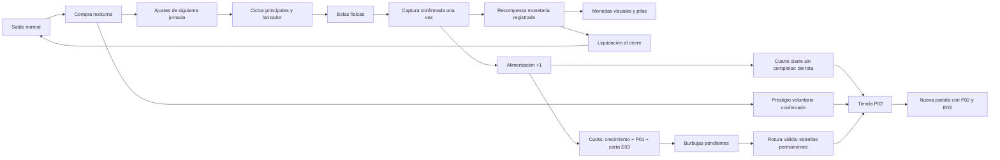
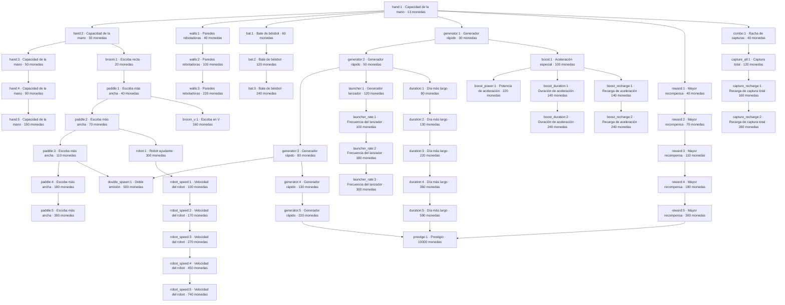

# AUD01 — Informe técnico verificable

**Proyecto:** Feed the Hole · **Versión:** 0.23.0+36 · balance v 20 · JSON v 16  
**Fuente auditada:** `0778d139d4a85124e0af2a9f89d595dc19159430` · rama `build/apk-0.6.0+13`  
**Fecha:** 27/10/2026 · auditoría estática; sin cambios de gameplay o balance.

## Resultado principal

**El árbol no cumple la regla de máximo cuatro vecinos:** `hand:1` tiene **6**: `hand:2`, `generator:1`, `reward:1`, `walls:1`, `bat:1`, `combo:1`. Los otros **54 nodos** sí cumplen. No se ha reconectado ninguno.

Se han inventariado **22 familias, 55 nodos de nivel y 57 aristas dibujadas**. Existe una sola componente conectada, sin nodos aislados, IDs duplicados, aristas duplicadas ni referencias rotas en esta versión. Todos son alcanzables por requisitos con recursos ilimitados; esto **no demuestra viabilidad económica antes de la derrota**. También se registran **15 niveles históricos retirados de 5 familias**, que no pertenecen al grafo actual.

La economía distingue tres monedas/progresos: **monedas normales**, **estrellas cobradas** y **niveles permanentes E03**. Las bolas capturadas alimentan cuotas por cantidad, no por valor. Hay derrota real al cuarto cierre de cada cuota activa. P02, E03, C01 y AJ-008A tienen código e integración; la tasa humana de captura y el rendimiento Android no están medidos en esta auditoría.

## Evidencia, alcance y método

- **VERIFICADO EN CÓDIGO:** lectura del código del commit indicado y extracción Python de `docs/balance.csv`, `UpgradeCatalog.labels` y `SkillTree` (sin ejecutar Dart). Los números de nodos, costes y posiciones provienen de estos archivos.
- **OBSERVADO EN EJECUCIÓN:** aquí se ejecutaron la reconstrucción estática, comprobaciones de consistencia de entregables, conservación aritmética y hashes. No se ejecutó el juego ni se midieron capturas humanas.
- **REFERENCIA DE EJECUCIÓN PREVIA:** documentación publicada de CI con 486 pruebas correctas y un benchmark AOT. Se identifica expresamente como previa, no como pruebas nuevas de AUD01.
- **INFERIDO:** fórmulas analíticas ideales y riesgos derivados, etiquetados como tales. No se presentan como tasas observadas.
- **DEFINIDO PERO NO IMPLEMENTADO:** tiers individuales, potenciadora y futuras mecánicas CF. No se extrapolan reglas incompletas.
- **DESCONOCIDO:** medición en Android real, captura según habilidad humana, rotura real de burbujas, balance final.

No había `flutter` ni `dart` disponibles en PATH al revisar. No se instaló SDK, no se lanzó pipeline, no se generó APK ni se modificaron fuentes del juego: no son necesarios para entregar esta auditoría documental. La evidencia de 486 pruebas está en `docs/estado-actual.md` y la [pipeline previa](https://github.com/migdlp/incremental_hole_game/actions/runs/40327063421), fuente compilada `a385b8592d37b88121c87f72abf1ced21a876204` (HEAD auditado añade documentación posterior).

Fuentes de diseño disponibles: `docs/e03-cartas-evolucion-especificacion.md`, `docs/s03-aj005b-cuotas-4-jornadas.md`, `docs/p02-tienda-permanente.md`, `docs/aj009-coleccion-monedas.md`, documentos de C01/AJ-008A presentes y los requisitos de AUD01 adjuntos. No hay imagen aprobada original de AJ-008A en el adjunto AUD01: no se certifica fidelidad píxel a píxel a esa imagen. El historial documental contiene reglas sustituidas; manda la implementación actual para este inventario.

## Entregables

- `AUD01_informe_tecnico.md`: este informe, tabla de cada nodo y grafo completo.
- `AUD01_nodos.csv`: 55 nodos actuales + 15 niveles obsoletos, con todos los campos solicitados, rutas, costes, efectos y persistencia.
- `AUD01_conexiones.csv`: 57 filas de aristas dibujadas y 53 filas de requisitos CSV. **Filtrar naturaleza antes de contar conexiones**: la segunda clase no añade líneas al mapa.
- `AUD01_habilidades.md`: árbol, P02, E03, eventos, herramientas y sistemas ajenos al árbol.
- `AUD01_economia.md`: producción, captura, ingresos, costes, estrellas, cuotas y fórmulas.
- `AUD01_desconocidos_y_riesgos.md`: divergencias, mediciones y propuestas sin implementar.
- `AUD01_constantes.csv`: todos los parámetros base del CSV, incluidas constantes históricas inertes. Interpretación de uso en economía/riesgos.
- `AUD01_grafo_verificacion.json`, `AUD01_arbol.mmd`, `AUD01_fuentes_sha256.csv`: resultados procesables y trazabilidad.
- `AUD01_completo.md`: documento único con todos los informes Markdown, para compartir.

## Arquitectura y fuentes de verdad

| Subsistema | Fuente / símbolo | Responsabilidad |
|---|---|---|
| Configuración | `docs/balance.csv`; `UpgradeCatalog.fromCsv/settings` | Precio, requisitos y valor absoluto por nivel; snapshot de ajustes por jornada; balances históricos para partidas interrumpidas |
| Grafo | `lib/features/upgrades/domain/skill_tree.dart`, `SkillTree/SkillNode` | Un nodo por nivel, padres y posiciones; rutas de líneas evitan otros nodos |
| Compra normal | `GameSession.purchaseBlock/purchase`; `SkillTreeScreen._canBuy` | Saldo, nivel previo, requisitos, compra nocturna, confirmación de prestigio |
| Simulación | `lib/features/board/domain/board.dart`, `Board.update` | Emisión, física propia en Dart, captura y recompensa por bola |
| Tiempo | `GameSession.tick/_step`; `DayCycle` | Pasos de 1/60 s y subpasos físicos de ≤1/240 s; pausa/cierre exacto |
| Saldo | `Economy`; `RewardDelivery`; `GameSession._step/finishDay` | Crédito registrado una vez, cobro diferido y liquidación completa antes del cierre |
| Monedas visuales | `planCoins`, `RewardVisuals`, `DailyCoinCollection` | Desglose de microlotes, emisor secuencial y pilas; sin autoridad económica |
| Cuotas | `FeedingProgress.creditBalls/expiresAt` | 100×10^n bolas, excedentes y plazo de cuatro jornadas |
| Estrellas | `StarConfig/StarLedger/StarBubbles`; `_changeStars` | Recompensa pendiente por cuota, física y cobro único por rotura |
| Meta | `MetaProgress`; `PermanentSkill/PermanentRun`; `EvolutionSkill/EvolutionRun` | P02 y E03 permanentes separados de contadores temporales |
| Persistencia | `GameSession.snapshot/restore/_drainSaves`; `FileSaveStore` | JSON16, checkpoints de meta, archivos temporales y renombrado, copia de recuperación |

**Flame renderiza/integra la pantalla; la física no es una simulación de cuerpos Forge 2D.** Las colisiones e impulsos están calculados en `Board`, `Launcher` y `StarBubbles`. Es relevante para BAL01 y para presupuestar nuevas mecánicas.

## Reconstrucción y validación del grafo

El grafo usa **IDs por nivel** (`hand:1`), no solo IDs de familia (`hand`). En cada nivel `i+1`, `parents` es la unión de nivel anterior, si existe, y requisitos nuevos respecto al nivel anterior. Los requisitos repetidos permanecen en la validación de compra, pero no generan la misma arista en cada nivel.

Las aristas se almacenan una sola vez padre→hijo; para vecinos se toma su cierre **no dirigido**, contando cada par una vez en cada extremo. La ausencia de la lista inversa en Dart **no es una asimetría errónea**: el modelo es explícitamente dirigido y el dibujado itera los padres. No hay un segundo catálogo de aristas bidireccionales que deba coincidir.

| Grado | Nodos | Regla 0–4 |
|---:|---:|---|
| 0 | 0 | Permitido; ninguno encontrado |
| 1 | 11 | Cumple |
| 2 | 34 | Cumple |
| 3 | 7 | Cumple |
| 4 | 2 | Cumple |
| 6 | 1 | **Incumple: hand:1** |

No se han encontrado ciclos de requisitos ni componentes aisladas. `prestige:1` depende de tres hojas (`generator:5`, `reward:5`, `duration:5`), es visible desde el inicio del **árbol**, pero el árbol entero permanece inaccesible hasta terminar jornada 1. El resto se descubre con compras y disponibilidad inmediata; nodos ocultos por descubrimiento también están inventariados. Con cero compras solo se revelan `hand:1` y `prestige:1` al poder abrir la tienda. DEBUG muestra todos.

Posiciones reales de centros: `spacing=64`, `canvasSize=864`; `line(x,y,dx,dy,n)` produce `(48+(x+dx·i+2)·64,48+(y+dy·i+2)·64)`. Prestigio tiene centro `(48,48)` y representación mayor girada 45°. La forma no añade vecinos.

### Todos los nodos actuales

Costes en monedas normales. Niveles anteriores de la misma familia son obligatorios; todas las compras normales se pierden al terminar la partida, se aplican al siguiente snapshot de jornada, excepto prestigio, que actúa inmediatamente. Efectos, acumulación y evidencia detallada por fila en `AUD01_nodos.csv` y por familia en habilidades.

| ID | Nombre | Coste | Efecto absoluto | Requisito CSV | Padres dibujados | Vecinos distintos (grado) | Posición x,y |
|---|---|---:|---|---|---|---|---|
| `prestige:1` | Prestigio | 10000 | `prestige_action=1` | generator:5, reward:5, duration:5 | generator:5, reward:5, duration:5 | duration:5, generator:5, reward:5 **(3)** | 48,48 |
| `hand:1` | Capacidad de la mano | 13 | `hand_capacity=2` | — | — | bat:1, combo:1, generator:1, hand:2, reward:1, walls:1 **(6)** | 496,368 |
| `hand:2` | Capacidad de la mano | 30 | `hand_capacity=3` | — | hand:1 | broom:1, hand:1, hand:3 **(3)** | 560,432 |
| `hand:3` | Capacidad de la mano | 50 | `hand_capacity=4` | — | hand:2 | hand:2, hand:4 **(2)** | 624,496 |
| `hand:4` | Capacidad de la mano | 90 | `hand_capacity=5` | — | hand:3 | hand:3, hand:5 **(2)** | 688,560 |
| `hand:5` | Capacidad de la mano | 150 | `hand_capacity=6` | — | hand:4 | hand:4 **(1)** | 752,624 |
| `walls:1` | Paredes rebotadoras | 40 | `wall_restitution=1.1` | hand:1 | hand:1 | hand:1, walls:2 **(2)** | 496,432 |
| `walls:2` | Paredes rebotadoras | 100 | `wall_restitution=1.35` | hand:1 | walls:1 | walls:1, walls:3 **(2)** | 496,496 |
| `walls:3` | Paredes rebotadoras | 220 | `wall_restitution=1.6` | hand:1 | walls:2 | walls:2 **(1)** | 496,560 |
| `bat:1` | Bate de béisbol | 60 | `bat_power=1` | hand:1 | hand:1 | bat:2, hand:1 **(2)** | 304,560 |
| `bat:2` | Bate de béisbol | 120 | `bat_power=1.35` | hand:1 | bat:1 | bat:1, bat:3 **(2)** | 304,624 |
| `bat:3` | Bate de béisbol | 240 | `bat_power=1.7` | hand:1 | bat:2 | bat:2 **(1)** | 368,624 |
| `broom:1` | Escoba recta | 20 | `broom_unlocked=1` | hand:2 | hand:2 | hand:2, paddle:1 **(2)** | 560,496 |
| `paddle:1` | Escoba más ancha | 40 | `paddle_radius=24` | broom:1 | broom:1 | broom:1, broom_v:1, paddle:2 **(3)** | 560,560 |
| `paddle:2` | Escoba más ancha | 70 | `paddle_radius=28` | broom:1 | paddle:1 | paddle:1, paddle:3, robot:1 **(3)** | 560,624 |
| `paddle:3` | Escoba más ancha | 110 | `paddle_radius=32` | broom:1 | paddle:2 | double_spawn:1, paddle:2, paddle:4 **(3)** | 560,688 |
| `paddle:4` | Escoba más ancha | 180 | `paddle_radius=36` | broom:1 | paddle:3 | paddle:3, paddle:5 **(2)** | 560,752 |
| `paddle:5` | Escoba más ancha | 300 | `paddle_radius=40` | broom:1 | paddle:4 | paddle:4 **(1)** | 560,816 |
| `broom_v:1` | Escoba en V | 160 | `v_unlocked=1` | paddle:1 | paddle:1 | paddle:1 **(1)** | 624,560 |
| `double_spawn:1` | Doble emisión | 500 | `balls_per_spawn=2` | generator:3, paddle:3 | generator:3, paddle:3 | generator:3, paddle:3 **(2)** | 48,176 |
| `generator:1` | Generador rápido | 30 | `spawn_interval=0.533333` | hand:1 | hand:1 | boost:1, generator:2, hand:1 **(3)** | 432,304 |
| `generator:2` | Generador rápido | 50 | `spawn_interval=0.426667` | hand:1 | generator:1 | duration:1, generator:1, generator:3, launcher:1 **(4)** | 368,240 |
| `generator:3` | Generador rápido | 80 | `spawn_interval=0.341333` | hand:1 | generator:2 | double_spawn:1, generator:2, generator:4 **(3)** | 304,176 |
| `generator:4` | Generador rápido | 130 | `spawn_interval=0.273067` | hand:1 | generator:3 | generator:3, generator:5 **(2)** | 240,112 |
| `generator:5` | Generador rápido | 220 | `spawn_interval=0.218453` | hand:1 | generator:4 | generator:4, prestige:1 **(2)** | 176,48 |
| `launcher:1` | Generador lanzador | 120 | `launcher_unlocked=1` | generator:2 | generator:2 | generator:2, launcher_rate:1 **(2)** | 368,112 |
| `launcher_rate:1` | Frecuencia del lanzador | 100 | `launcher_interval=1.8` | launcher:1 | launcher:1 | launcher:1, launcher_rate:2 **(2)** | 304,48 |
| `launcher_rate:2` | Frecuencia del lanzador | 180 | `launcher_interval=1.2` | launcher:1 | launcher_rate:1 | launcher_rate:1, launcher_rate:3 **(2)** | 368,48 |
| `launcher_rate:3` | Frecuencia del lanzador | 300 | `launcher_interval=0.8` | launcher:1 | launcher_rate:2 | launcher_rate:2 **(1)** | 432,48 |
| `reward:1` | Mayor recompensa | 40 | `ball_value=2` | hand:1 | hand:1 | hand:1, reward:2 **(2)** | 496,304 |
| `reward:2` | Mayor recompensa | 70 | `ball_value=3` | hand:1 | reward:1 | reward:1, reward:3 **(2)** | 496,240 |
| `reward:3` | Mayor recompensa | 110 | `ball_value=5` | hand:1 | reward:2 | reward:2, reward:4 **(2)** | 496,176 |
| `reward:4` | Mayor recompensa | 180 | `ball_value=8` | hand:1 | reward:3 | reward:3, reward:5 **(2)** | 496,112 |
| `reward:5` | Mayor recompensa | 300 | `ball_value=13` | hand:1 | reward:4 | prestige:1, reward:4 **(2)** | 496,48 |
| `duration:1` | Día más largo | 80 | `production_duration=18` | generator:2 | generator:2 | duration:2, generator:2 **(2)** | 304,240 |
| `duration:2` | Día más largo | 130 | `production_duration=21` | generator:2 | duration:1 | duration:1, duration:3 **(2)** | 240,240 |
| `duration:3` | Día más largo | 220 | `production_duration=24` | generator:2 | duration:2 | duration:2, duration:4 **(2)** | 176,240 |
| `duration:4` | Día más largo | 360 | `production_duration=27` | generator:2 | duration:3 | duration:3, duration:5 **(2)** | 112,240 |
| `duration:5` | Día más largo | 590 | `production_duration=30` | generator:2 | duration:4 | duration:4, prestige:1 **(2)** | 48,240 |
| `robot:1` | Robot ayudante | 300 | `robot_count=1` | paddle:2 | paddle:2 | paddle:2, robot_speed:1 **(2)** | 432,624 |
| `robot_speed:1` | Velocidad del robot | 100 | `robot_speed=51.75` | robot:1 | robot:1 | robot:1, robot_speed:2 **(2)** | 368,688 |
| `robot_speed:2` | Velocidad del robot | 170 | `robot_speed=59.5125` | robot:1 | robot_speed:1 | robot_speed:1, robot_speed:3 **(2)** | 304,688 |
| `robot_speed:3` | Velocidad del robot | 270 | `robot_speed=68.4394` | robot:1 | robot_speed:2 | robot_speed:2, robot_speed:4 **(2)** | 240,688 |
| `robot_speed:4` | Velocidad del robot | 450 | `robot_speed=78.7053` | robot:1 | robot_speed:3 | robot_speed:3, robot_speed:5 **(2)** | 176,688 |
| `robot_speed:5` | Velocidad del robot | 740 | `robot_speed=90.5111` | robot:1 | robot_speed:4 | robot_speed:4 **(1)** | 112,688 |
| `combo:1` | Racha de capturas | 40 | `combo_unlocked=1` | hand:1 | hand:1 | capture_all:1, hand:1 **(2)** | 560,304 |
| `capture_all:1` | Captura total | 120 | `capture_all_unlocked=1` | combo:1 | combo:1 | capture_recharge:1, combo:1 **(2)** | 624,368 |
| `capture_recharge:1` | Recarga de captura total | 160 | `capture_all_cooldown=10` | capture_all:1 | capture_all:1 | capture_all:1, capture_recharge:2 **(2)** | 688,368 |
| `capture_recharge:2` | Recarga de captura total | 280 | `capture_all_cooldown=8` | capture_all:1 | capture_recharge:1 | capture_recharge:1 **(1)** | 752,368 |
| `boost:1` | Aceleración especial | 100 | `boost_unlocked=1` | generator:1 | generator:1 | boost_duration:1, boost_power:1, boost_recharge:1, generator:1 **(4)** | 368,304 |
| `boost_power:1` | Potencia de aceleración | 220 | `boost_multiplier=3` | boost:1 | boost:1 | boost:1 **(1)** | 304,304 |
| `boost_duration:1` | Duración de aceleración | 140 | `boost_duration=5` | boost:1 | boost:1 | boost:1, boost_duration:2 **(2)** | 368,432 |
| `boost_duration:2` | Duración de aceleración | 240 | `boost_duration=6` | boost:1 | boost_duration:1 | boost_duration:1 **(1)** | 368,496 |
| `boost_recharge:1` | Recarga de aceleración | 140 | `boost_cooldown=8` | boost:1 | boost:1 | boost:1, boost_recharge:2 **(2)** | 368,176 |
| `boost_recharge:2` | Recarga de aceleración | 240 | `boost_cooldown=6` | boost:1 | boost_recharge:1 | boost_recharge:1 **(1)** | 432,176 |

### Grafo completo de aristas dibujadas

### Familias retiradas

`Barrido/sweep` (1 nivel), `Área/collection` (5), `Imán/magnet` (1), `Atracción/attraction` (3) y `Fuerza de agarre/hand_grip` (5): **15 niveles históricos**, no nodos actuales. Conservados en CSV de inventario con costes/requisitos antiguos y sin posición ni vecindad actual. `retiredIds/retiredDefinition` permiten validar y migrar guardados históricos; no son compras ocultas disponibles. Robot actual ya no exige Barrido. No se contabilizan sus aristas antiguas como conexiones del árbol vigente. Los balances v 1–v 19 conservan históricos para restauración; no se mezclan sus catálogos entre sí.
