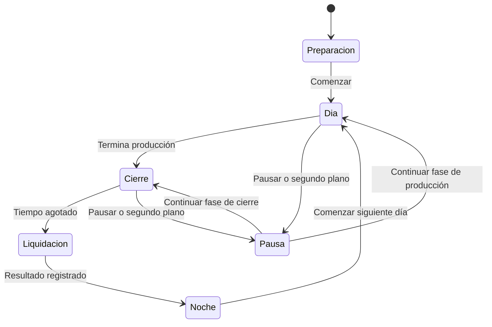

# Diseño de juego del MVP

Actualizado para `0.2.1+3`: reglas implementadas y objetivos de sensación todavía por validar en Android. Las reglas económicas proceden del [PRD](PRD-game-incremental.md); geometría y sensaciones son hipótesis de prototipo.

## Objetivo de la interacción

Mover un grupo hacia el hoyo debe resultar cómodo y comprensible. La dificultad viene de elegir recorridos y repartir el tiempo entre bolas y monedas. No se busca exigir precisión de un píxel ni muchos toques repetitivos.

## Tablero y gesto

Base: arena rectangular con esquinas redondeadas, un generador cerca del borde superior y hoyo en la zona central inferior. Reservar espacio alrededor del hoyo para monedas. La interfaz ocupa una franja superior fuera del área de simulación y respeta las zonas seguras del dispositivo.

Usar coordenadas lógicas con escala uniforme y márgenes para otras proporciones de pantalla; no deformar círculos. El tamaño mínimo de referencia del tablero es 360 × 560 unidades lógicas. Los tamaños finales se ajustan en móvil.

- La mano inicial agarra una sola bola, que se arrastra o se lanza al soltar. Dejarla despacio o detenerse antes de soltar debe producir poco movimiento residual; un gesto final rápido le da inercia en esa dirección.
- Después se compra escoba recta, se amplía su anchura y se desbloquea escoba en V. Se puede volver a herramientas compradas desde el selector.
- La escoba es perpendicular al arrastre, con giro suave y orientación conservada al parar. Al tocar se orienta hacia el hoyo. Evitar dispersión radial de la antigua pala circular.
- La V abre hacia el barrido y reúne hacia el centro por contacto; no aspira. El frente visible y su colisión comparten geometría. Los valores implementados están en [implementación](implementacion.md#física-e-interacción).
- Al inicio solo pulsar recoge monedas; arrastrar sobre ellas no cobra. Tras comprar barrido se recoge por todo el segmento entre eventos y el toque sigue funcionando. Las monedas no bloquean bolas ni herramienta.
- Solo el primer puntero controla el tablero. Al pausar, cancelar, terminar o perder foco se cancela el gesto sin lanzar ni cobrar una pulsación pendiente.

Las bolas tienen fricción y rebote suave, chocan entre sí y con bordes; no hay apilamiento vertical. Validar comodidad, extremos, giros y posibles atascos en dispositivo real. La aspiradora está aparcada y los [otros métodos](ideas-herramientas-bolas.md) siguen siendo candidatos.

## Generación y hoyo

El generador intenta emitir una bola por intervalo. Si la zona de salida está ocupada, espera al siguiente intento. Si se alcanza la población máxima, espera igualmente; no guarda emisiones pendientes.

El hoyo atrae suavemente dentro de un radio local. Una bola entra al cruzar el radio de captura con su centro. Se marca como capturada inmediatamente, se retira de las colisiones y genera exactamente una recompensa. La animación de hundirse no puede repetir el cobro.

## Monedas

Cada bola genera un objeto con valor entero, según la mejora de recompensa activa. La moneda salta visualmente desde el hoyo hasta un punto cercano dentro del tablero. El salto es presentación; al aterrizar queda disponible para recoger. Propuesta: aterrizaje en unos 0,2 s, a validar.

La recogida muestra destello y cambio de contador. No exige ver terminar la animación para registrar el ingreso. Las pilas próximas se fusionan conservando todo su valor. En saturación, integrar la recompensa nueva en una pila existente; nunca borrarla por alcanzar un límite.

La mejora de barrido habilita cobrar arrastrando; no es un aumento de radio ni desbloquea el imán. Está implementada como `sweep`, desbloqueo de 20 monedas sin requisito. El precio es provisional; ver [economía](economia.md).

El imán funciona dentro de un radio alrededor del dedo mientras está apoyado: atrae monedas y las cobra al llegar al radio de recogida. No recoge todo el tablero ni actúa al levantar el dedo. Las pilas muestran su valor, evitando depender únicamente del tamaño.

## Robot básico

Un robot, desbloqueado de forma permanente. Durante el día selecciona una bola, se coloca detrás de ella respecto al hoyo y avanza empujándola. Recalcula si la bola entra, desaparece o deja de progresar. Si no hay objetivo, espera.

La elección se actualiza cada 0,25 s como punto de partida. Detectar bloqueo por falta de avance durante aproximadamente 1 s y buscar otra posición u objetivo. Priorizar comportamiento estable frente a planificación perfecta. El robot no recoge monedas y no bloquea la herramienta; probar separación suave de bolas a su alrededor.

## Estados del ciclo

La pausa conserva la fase anterior; no reinicia tiempo. El día base dura 20 s en total: 15 de producción y 5 de cierre. La primera bola se intenta emitir a los ⅔ s. El cierre mantiene herramienta y robot, detiene el generador y muestra «Últimos segundos: recoge las monedas». No es una fase de compras.

Al agotarse el tiempo, procesar solo la fracción de simulación anterior al límite; después bloquear entrada y liquidar. Los efectos visuales pueden terminar, pero no conceden ingresos posteriores. Toda moneda pendiente, incluso en animación de salida, cuenta como perdida. Regla acordada: retirar también todas las bolas restantes al pasar a la noche. Cada día nuevo empieza sin bolas ni monedas. El ahorro ya recogido y los niveles de mejora se conservan. La verificación está desglosada en el [seguimiento de cambios](plan-cambios-agarre-escoba.md).

## Primera experiencia y noche

El primer día utiliza dos mensajes breves: «Agarra una bola · Arrastra y suelta para lanzar» y, al aparecer la primera moneda, «Pulsa las monedas para recogerlas». Tras comprar barrido, indicar «Toca o desliza para recoger las monedas». No añadir un tutorial separado obligatorio.

La noche presenta ingreso diario, récord y resumen; el botón Abrir árbol de mejoras abre el [árbol progresivo](arbol-de-mejoras.md), con arrastre y zoom. Cada nodo tiene nombre, efecto actual y siguiente, precio y requisito. Estados: disponible, sin saldo, bloqueado por requisito y completado. Un toque consulta; mantener tres segundos en el nodo seleccionado o ficha compra una vez. Soltar antes, mover, añadir otro dedo o interrumpir cancela sin gastar. No permitir compras durante el día.

Al completar todos los niveles se puede seguir jugando para mejorar el récord; mostrar «Mejoras del MVP completadas», sin prometer contenido que no existe.

## Pruebas de sensación

- Colocar una bola suavemente, lanzar rápido y parar antes de soltar; comprobar dirección e inercia con el dedo.
- Barrer grupos con recta y V, comparar anchuras y revisar extremos y giros sin atascos ni golpes exagerados.
- Tras comprar barrido, recoger una línea de monedas con un gesto rápido; antes, cruzarla arrastrando no debe cobrarla.
- Entender, sin explicación verbal, que introducir bolas y cobrar son acciones distintas.
- Entender el aviso de cierre y la pérdida de monedas.
- Percibir la primera ampliación de escoba y la ayuda del robot.
- Revisar si el dedo tapa el hoyo; probar un pequeño desplazamiento visual de la herramienta solo si las sesiones lo justifican.
