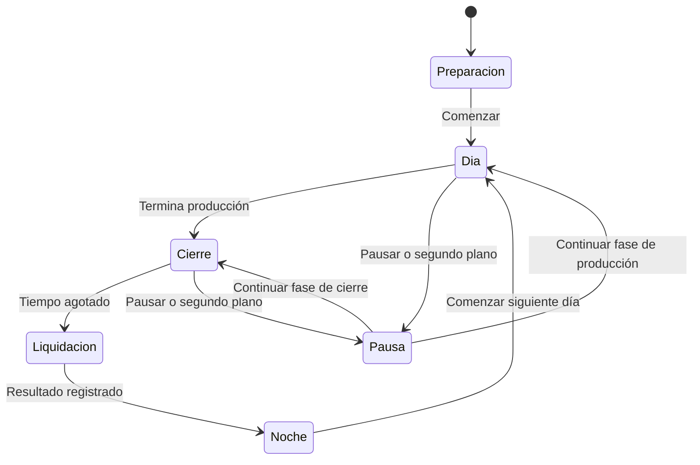

# Diseño de juego del MVP

Estado: especificación inicial. Las reglas económicas proceden del [PRD](PRD-game-incremental.md); geometría y sensaciones son hipótesis de prototipo.

## Objetivo de la interacción

Mover un grupo hacia el hoyo debe resultar cómodo y comprensible. La dificultad viene de elegir recorridos y repartir el tiempo entre bolas y monedas. No se busca exigir precisión de un píxel ni muchos toques repetitivos.

## Tablero y gesto

Base: arena rectangular con esquinas redondeadas, un generador cerca del borde superior y hoyo en la zona central inferior. Reservar espacio alrededor del hoyo para monedas. La interfaz ocupa una franja superior fuera del área de simulación y respeta las zonas seguras del dispositivo.

Usar coordenadas lógicas con escala uniforme y márgenes para otras proporciones de pantalla; no deformar círculos. El tamaño mínimo de referencia del tablero es 360 × 560 unidades lógicas. Los tamaños finales se ajustan en móvil.

- Al apoyar el dedo aparece la pala en su posición. Al soltar, desaparece su efecto físico.
- La aparición de la pala no desplaza bruscamente un montón: se separan solapamientos con corrección limitada.
- Al moverla, empuja bolas mediante su contorno circular. No se pueden agarrar ni transportar bolas individualmente.
- Limitar velocidad e interpolar el recorrido para evitar atravesar objetos con un gesto rápido.
- Recoger monedas a lo largo del segmento recorrido, no solo en el último punto recibido.
- Un toque también recoge monedas dentro del radio de recogida. Las monedas no bloquean bolas ni pala.
- Solo el primer puntero controla el tablero; botones y menús consumen su propia entrada.
- Al pausar, terminar el día o perder el foco se cancela el gesto activo.

Las bolas tienen rozamiento y rebote suave, colisionan entre sí y con los bordes. Se propone movimiento arcade con velocidad máxima, sin saltos físicos ni apilamiento vertical. La pala y el robot pueden mover grupos, pero no deben provocar vibraciones permanentes.

## Generación y hoyo

El generador intenta emitir una bola por intervalo. Si la zona de salida está ocupada, espera al siguiente intento. Si se alcanza la población máxima, espera igualmente; no guarda emisiones pendientes.

El hoyo atrae suavemente dentro de un radio local. Una bola entra al cruzar el radio de captura con su centro. Se marca como capturada inmediatamente, se retira de las colisiones y genera exactamente una recompensa. La animación de hundirse no puede repetir el cobro.

## Monedas

Cada bola genera un objeto con valor entero, según la mejora de recompensa activa. La moneda salta visualmente desde el hoyo hasta un punto cercano dentro del tablero. El salto es presentación; al aterrizar queda disponible para recoger. Propuesta: aterrizaje en unos 0,2 s, a validar.

La recogida muestra destello y cambio de contador. No exige ver terminar la animación para registrar el ingreso. Las pilas próximas se fusionan conservando todo su valor. En saturación, integrar la recompensa nueva en una pila existente; nunca borrarla por alcanzar un límite.

El imán funciona dentro de un radio alrededor del dedo mientras está apoyado: atrae monedas y las cobra al llegar al radio de recogida. No recoge todo el tablero ni actúa al levantar el dedo. Las pilas muestran su valor, evitando depender únicamente del tamaño.

## Robot básico

Un robot, desbloqueado de forma permanente. Durante el día selecciona una bola, se coloca detrás de ella respecto al hoyo y avanza empujándola. Recalcula si la bola entra, desaparece o deja de progresar. Si no hay objetivo, espera.

La elección se actualiza cada 0,25 s como punto de partida. Detectar bloqueo por falta de avance durante aproximadamente 1 s y buscar otra posición u objetivo. Priorizar comportamiento estable frente a planificación perfecta. El robot no recoge monedas y no bloquea la pala; probar separación suave de bolas a su alrededor.

## Estados del ciclo

La pausa conserva la fase anterior; no reinicia tiempo. El cierre mantiene pala y robot, detiene el generador y muestra «Últimos segundos: recoge las monedas». No es una fase de compras.

Al agotarse el tiempo, procesar solo la fracción de simulación anterior al límite; después bloquear entrada y liquidar. Los efectos visuales pueden terminar, pero no conceden ingresos posteriores. Toda moneda pendiente, incluso en animación de salida, cuenta como perdida. Base propuesta: retirar también las bolas restantes.

## Primera experiencia y noche

El primer día utiliza dos mensajes breves: «Arrastra para empujar las bolas al hoyo» y, al aparecer la primera moneda, «Toca o desliza para recoger monedas». No añadir un tutorial separado obligatorio.

La noche presenta ingreso diario, récord y resumen; el árbol es accesible en la misma pantalla mediante desplazamiento. Cada nodo tiene nombre, efecto actual y siguiente, precio y requisito. Estados: disponible, sin saldo, bloqueado por requisito y completado. Comprar requiere una acción explícita sin confirmación adicional. No permitir compras durante el día.

Al completar todos los niveles se puede seguir jugando para mejorar el récord; mostrar «Mejoras del MVP completadas», sin prometer contenido que no existe.

## Pruebas de sensación

- Empujar diez bolas juntas sin que atraviesen la pala ni salgan del tablero.
- Recoger una línea de monedas con un gesto rápido.
- Entender, sin explicación verbal, que introducir bolas y cobrar son acciones distintas.
- Entender el aviso de cierre y la pérdida de monedas.
- Percibir la primera ampliación de pala y la ayuda del robot.
- Revisar si el dedo tapa el hoyo; probar un pequeño desplazamiento visual de la pala solo si las sesiones lo justifican.
