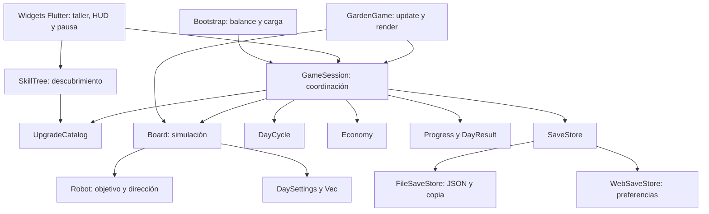
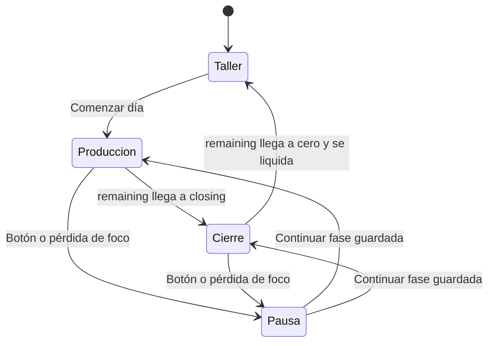

# Cómo está implementado el juego

Referencia de `0.2.2+4`: cadencia inicial de 1,5 bolas/s y resultados en un pop-up sobre el juego detenido. Para el diseño objetivo y su evolución, consultar [arquitectura](arquitectura.md); para las diferencias actuales, [estado](estado-actual.md).

## Ampliación vigente · E01

`MotionSensorBridge` prueba sensores Android con lecturas reales y remite gravedad
(o acelerómetro filtrado) por canales de plataforma. `AndroidMotionInput` valida,
remapea ejes y anula lecturas obsoletas. La sesión activa el muestreo solo en
producción visible y sin pausa. `GravityEvent` gestiona el único sorteo, objeto,
daño y duración con RNG propio; `Board` integra su fuerza en bolas y herramientas
libres. Los agarres y monedas conservan su control. El evento se guarda sin
reactivarlo y se limpia al recoger; DEBUG permite forzar/simular con aislamiento.
[Contrato, parámetros abiertos y verificación E01](e01-gravedad.md).

## Ampliación M02

El bate comparte `TwoPointGrip` con la escoba. `Board._contactBat` calcula velocidad
superficial de traslación y giro, aproximación normal, restitución constante y
bonificación manual según nivel. La física usa los subpasos del tablero y el
límite de velocidad de M01. No hay física, cobro ni activación especial de monedas
por contacto con el bate. `BatFeedback` agrupa contactos del frame y limita audio
sistema/háptica respetando preferencias; `GardenGame` dibuja bate y destellos sin
avanzar física al renderizar. Balance v10, JSON v7; v9 congelado para jornadas
anteriores. [Contrato y pruebas M02](m02-bate-beisbol.md).

## Contexto y límites

Una aplicación Flutter, un paquete Dart y una partida local. Flutter presenta menús y HUD; Flame aporta bucle y lienzo del tablero. La física y las reglas de juego son Dart puro. No hay servidor ni sincronización entre dispositivos.



Las flechas representan uso de datos o llamadas; la fábrica de persistencia elige el adaptador con una importación condicional. `GameSession` usa `ChangeNotifier`, por lo que pertenece a la capa de aplicación, no al dominio puro.

## Mapa del código

| Ruta | Responsabilidad y entrada útil |
| --- | --- |
| [main.dart](../lib/main.dart) | Inicializa Flutter, pide orientación vertical, carga `docs/balance.csv`, crea almacenamiento y sesión; muestra errores y recuperación explícita |
| [app/game_app.dart](../lib/app/game_app.dart) | `GardenApp`, `SessionScreen`, `DayScreen`, `NightScreen`, `ToolSelector`; ciclo de vida y entrada del puntero |
| [app/game_session.dart](../lib/app/game_session.dart) | `startDay`, `tick`, `touch`, `drag`, `pause`, `purchase`, `finishDay`, `snapshot`, `restore`, `save` |
| [board/domain/board.dart](../lib/features/board/domain/board.dart) | `Board`, `Ball`, `Coin`, `BoardEvents`; generación, movimiento, colisiones, captura y recogida |
| [board/domain/tool.dart](../lib/features/board/domain/tool.dart) | `BallTool`, `ToolSegment`, `broomSegments`: herramientas y geometría común a colisión y render |
| [board/presentation/garden_game.dart](../lib/features/board/presentation/garden_game.dart) | `GardenGame.update` avanza sesión; `render` lee tablero y dibuja primitivas; `boardPoint` transforma entrada |
| [day_cycle/domain/day_cycle.dart](../lib/features/day_cycle/domain/day_cycle.dart) | Tiempo restante y fase derivada; `advance` limita el tiempo consumido |
| [economy/domain/economy.dart](../lib/features/economy/domain/economy.dart) | Saldo, ingreso recogido y generado; validación de gasto y recogida |
| [upgrades/domain/catalog.dart](../lib/features/upgrades/domain/catalog.dart) | Catálogo CSV, requisitos, validación de niveles y configuración efectiva |
| [upgrades/domain/skill_tree.dart](../lib/features/upgrades/domain/skill_tree.dart) | Nodos por nivel, padres y descubrimiento derivado de compras |
| [upgrades/presentation/skill_tree_screen.dart](../lib/features/upgrades/presentation/skill_tree_screen.dart) | Árbol con arrastre/zoom, ficha y compra cancelable de 3 s |
| [automation/domain/robot.dart](../lib/features/automation/domain/robot.dart) | Selección de bola y punto objetivo; no cobra ni escribe archivos |
| [progression/domain/progress.dart](../lib/features/progression/domain/progress.dart) | Día siguiente, récord y último resultado |
| [core/vec.dart](../lib/core/vec.dart) | Vectores, límites del tablero y distancia de un punto a un segmento |
| [persistence/](../lib/persistence/) | Puerto y adaptadores; ver [formato y recuperación](persistencia.md) |

No se han creado todas las carpetas de la arquitectura propuesta: no hay paquetes independientes, capa de casos de uso por módulo, bus de eventos, inyección de dependencias mediante framework ni clases para cada mapa de serialización.

## Arranque y ciclo

1. `main` inicializa Flutter y solicita orientación vertical.
2. `Bootstrap` carga el CSV como asset y construye `UpgradeCatalog`.
3. La fábrica crea el adaptador de guardado; `GameSession.load` intenta principal y copia.
4. Sin partida activa se abre el taller. Una jornada restaurada se abre pausada y sin puntero activo.
5. `startDay` toma las mejoras actuales, crea `DaySettings`, tablero limpio y reloj; reinicia la contabilidad diaria y solicita guardado.



En código, `DayPhase` contiene `production`, `closing`, `night`; la pausa es un booleano de sesión. La noche se representa con `cycle == null` y `board == null`. No hay un objeto de fase «preparación» o «liquidación» separado: la liquidación es la operación síncrona `finishDay`.

## Avance de la simulación

Flame llama `GardenGame.update(dt)`, que delega en `GameSession.tick`. La sesión acumula tiempo y simula pasos de `1/60 s`; limita a `0,1 s` el tiempo aceptado por actualización. Los pasos se dividen en el límite producción/cierre y nunca simulan más allá del final del día.

Esto favorece estabilidad: tras una caída de rendimiento se descarta parte del tiempo real, por lo que la duración de pared puede alargarse. Al pausar se borra el acumulador; al volver no se recupera tiempo cerrado. Los avisos periódicos a widgets se solicitan aproximadamente cada `0,1 s`, además de notificaciones inmediatas para comandos y cambios relevantes.

En cada paso, `Board.update` procesa aterrizaje, emisión si hay producción, imán y robot, movimiento de herramienta/bolas, colisiones y capturas. La parte física se divide en pasos de hasta 1/240 s. Devuelve `BoardEvents(captured, collected)`. La sesión valida el importe recogido, asigna la recompensa a las capturas, crea sus monedas y avanza el reloj.

## Física e interacción

El mundo mide `360 × 560`; hoyo arriba en `(180, 60)` y generador abajo en `(180, 412)`, con salida y emisión de bolas hacia arriba. El render escala uniformemente y centra el mundo. La entrada fuera del tablero no se transforma en una pulsación válida. Solo el primer puntero controla el tablero. Su `timeStamp` se pasa a dominio para calcular velocidad sin depender de la frecuencia de eventos.

- La herramienta inicial es `BallTool.hand`. `touch` selecciona una bola próxima y conserva su ID y desplazamiento respecto al dedo. La tolerancia es radio de bola + 12 unidades. Una moneda aterrizada en el radio de recogida tiene prioridad; un gesto vacío no agarra bolas al cruzarlas después.
- La bola agarrada sigue el objetivo hasta 700 u/s y participa como cuerpo dirigido en los contactos. `releasePointer` usa la velocidad del tramo final de 80 ms, limitada a 380 u/s; por debajo de 18 u/s queda quieta. Parar antes de soltar elimina la inercia anterior. Cancelar no lanza ni confirma un cobro.
- La escoba sigue el dedo hasta 900 u/s. Su frente es perpendicular al desplazamiento; cambios inferiores a 3 unidades no cambian la orientación objetivo. Gira como máximo 3 rad/s y conserva orientación al parar. Al tocar se orienta hacia el hoyo; la recta evita girar 180° cuando la línea equivalente ya sirve.
- `broomSegments` produce un segmento o dos brazos en V abiertos hacia el movimiento, con vértice posterior. Contacto y dibujo comparten esos segmentos de grosor 7. La V reúne físicamente, sin atracción remota. La anchura completa es `paddle_radius * 4`: 80 base, 96/112/128 mejorada.
- El impulso de escoba depende de velocidad relativa normal, sin impulso extra por contacto parado. La velocidad de contacto por giro se limita a 80 u/s para evitar golpes excesivos.
- Bolas libres: rozamiento exponencial `exp(-1.6 * dt)`, velocidad máxima 380 u/s, reposo por debajo de 1 u/s y rebote amortiguado en bordes. Rejilla de celdas 20; cada pareja se procesa una vez por IDs en cada subpaso. No se ha certificado ausencia de todo atasco con cualquier carga.
- El hoyo atrae localmente; captura retira la bola una vez y libera el agarre si corresponde.

La primera emisión se intenta después de acumular `spawn_interval`; no es inmediata. Si está ocupada la salida o se alcanzó el máximo de bolas, se pierde ese intento y no se acumula una cola de producción.

## Entrada de monedas

Sin `sweep`, `touch` inicia una posible pulsación y no cobra; `releasePointer` confirma si el desplazamiento no superó 8 unidades y el gesto no agarró una bola. Arrastrar desde una moneda o cruzarla no cobra. Con `sweep`, `touch` y `drag` cobran monedas aterrizadas a lo largo del segmento completo entre objetivos, incluso antes del siguiente fotograma. `GameSession.release` contabiliza el importe de una pulsación y notifica a la UI. Pausa, cancelación y cierre usan `cancel: true`.

## Monedas y contabilidad

Una captura aún no es dinero ahorrado. Cada recompensa crea una moneda o incrementa una pila próxima. El aterrizaje dura `0,2 s`; mientras tanto no puede recogerse. En el límite de pilas, el valor se integra en una existente en lugar de eliminarse.

```mermaid
sequenceDiagram
    participant B as Board
    participant S as GameSession
    participant E as Economy
    participant P as Progress
    participant G as SaveStore
    B->>S: Conteo de capturas
    S->>E: Incrementar generated
    S->>B: releaseCoin(valor por bola)
    B->>S: Importe recogido al retirar monedas
    S->>E: collect(importe)
    Note over E: collected cambia; balance aún no
    S->>S: finishDay si existe jornada
    S->>E: bank()
    S->>P: Guardar resultado, récord y siguiente día
    S->>S: Retirar board y cycle
    S->>G: Encolar una instantánea completa
```

Las monedas usan enteros. Durante la jornada, `generated = collected + board.pending`. El resultado calcula `lost = generated - collected`. `finishDay` retorna sin efectos si ya no hay jornada; esa guarda de sesión evita el segundo cobro. `Economy.bank()` por sí mismo no es idempotente: los llamadores deben pasar por la sesión.

El cierre descarta tablero y pendientes, conserva ahorro y niveles, actualiza récord y día, y guarda el resultado. `Progress` conserva solo `last`, no una lista histórica; `previousIncome` permite comparar dos jornadas consecutivas.

## Balance y mejoras

`docs/balance.csv` es el único archivo editable del balance económico y se empaqueta directamente desde `pubspec.yaml`. `UpgradeCatalog` lee cada línea con `split(',')`: es un CSV simple de nueve columnas, sin soporte de campos entrecomillados con comas.

El cargador comprueba estructura de fila, efectos positivos finitos, bases duplicadas, once IDs de mejora conocidos, niveles consecutivos, costes no negativos, referencias de requisitos reconocidas y presencia de parámetros base obligatorios. `validateLevels` verifica niveles y requisitos guardados. La columna `cap` es descriptiva: el parser actual no la usa como validador independiente; los límites efectivos proceden de los valores base y niveles disponibles.

| ID estable | Rama | Propiedad aplicada |
| --- | --- | --- |
| `broom` | Control | `broom_unlocked` |
| `paddle` | Control | `paddle_radius` (cuarta parte de la anchura) |
| `broom_v` | Control | `v_unlocked` |
| `sweep` | Control | `coin_sweep` |
| `collection` | Control | `collection_radius` |
| `magnet` | Control | `magnet_radius` |
| `generator` | Producción | `spawn_interval` |
| `reward` | Producción | `ball_value` |
| `duration` | Producción | `production_duration` |
| `robot` | Automatización | `robot_count` |
| `robot_speed` | Automatización | `robot_speed` |

`purchaseBlock` comprueba noche, máximo de nivel, requisito y saldo. `purchase` descuenta y sube nivel como una operación síncrona de sesión; después encola el guardado. Los efectos se copian en `DaySettings` al comenzar la jornada, no se recalculan a mitad del día. Comprar escoba/V selecciona esa herramienta; `selectTool` permite cambiar entre herramientas disponibles y cancela el gesto activo. La elección se guarda.

El balance actual empieza con 10 s de producción + 5 s de cierre e cadencia de 1,5 bolas/s. `DaySettings.balanceVersion` distingue ese balance (`3`) de los históricos (`1` y `2`). Los valores históricos de duración/intervalo se conservan en catálogo exclusivamente para validar y terminar jornadas antiguas. Ver [economía](economia.md) y [guardado v3](persistencia.md).

No todos los parámetros físicos están en el CSV. Geometría, fricción, impulsos, subpasos y heurísticas del robot están en `Board`/`Robot`; el paso fijo y los puntos de control están en `GameSession`. `particle_limit` se carga, pero no existe todavía un sistema que lo consuma.

## Robot e imán

`Board` posee un `Robot`. Le entrega posiciones/IDs de bolas y el hoyo. El controlador mantiene un objetivo, revisa la elección aproximadamente cada `0,25 s` y puede cambiarlo si desaparece o no progresa durante más de un segundo. Busca un punto detrás de la bola respecto al hoyo y, al alinearse, avanza empujando. Devuelve un punto objetivo; el tablero aplica movimiento y empuje. No existe navegación con obstáculos ni recogida de dinero por el robot.

El imán actúa sobre monedas aterrizadas dentro de su radio mientras el dedo está activo; las acerca al punto del puntero y las cobra al llegar al radio de recogida. Su compra es independiente de barrido: aumentar radio no concede barrido y comprar barrido no concede atracción. Soltar, pausar o terminar la jornada cancela el gesto.

## Presentación y mantenimiento

`GardenGame.render` dibuja suelo, generador, bolas, hoyo, monedas, indicador de agarre, escobas y robot con primitivas; reutiliza un caché limitado de etiquetas. No hay atlas ni componentes Flame por objeto. El botón del pop-up abre `SkillTreeScreen` en una ruta independiente: 23 nodos de once tipos, conexiones, visibilidad derivada de niveles, visor con zoom y ficha. Mantener 3 s en la selección compra una vez; movimiento, segundo dedo o interrupción cancelan. La UI comprueba descubrimiento además de los requisitos de sesión. Ver [contrato del árbol](arbol-de-mejoras.md); no hay un segundo guardado de nodos visibles.

`SessionScreen` observa el ciclo de vida y pausa al abandonar `resumed`. Los sonidos se solicitan desde la UI mediante `SystemSound`; no alteran la contabilidad. Las decisiones y sus consecuencias se resumen en [decisiones técnicas](decisiones.md).

## Resultados sobre el tablero detenido

`SessionScreen` mantiene montado `DayScreen` y superpone `_DayResultsOverlay`, con barrera no descartable, foco y semántica limitados al diálogo y bloqueo del botón Atrás. El pop-up contiene el resumen, el botón de acceso al árbol y el de siguiente día. El árbol abre una ruta independiente; volver recupera el mismo resumen. `GardenGame` conserva una referencia de presentación al último tablero y pausa el motor al terminar o pausar; no avanza física ni animación. La sesión liquida y descarta el tablero activo igual que antes. Al comenzar otro día el mismo visor reanuda el motor con un tablero nuevo vacío. Tras recargar una noche, el fondo se reconstruye vacío y detenido; no se recuperan objetos cobrables del día anterior.
