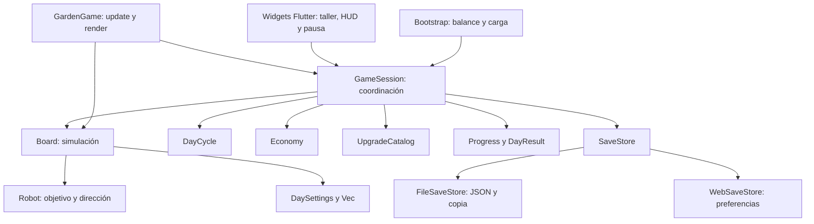
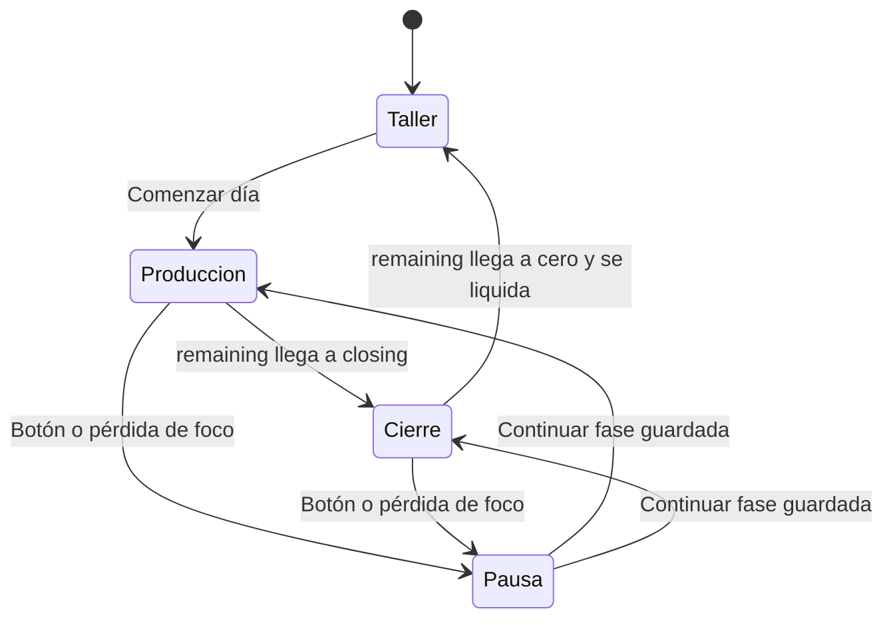

# Cómo está implementado el juego

Referencia del código entregado hasta `44d0aeb`. Para el diseño objetivo y su evolución, consultar [arquitectura](arquitectura.md); para las diferencias actuales, [estado](estado-actual.md).

## Contexto y límites

Una aplicación Flutter, un paquete Dart y una partida local. Flutter presenta menús y HUD; Flame aporta bucle y lienzo del tablero. La física y las reglas de juego son Dart puro. No hay servidor ni sincronización entre dispositivos.



Las flechas representan uso de datos o llamadas; la fábrica de persistencia elige el adaptador con una importación condicional. `GameSession` usa `ChangeNotifier`, por lo que pertenece a la capa de aplicación, no al dominio puro.

## Mapa del código

| Ruta | Responsabilidad y entrada útil |
| --- | --- |
| [main.dart](../lib/main.dart) | Inicializa Flutter, pide orientación vertical, carga `docs/balance.csv`, crea almacenamiento y sesión; muestra errores y recuperación explícita |
| [app/game_app.dart](../lib/app/game_app.dart) | `GardenApp`, `SessionScreen`, `DayScreen`, `NightScreen`, `UpgradeCard`; ciclo de vida y entrada del puntero |
| [app/game_session.dart](../lib/app/game_session.dart) | `startDay`, `tick`, `touch`, `drag`, `pause`, `purchase`, `finishDay`, `snapshot`, `restore`, `save` |
| [board/domain/board.dart](../lib/features/board/domain/board.dart) | `Board`, `Ball`, `Coin`, `BoardEvents`; generación, movimiento, colisiones, captura y recogida |
| [board/presentation/garden_game.dart](../lib/features/board/presentation/garden_game.dart) | `GardenGame.update` avanza sesión; `render` lee tablero y dibuja primitivas; `boardPoint` transforma entrada |
| [day_cycle/domain/day_cycle.dart](../lib/features/day_cycle/domain/day_cycle.dart) | Tiempo restante y fase derivada; `advance` limita el tiempo consumido |
| [economy/domain/economy.dart](../lib/features/economy/domain/economy.dart) | Saldo, ingreso recogido y generado; validación de gasto y recogida |
| [upgrades/domain/catalog.dart](../lib/features/upgrades/domain/catalog.dart) | Catálogo CSV, requisitos, validación de niveles y configuración efectiva |
| [automation/domain/robot.dart](../lib/features/automation/domain/robot.dart) | Selección de bola y punto objetivo; no cobra ni escribe archivos |
| [progression/domain/progress.dart](../lib/features/progression/domain/progress.dart) | Día siguiente, récord y último resultado |
| [core/vec.dart](../lib/core/vec.dart) | Vectores, límites del tablero y distancia de un punto a un segmento |
| [persistence/](../lib/persistence/) | Puerto y adaptadores; ver [formato y recuperación](persistencia.md) |

No se han creado todas las carpetas de la arquitectura propuesta: no hay paquetes independientes, capa de casos de uso por módulo, bus de eventos, inyección de dependencias mediante framework ni clases para cada mapa de serialización.

## Arranque y ciclo

1. `main` inicializa Flutter y solicita orientación vertical.
2. `Bootstrap` carga el CSV como asset y construye `UpgradeCatalog`.
3. La fábrica crea el adaptador de guardado; `GameSession.load` intenta principal y copia.
4. Sin partida activa se abre el taller. Una jornada restaurada se abre pausada y sin puntero activo.
5. `startDay` toma las mejoras actuales, crea `DaySettings`, tablero limpio y reloj; reinicia la contabilidad diaria y solicita guardado.



En código, `DayPhase` contiene `production`, `closing`, `night`; la pausa es un booleano de sesión. La noche se representa con `cycle == null` y `board == null`. No hay un objeto de fase «preparación» o «liquidación» separado: la liquidación es la operación síncrona `finishDay`.

## Avance de la simulación

Flame llama `GardenGame.update(dt)`, que delega en `GameSession.tick`. La sesión acumula tiempo y simula pasos de `1/60 s`; limita a `0,1 s` el tiempo aceptado por actualización. Los pasos se dividen en el límite producción/cierre y nunca simulan más allá del final del día.

Esto favorece estabilidad: tras una caída de rendimiento se descarta parte del tiempo real, por lo que la duración de pared puede alargarse. Al pausar se borra el acumulador; al volver no se recupera tiempo cerrado. Los avisos periódicos a widgets se solicitan aproximadamente cada `0,1 s`, además de notificaciones inmediatas para comandos y cambios relevantes.

En cada paso, `Board.update` procesa aterrizaje, emisión si hay producción, pala/imán, robot, movimiento, colisiones y capturas. Devuelve `BoardEvents(captured, collected)`. La sesión valida el importe recogido, asigna la recompensa a las capturas, crea sus monedas y avanza el reloj.

## Física e interacción

El mundo mide `360 × 560`; hoyo `(180, 412)` y generador `(180, 60)`. El render escala uniformemente y centra el mundo. La entrada fuera del tablero no se transforma en una pulsación válida. Solo el primer puntero controla la pala.

- `touch` sitúa la pala y recoge monedas aterrizadas en el radio de recogida.
- `drag` recoge a lo largo del segmento entre objetivos de entrada, incluso si se suelta antes de otro fotograma.
- La posición física de la pala sigue el objetivo con límite de velocidad y subpasos. La aparición sobre un grupo corrige el solapamiento de forma limitada.
- Bolas con rozamiento exponencial, velocidad limitada y rebote amortiguado en los bordes.
- Una rejilla de celdas de 20 unidades reduce los pares de bolas a comprobar; se visitan celdas vecinas y cada pareja se procesa una vez por IDs.
- El hoyo atrae localmente; una bola capturada se retira antes de devolver el evento.

La primera emisión se intenta después de acumular `spawn_interval`; no es inmediata. Si está ocupada la salida o se alcanzó el máximo de bolas, se pierde ese intento y no se acumula una cola de producción.

## Monedas y contabilidad

Una captura aún no es dinero ahorrado. Cada recompensa crea una moneda o incrementa una pila próxima. El aterrizaje dura `0,2 s`; mientras tanto no puede recogerse. En el límite de pilas, el valor se integra en una existente en lugar de eliminarse.

```mermaid
sequenceDiagram
    participant B as Board
    participant S as GameSession
    participant E as Economy
    participant P as Progress
    participant G as SaveStore
    B->>S: Conteo de capturas
    S->>E: Incrementar generated
    S->>B: releaseCoin(valor por bola)
    B->>S: Importe recogido al retirar monedas
    S->>E: collect(importe)
    Note over E: collected cambia; balance aún no
    S->>S: finishDay si existe jornada
    S->>E: bank()
    S->>P: Guardar resultado, récord y siguiente día
    S->>S: Retirar board y cycle
    S->>G: Encolar una instantánea completa
```

Las monedas usan enteros. Durante la jornada, `generated = collected + board.pending`. El resultado calcula `lost = generated - collected`. `finishDay` retorna sin efectos si ya no hay jornada; esa guarda de sesión evita el segundo cobro. `Economy.bank()` por sí mismo no es idempotente: los llamadores deben pasar por la sesión.

El cierre descarta tablero y pendientes, conserva ahorro y niveles, actualiza récord y día, y guarda el resultado. `Progress` conserva solo `last`, no una lista histórica; `previousIncome` permite comparar dos jornadas consecutivas.

## Balance y mejoras

`docs/balance.csv` es el único archivo editable del balance económico y se empaqueta directamente desde `pubspec.yaml`. `UpgradeCatalog` lee cada línea con `split(',')`: es un CSV simple de nueve columnas, sin soporte de campos entrecomillados con comas.

El cargador comprueba estructura de fila, efectos positivos finitos, bases duplicadas, ocho IDs de mejora conocidos, niveles consecutivos, costes no negativos, referencias de requisitos reconocidas y presencia de parámetros base obligatorios. `validateLevels` verifica niveles y requisitos guardados. La columna `cap` es descriptiva: el parser actual no la usa como validador independiente; los límites efectivos proceden de los valores base y niveles disponibles.

| ID estable | Rama | Propiedad aplicada |
| --- | --- | --- |
| `paddle` | Control | `paddle_radius` |
| `collection` | Control | `collection_radius` |
| `magnet` | Control | `magnet_radius` |
| `generator` | Producción | `spawn_interval` |
| `reward` | Producción | `ball_value` |
| `duration` | Producción | `production_duration` |
| `robot` | Automatización | `robot_count` |
| `robot_speed` | Automatización | `robot_speed` |

`purchaseBlock` comprueba noche, máximo de nivel, requisito y saldo. `purchase` descuenta y sube nivel como una operación síncrona de sesión; después encola el guardado. Los efectos se copian en `DaySettings` al comenzar la jornada, no se recalculan a mitad del día.

No todos los parámetros físicos están en el CSV. Geometría, fricción, impulsos, subpasos y heurísticas del robot están en `Board`/`Robot`; el paso fijo y los puntos de control están en `GameSession`. `particle_limit` se carga, pero no existe todavía un sistema que lo consuma.

## Robot e imán

`Board` posee un `Robot`. Le entrega posiciones/IDs de bolas y el hoyo. El controlador mantiene un objetivo, revisa la elección aproximadamente cada `0,25 s` y puede cambiarlo si desaparece o no progresa durante más de un segundo. Busca un punto detrás de la bola respecto al hoyo y, al alinearse, avanza empujando. Devuelve un punto objetivo; el tablero aplica movimiento y empuje. No existe navegación con obstáculos ni recogida de dinero por el robot.

El imán actúa sobre monedas aterrizadas dentro de su radio mientras la pala está activa; las acerca a la pala y la recogida normal las cobra. Soltar, pausar o terminar la jornada cancela el gesto.

## Presentación y mantenimiento

`GardenGame.render` dibuja suelo, generador, bolas, hoyo, monedas, pala y robot con primitivas; reutiliza un caché limitado de etiquetas. No hay atlas ni componentes Flame por objeto. La UI presenta el taller como lista de tres ramas y consume los mismos niveles/catálogo que la sesión.

`SessionScreen` observa el ciclo de vida y pausa al abandonar `resumed`. Los sonidos se solicitan desde la UI mediante `SystemSound`; no alteran la contabilidad. Las decisiones y sus consecuencias se resumen en [decisiones técnicas](decisiones.md).
