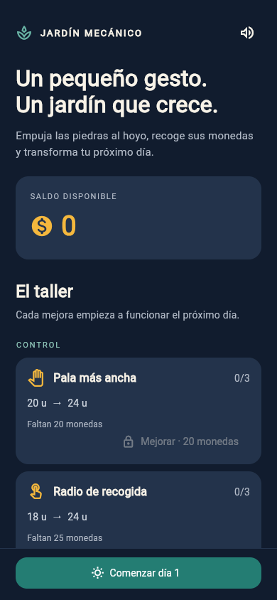
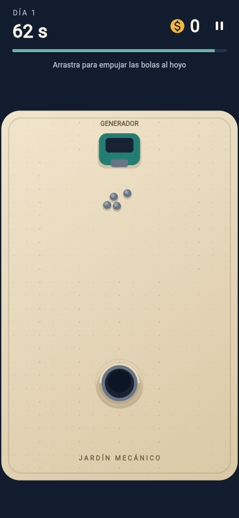

# Registro de validación

## AJ-005B — 24 de octubre de 2026

Implementación sobre `build/apk-0.6.0+13`, base `7d5266f`. Entorno Linux cloud,
Flutter 3.35.7 y Dart 3.9.2. Formato y análisis sin avisos; **380 pruebas**
superadas. Compilación web con `--no-web-resources-cdn` correcta. Prueba adicional
en Chromium correcta: transición de cuotas de 500 dígitos, conservación exacta
de excedentes, JSON decimal BigInt y proporción del indicador sin overflow.

Se verifican capturas masivas, doradas/racha y Captura total, independencia de
economía, 30 jornadas sin captura sin derrota, persistencia entre jornadas y
compras, crecimiento AJ-005A sin duplicados, recompensas múltiples P01 y
compatibilidad/recuperación de prestigio histórico.

[Migración y reglas](aj-005b-cuotas-infinitas.md): se conserva crecimiento previo;
el progreso monetario parcial antiguo se reinicia sin convertirlo en bolas.
No se ha generado una APK de esta tarea ni validado tacto/rendimiento en un
Android físico. Las descargas históricas inferiores no contienen AJ-005B.

> **Entrega CF-09 a CF-15 — 19 de octubre de 2026:** [PR #18](https://github.com/migdlp/incremental_hole_game/pull/18) integrada en `main`, código `34ea6d66e884903e6fd4d47c02883e3f31b48f74`. **[Descargar APK 0.5.0+10 y SHA-256 (ZIP)](https://github.com/migdlp/incremental_hole_game/actions/runs/39292311120/artifacts/12206371751)**, disponible hasta el 2 de noviembre de 2026. [Pipeline 39292311120](https://github.com/migdlp/incremental_hole_game/actions/runs/39292311120) correcta: formato, análisis, **116 pruebas**, compilación Android y firma v2 verificada. Descomprimir e instalar `jardin-mecanico-debug.apk`. No incluye las ideas de bolas duplicadoras/bomba. Validación en Android físico y ajuste de precios jugando pendientes.

## S03 · 0.14.0+22 · 21/10/2026

Fuente `6d11b9a`, rama `build/apk-0.6.0+13`.
[Pipeline](https://github.com/migdlp/incremental_hole_game/actions/runs/39678229238):
**321 pruebas**, formato y análisis sin avisos, APK compilado y firma v2 verificada.
Etiqueta Feed the Hole, paquete `com.migdlp.incremental_hole_game`, versionCode 22.
[APK y SHA-256](https://github.com/migdlp/incremental_hole_game/actions/runs/39678229238/artifacts/12381589376).

23 pruebas específicas de prestigio: cuota fallida/cumplida, derrota sencilla,
tienda, día 1, conservación permanente y P01 opaco, ausencia de estrellas automáticas,
revisiones antiguas, recuperación desde checkpoint tras fallo del archivo normal,
fallo de checkpoint y reintento, corrupción sin resurrección, dos copias en
Android/nativo y web, restauración en tienda, DEBUG aislado, rombo grande a 45°,
confirmación y cancelación en ambos modos, cierre de árbol/modal y botones
bloqueados durante escritura. Suite anterior adaptada al nodo y a la derrota
normal, sin perder cobertura de C01 ni otras mecánicas.

Usuario autorizó derrota normal con cuotas provisionales; nodo en normal y DEBUG,
mayor y girado 45°. Coste 10.000, Generador/Valor/Duración V y posición (48,48)
son configuración de prueba pendiente de BAL01. Sin premios P01, catálogo ni
efectos P02 inventados. No se certifica todavía que una nueva partida sea más
potente sin P02, ni la experiencia física o narrativa de la primera muerte.
[Contrato y pendientes](s03-prestigio-metaprogresion.md).

Persisten avisos no bloqueantes de Node 20/24 y setup-java@v4. No se modifica
infraestructura de CI. La pipeline comprueba esta firma pero no acredita
actualización sobre APK anteriores con firma distinta; no desinstalar para
resolverlo si se quiere conservar el progreso. Prueba Android física pendiente.

## C01 · 0.13.0+21 · 21/10/2026

Fuente `c6f9125`, rama `build/apk-0.6.0+13`.
[Pipeline](https://github.com/migdlp/incremental_hole_game/actions/runs/39669624882):
**298 pruebas**, formato y análisis sin avisos; APK compilado y firma v2 verificada.
Etiqueta Feed the Hole, paquete `com.migdlp.incremental_hole_game`, versionCode 21.
[APK y SHA-256](https://github.com/migdlp/incremental_hole_game/actions/runs/39669624882/artifacts/12379681616).

Cobro completo y contabilidad independiente del pool, liquidación y restauración
sin duplicados, pausa, retirada sin reembolso autorizada, reconstrucción de
balances antiguos y Robot heredado, escrituras coalescidas con disco bloqueado,
100.000 recompensas con memoria acotada, 200 bolas con Captura total, doradas y
racha bajo presupuestos 0/1/24, curvas variables, destino real del monedero,
render sin mutación, control táctil, pantalla pequeña y DEBUG aislado.
Los tests antiguos de monedas quedan identificados como históricos; la jornada
actual cierra directamente sin recogida y los resultados muestran cobro íntegro.

No hay prueba Android física ni medición de 60 FPS. Presupuesto inicial 24,
trayectorias y adaptación provisionales. [Medición pendiente y procedimiento](c01-cobro-automatico.md).
El APK debug no permite certificar rendimiento; medir profile con DevTools y
herramientas Android, también fuera de DEBUG para incluir el coste del guardado.

Persisten los avisos no bloqueantes de Node 20/24 y setup-java@v4.
La pipeline estándar verifica esta firma, sin certificar actualización sobre
APK anteriores con otra firma. No desinstalar si se quiere conservar su progreso.

## S01 · 0.12.0+20 · 21/10/2026

Fuente `8eaff28`, rama `build/apk-0.6.0+13`.
[Pipeline de entrega](https://github.com/migdlp/incremental_hole_game/actions/runs/39652999440):
**285 pruebas**, formato y análisis sin avisos, APK compilado y firma v2 verificada.
Etiqueta Feed the Hole, paquete `com.migdlp.incremental_hole_game`, versionCode 20.
[APK y SHA-256](https://github.com/migdlp/incremental_hole_game/actions/runs/39652999440/artifacts/12369473392).

23 pruebas nuevas de alimentación: recompensa completa con combo/dorada y Captura
total, independencia del cobro, captura rápida, períodos de cinco jornadas,
cuota anticipada y vencida, reinicio sin premios, continuidad normal sin derrota,
guardado/restauración idempotente, migración v7, corrupción atómica, pausa y
recogida, DEBUG aislado, anillo bajo bolas y pantalla pequeña al 150 %.
Balance v14 con v13 congelado, JSON v8. El usuario confirmó que todos los
multiplicadores cuentan y que se muestren cuotas provisionales en juego normal.
10/+10 no es balance final; BAL01 y S03 siguen pendientes. Sin derrota real,
prestigio inventado ni pérdida de progreso. Validación en Android físico pendiente.

La pipeline habitual no acredita actualización sobre APK anteriores con firma
distinta (G01); no desinstalar si se quiere conservar su progreso. Se mantienen
avisos no bloqueantes de acciones Node.js 20/24 y setup-java@v4, sin cambios de
infraestructura dentro de S01.

## M03 · 0.11.0+19 · 21/10/2026

Fuente `571d001`, rama `build/apk-0.6.0+13`. [Pipeline de entrega](https://github.com/migdlp/incremental_hole_game/actions/runs/39645255701).
**262 pruebas**, formato y análisis sin avisos. Compilación Android y firma v2
verificadas; etiqueta Feed the Hole, paquete `com.migdlp.incremental_hole_game`,
versionCode 19. [APK y SHA-256](https://github.com/migdlp/incremental_hole_game/actions/runs/39645255701/artifacts/12366918039).

30 pruebas nuevas: rama y frecuencia independientes, emisores simultáneos,
velocidad/sin retroceso, gestos y giro, cuerpo/cañón en todas las orientaciones,
resistencia ante tres bolas, presión sostenida y parada, obstrucciones, límite
de población, doradas, rebotes, 200 bolas, monedas, pausa/segundo plano/recogida,
reanudación sin duplicados, pose entre jornadas/reinicios y guardado al soltar,
migración v12, corrupción atómica, DEBUG aislado, sonido y render sin mutación,
prioridad de agarres al solaparse, además de gestos reales de dos dedos en pantalla de 320×568. Suite anterior conservada.

La presión de acumulación se verifica con contactos comprimidos sostenidos;
calibración de una acumulación libre, tacto, rendimiento, sonido/aspecto y balance
siguen pendientes en Android físico. Generador II, costes, niveles y parámetros
son de prueba. No se certifica compatibilidad de firma con APK anteriores (G01).

Avisos no bloqueantes de infraestructura en esta ejecución: las acciones con
Node.js 20 se ejecutan mediante Node.js 24 y `actions/setup-java@v4` está deprecada.
No fallaron las comprobaciones; actualizar acciones queda fuera de M03.

## E02 · 0.10.0+18 · 21/10/2026

Fuente `34b1592`, rama `build/apk-0.6.0+13`. [Pipeline de entrega](https://github.com/migdlp/incremental_hole_game/actions/runs/39641047592).
**232 pruebas**, formato y análisis sin avisos. Compilación Android y firma v2
verificadas; etiqueta Feed the Hole, paquete `com.migdlp.incremental_hole_game`,
versionCode 18. [APK y SHA-256](https://github.com/migdlp/incremental_hole_game/actions/runs/39641047592/artifacts/12365725792).

21 pruebas nuevas: comprobaciones periódicas y probabilidad, varios objetos,
daños/gestos/solapamientos, alcance frente a captura, curva e inercia, doradas,
agarres/monedas/herramientas, límites con 200 bolas, renovación de tiempo,
pausa/segundo plano, guardado/restauración/corrupción, migración v11, independencia
de RNG/E01, DEBUG aislado y pantalla pequeña, sonido sin reproducción duplicada
y renderizado bajo las bolas sin mutar la simulación. Suite anterior conservada.
La retirada de objetos al terminar producción responde a la elección del usuario.

Pendientes: calibración de intervalo/física, gráficos/audio definitivos, prueba
y rendimiento en Android físico. La pipeline habitual verifica esta firma; no
acredita actualización sobre APK anteriores con otro certificado (G01).

## E01 · 0.9.0+17 · 21/10/2026

Fuente `172872a`, rama `build/apk-0.6.0+13`. [Pipeline correcta](https://github.com/migdlp/incremental_hole_game/actions/runs/39634096764):
**211 pruebas**, formato, análisis sin avisos, compilación Android (incluido el
puente Kotlin de sensores) y firma v2 correctos. Nombre Feed the Hole, paquete
`com.migdlp.incremental_hole_game`, versionCode 17. [APK y SHA-256](https://github.com/migdlp/incremental_hole_game/actions/runs/39634096764/artifacts/12361665066).

22 pruebas de Gravedad y 6 del adaptador: probabilidad, pulsaciones/gestos,
fuerzas, agarres, monedas y premios, 200 bolas, tiempo, pausa/segundo plano,
guardado, migración v10, DEBUG y disponibilidad/ejes/lecturas obsoletas. Suite
anterior conservada. Revisadas imágenes de daño y anuncio; no hay prueba de
sensores ni rendimiento en un Android físico. Parámetros y aspecto provisionales;
daño por bolas y futuros eventos simultáneos siguen abiertos.

La comparación de firma contra APK anteriores se omitió en la pipeline habitual;
el bloqueo de compatibilidad de G01 sigue pendiente. No se modifica paquete,
archivos de guardado, saldo, compras ni migraciones existentes.

## M02 · 0.8.0+16 · 21/10/2026

Fuente compilada `e9e9620`, rama `build/apk-0.6.0+13`.
[Pipeline correcta](https://github.com/migdlp/incremental_hole_game/actions/runs/39580911892):
**183 pruebas**, formato y análisis sin avisos, compilación Android y firma v2
correctas. Nombre Feed the Hole, paquete `com.migdlp.incremental_hole_game`,
versionCode 16. [APK y SHA-256](https://github.com/migdlp/incremental_hole_game/actions/runs/39580911892/artifacts/12336244410).

19 pruebas específicas del bate: gestos, potencia, velocidad relativa/giro,
contactos continuos y primer golpe desde reposo, bordes, monedas, persistencia,
compatibilidad v9, DEBUG, feedback y estrés con 200 bolas. Las cinco pruebas de
control de escoba pasan tras extraer el controlador compartido. Revisada una
imagen del tablero; no hay prueba en Android físico ni medición de FPS del móvil.

Valores de fuerza/precios/dependencia provisionales; [contrato M02](m02-bate-beisbol.md).
La pipeline habitual omitió la comparación de firma con APK anteriores. Sigue
pendiente la compatibilidad descrita en G01; no se acredita conservación de datos
al actualizar cualquier APK instalada. No se cambian paquete ni guardado.

## CF-09 a CF-15 — 19 de octubre de 2026 · 0.5.0+10

- 116 pruebas correctas; formato y análisis sin incidencias con Flutter 3.35.7 / Dart 3.9.2.
- Nuevas comprobaciones: monedas individuales de denominaciones válidas, área sin barrido/imán, bloqueo de cobro y atracción con bolas agarradas, precio inicial 13 y curva entera ×1,65.
- Compatibilidad: compras v4 de imán con Área I conservadas sin regalar nuevos niveles; jornada de balance 5 conserva recompensa 11 y la siguiente adopta balance 6 con recompensa 13. Pilas antiguas descompuestas con importe conservado y reserva bajo el límite técnico; recuentos alterados se rechazan sin modificar la sesión.
- Recuento exacto de 55 recogidos como una moneda de 50 y cinco de 1, persistido al terminar. Resumen ordenado, sin barra y sin símbolos `$`, comprobado a 320 × 568 y texto al 150 %. Siluetas de las cinco monedas con la misma anchura y altura.
- Temporizadores: día inicial muestra 10 s; al llegar a cero aparece una barra independiente de recogida de 3 s. Revisión visual con Roboto/MaterialIcons del resumen, la ficha y el cambio de fase.
- No se implementan bolas duplicadoras ni bomba. La aceptación en Android físico y el ajuste de precios jugando permanecen pendientes. La entrega Android verificada se registra en el bloque inicial: pipeline 39292311120.

> **Entrega CF-06 a CF-08 — 19 de octubre de 2026:** [PR #17](https://github.com/migdlp/incremental_hole_game/pull/17) integrada en `main`, código `1cd7b8761a9e1e4eea19761385086e92ec470438`. **APK 0.4.0+9:** [descargar APK y SHA-256 (ZIP)](https://github.com/migdlp/incremental_hole_game/actions/runs/39223285776/artifacts/12173036451), disponible hasta el 2 de noviembre de 2026. [Pipeline 39223285776](https://github.com/migdlp/incremental_hole_game/actions/runs/39223285776) correcta: formato, análisis, **107 pruebas**, compilación Android y firma v2 verificada. Incluye estadísticas visuales, árbol compacto de ocho direcciones y cinco niveles de fuerza de agarre. Descomprimir e instalar `jardin-mecanico-debug.apk`. Validación en Android físico y ajuste definitivo de precios pendientes.

## Próximas mejoras CF-06 a CF-08 — 19 de octubre de 2026 · 0.4.0+9

Implementadas estadísticas visuales, disposición más cercana en ocho direcciones y cinco niveles de fuerza de agarre de mano. La lista vigente queda completa; las propuestas históricas y la aceptación física conservan su estado independiente.

- Flutter 3.35.7 / Dart 3.9.2, dependencias conservadas.
- 107 pruebas locales correctas. Nuevas pruebas verifican mejora de rapidez en cada nivel, movimiento sin teletransporte, retención bajo tirones, ausencia de atracción desde una mano vacía y conservación de capacidad/alcance.
- Simulación de agarre más fuerte consistente a 30/60/120 Hz; compra, requisitos y restauración preservan el progreso. Las jornadas sin la compra nueva conservan su configuración original.
- Cada conexión entre nodos y cada segmento del trazado cumple una de las ocho direcciones. Las rutas conservan 30 unidades de distancia respecto a otros nodos; no cambian los requisitos de compra.
- Estadísticas con cero y con ingresos, una sola acción y pantalla de 320 × 568 con texto al 150 % sin desbordamientos. Capturas con fuentes reales del resumen y de la ficha revisadas.
- Formato, análisis, enlaces relativos y `git diff --check` correctos; compilación web correcta.

No se declara aceptación táctil, rendimiento ni satisfacción subjetiva en Android físico. Los precios de la nueva fuerza son un balance inicial para jugar y ajustar; no una calibración final. La entrega Android verificada se registra al principio de este documento.

> **Entrega CF-05 — 19 de octubre de 2026:** PR #16 integrada en `main`, commit `91b10cb0d5ff57ee0c69e02e17c1145d48d53c4d`. [APK 0.3.3+8 y SHA-256 (ZIP)](https://github.com/migdlp/incremental_hole_game/actions/runs/39182903655/artifacts/12156897149), disponible hasta el 2 de noviembre de 2026. [Pipeline 39182903655](https://github.com/migdlp/incremental_hole_game/actions/runs/39182903655) correcta sobre ese commit: formato, análisis, **101 pruebas**, compilación Android y firma v2 verificadas. Incluye el árbol compacto, ficha al seleccionar y compra de 1 s, junto con los cambios que ya había en `main`. Las notas de preparación inferiores son históricas. Prueba en Android físico pendiente.

> **Entrega Android — 19 de octubre de 2026:** PR #15 integrada en `main`, commit `27b3950146389f2db3f63cf708ffb289ed908859`. Versión **0.3.1+6**. [Pipeline 39181076818](https://github.com/migdlp/incremental_hole_game/actions/runs/39181076818) correcta: formato, análisis, 88 pruebas, compilación Android y firma verificada. [Descargar APK y SHA-256 (ZIP)](https://github.com/migdlp/incremental_hole_game/actions/runs/39181076818/artifacts/12155843676), disponible hasta el 2 de noviembre de 2026. Descomprimir e instalar `jardin-mecanico-debug.apk`. La prueba en Android físico y el ajuste de balance siguen pendientes. Las notas de preparación inferiores conservan el estado anterior a esta entrega.

## CF-01 a CF-04 y monedas sin cifras — 19 de octubre de 2026

Revisión preparada en la rama `feat/coin-colors-and-day-flow`, versión 0.3.1+6, antes de integrar. Ver [cambios futuros](cambios-futuros-arbol-mejoras.md) y [referencia actual](arbol-de-mejoras.md).

- Flutter 3.35.7 estable / Dart 3.9.2; archivo de dependencias conservado y resuelto con `flutter pub get --enforce-lockfile`.
- `dart format --output=none --set-exit-if-changed lib test`: correcto.
- `flutter analyze --no-pub`: sin incidencias.
- `flutter test --no-pub`: **88 pruebas correctas**. Nuevas comprobaciones de captura/cobro único de $1, denominaciones mixtas y grandes sin perder valor, restauraciones sucesivas de una jornada de balance 4, cara de monedas sin numerales y colores por denominación.
- Widgets: estadísticas con una única acción, compra y comienzo directo del siguiente día desde el árbol, cancelación de una compra incompleta al comenzarlo y estados gris/blanco/color de tipo. Incluye vista de 320 × 568; las pruebas anteriores de 360 × 640 siguen pasando.
- `flutter build web --no-pub --no-web-resources-cdn`: correcto, incluidos compilación JavaScript y ensayo de compatibilidad Wasm.
- `git diff --check` y revisión de enlaces relativos de Markdown: correctos.

No se ha desplegado la web ni generado un nuevo APK. Tampoco se acredita aceptación táctil, legibilidad por color ni rendimiento en Android físico. El cambio a $1 conserva los precios existentes para esta revisión; no se declara validado el ritmo de progreso.

## Entrega actual — 0.2.1+3, 18 de octubre de 2026

| Evidencia | Resultado y alcance |
| --- | --- |
| [PR #8](https://github.com/migdlp/incremental_hole_game/pull/8), `1a8fed7`, versión 0.2.0+2 | Mano, lanzamiento, escoba recta/V, anchura, barrido comprado y guardado v2; 36 pruebas |
| Navegador de controles, Chromium 390 × 844 | Generación normal y puntero: 2 capturas, 4 monedas por pulsación, recarga pausada con ingreso conservado; sin errores JavaScript. Cambio de herramientas y barrido persistente con guardado aislado de prueba |
| [PR #10](https://github.com/migdlp/incremental_hole_game/pull/10), `1d71843`, versión 0.2.1+3 | Día de 10 + 5 s, intervalos cuatro veces mayores, guardado v3 y balance por jornada |
| Validación local de 0.2.1+3 | Formato y análisis correctos, **41 pruebas**: 37 de dominio/sesión y 4 de widgets |
| [CI 39138119402](https://github.com/migdlp/incremental_hole_game/actions/runs/39138119402) | Correcta sobre `1d71843`: dependencias, formato, análisis, 41 pruebas, compilación Android, firma y subida |
| [APK del balance, antes del árbol](https://github.com/migdlp/incremental_hole_game/actions/runs/39138119402/artifacts/12141030218) | `0.2.1+3`; ZIP con APK/SHA-256, disponible hasta el 1 de noviembre de 2026 |
| [PR #12](https://github.com/migdlp/incremental_hole_game/pull/12), `1720fba` | Árbol progresivo, siete pruebas adicionales, sin cambiar versión de paquete ni guardado |
| [CI 39141075339](https://github.com/migdlp/incremental_hole_game/actions/runs/39141075339) | Correcta: formato, análisis, **48 pruebas** (39 de dominio/sesión y 9 de widgets), APK y firma |
| [APK actual con árbol](https://github.com/migdlp/incremental_hole_game/actions/runs/39141075339/artifacts/12142120297) | `0.2.1+3` sobre `1720fba`, ZIP con APK/SHA-256; retención hasta el 1 de noviembre |

Las pruebas nuevas comprueban 15 segundos totales, producción detenida durante cierre, primera emisión a los 3 s, intervalos por nivel y conservación de una jornada antigua en varias reaperturas antes de adoptar el balance nuevo. Las de controles comprueban lanzamiento con eventos de 30/60/120 Hz, colocación y parada, geometría, V hasta capturar ambos lados y entrada de puntero a través de widgets.

La revisión de navegador corresponde al control de `0.2.0+2`; no se presenta como una sesión manual con el nuevo balance. La compilación web de controles fue correcta; el build de Android y las pruebas de balance son los de `0.2.1+3`. No hay prueba de instalación, sensación, diez jornadas manuales ni perfil en Android físico. El ritmo de primera compra y robot está pendiente de redefinir; no se conserva la antigua hipótesis de 3–5 días como objetivo verificado.

## Primera implementación — registro histórico

Fecha: 17 de octubre de 2026. La implementación original de `feat/playable-prototype` quedó fusionada en `main` como `70556fb` mediante la [PR #2](https://github.com/migdlp/incremental_hole_game/pull/2). Este registro conserva evidencia histórica; no equivale a repetir las pruebas en cada modificación documental.

## Entorno

Flutter 3.35.7 estable, Dart 3.9.2, Flame 1.35.1. Linux Debian 13, Chromium 154 en modo headless, viewport de 390 × 844. Android SDK API 36 y OpenJDK 21. El viewport simula el tamaño de un móvil, no su rendimiento ni sus condiciones de entrada.

## Comprobaciones completadas

| Comprobación | Resultado |
| --- | --- |
| Dependencias con `flutter pub get` | Correcto; versiones fijadas en lockfile |
| `dart format --output=none --set-exit-if-changed lib test` | Sin cambios pendientes |
| `flutter analyze` | Sin incidencias |
| `flutter test` | 17 pruebas superadas |
| Compilación web sin CDN de CanvasKit | Correcta |
| `flutter build apk --debug --no-pub` | APK generado correctamente; firma verificada con apksigner |
| Navegador: apertura, comienzo de jornada y pausa | Correcto; sin errores de JavaScript |
| Navegador: recarga de jornada interrumpida | Restaurada pausada, con botón Continuar |
| Navegador: empuje y recogida mediante ratón | 3 capturas, 6 monedas cobradas, 0 pendientes, sin errores de JavaScript |

Las pruebas automáticas cubren diez ciclos completos, conservación de valor al fusionar y saturar pilas, capturas y recogidas únicas, barrido rápido, requisitos y saldo de compras, límite del día, pausa, robot, imán, restauración de objetos en aterrizaje, rechazo de contabilidad corrupta, fallo de escritura y recuperación mediante copia de seguridad. La prueba de widgets recorre taller → jornada → pausa → continuar → siguiente noche.

Las pruebas de simulación introducen objetos controlados para verificar invariantes; no certifican dificultad, diversión ni balance. La prueba del navegador usa el generador y gestos reales de puntero.

## Presentación observada del prototipo 0.1.0+1

## Pendiente antes de aceptar el MVP

- Ejecutar el APK en un teléfono Android físico y elegir un dispositivo de referencia.
- Validar comodidad del gesto, grupos de diez bolas y lectura de monedas entre muchos objetos.
- Jugar diez jornadas manualmente con los valores actuales y acordar primera compra y acceso al robot. La hipótesis histórica de 3–5 días necesita redefinirse.
- Medir en modo profile la carga de 200 bolas y 100 pilas durante tres jornadas y después de diez ciclos. No se afirma haber alcanzado 60 FPS.
- Validar guardado/reemplazo en Android ante segundo plano, cierre forzado y recuperación de archivos.
- Completar audio propio, control de volumen, grafo visual del árbol e iconos de instalación.

No hay progresión sin conexión. Los puntos de control se solicitan cada cinco segundos de avance activo. Un cierre abrupto puede perder el trabajo desde la última escritura correcta; fallos de guardado o recuperación de una copia anterior pueden retroceder más. Ver [garantías y límites del guardado](persistencia.md).

## Preparación Android comprobada

Se instalaron el JDK completo Temurin 21.0.12.1, SDK Platforms 35 y 36, Build Tools 35.0.0, NDK 27.0.12077973 y CMake 3.22.1. Se configuraron proxy y confianza de certificados del entorno para Gradle. El ajuste del proyecto limita Gradle a 3 GB de heap y dos workers para evitar agotar la memoria de este entorno.

APK de depuración generado en `build/app/outputs/flutter-apk/app-debug.apk`. La compilación y su firma son correctas; esto no sustituye una prueba de instalación y juego en un teléfono físico.

## Evidencia de CI sobre main

La [PR #3](https://github.com/migdlp/incremental_hole_game/pull/3) incorporó la pipeline manual como `44d0aeb`. La [ejecución 39020361800](https://github.com/migdlp/incremental_hole_game/actions/runs/39020361800), iniciada con `workflow_dispatch` el 17 de octubre de 2026, terminó con `success` sobre ese commit. Pasaron formato, análisis y pruebas; se compiló el APK, se comprobó su firma y se subieron APK/SHA-256 y registros.

Los artefactos `jardin-mecanico-debug-apk` y `flutter-validation-logs` tienen retención de 14 días, hasta el 31 de octubre de 2026 para esa ejecución. Una descarga caducada no implica que fallase el build: se puede lanzar una nueva ejecución mediante la [guía de CI](ci.md).

## Dónde está cada prueba — suite actual

| Grupo | Ubicación | Alcance comprobado |
| --- | --- | --- |
| Catálogo y reloj | [game_rules_test.dart](../test/features/game_rules_test.dart) | Once mejoras actuales, configuración máxima, rechazo de CSV inválido y límite producción/cierre |
| Recompensas y monedas | [game_rules_test.dart](../test/features/game_rules_test.dart) | Captura única, fusión/saturación conservando valor y barrido entre eventos de puntero |
| Ciclo y compras | [game_rules_test.dart](../test/features/game_rules_test.dart) | Diez ciclos controlados, pérdida de pendientes, cierre repetido, fase/saldo/requisitos/máximos |
| Pausa y restauración | [game_rules_test.dart](../test/features/game_rules_test.dart) | Tiempo detenido, gesto cancelado, objetos en aterrizaje, estado aleatorio y cobro consistente |
| Errores de almacenamiento | [game_rules_test.dart](../test/features/game_rules_test.dart) | Contabilidad inválida, fallo recuperable, copia válida y principal de archivo interrumpido |
| Física y automatización | [game_rules_test.dart](../test/features/game_rules_test.dart) | Grupo dentro de bordes, robot en caso alcanzable e imán solo con puntero activo |
| Control de bolas | [ball_controls_test.dart](../test/features/ball_controls_test.dart) | Agarre único, inercia, frecuencia de eventos, escobas, anchura, captura en V y guardados |
| Balance y compatibilidad | [balance_test.dart](../test/features/balance_test.dart) | Contador 15 s, tres emisiones, cierre, niveles y compatibilidad del balance anterior |
| Árbol progresivo | [skill_tree_test.dart](../test/features/skill_tree_test.dart) | Dos pruebas de dominio y cinco de widgets: descubrimiento, compras heredadas, compra por pulsación, cancelación, saldo y zoom |
| Recorrido de pantalla | [widget_test.dart](../test/widget_test.dart) | Taller/ciclo, entrada real de puntero para monedas y mano, y cambio de herramientas sin excepción de widgets |

El mapa anterior apunta a las suites actuales: 16 de reglas/sesión, 16 de controles, 5 de balance, 2 de dominio del árbol, 4 de widgets generales y 5 de widgets del árbol (48 en total). La primera entrega tenía 17; se conserva arriba como evidencia histórica. La prueba de archivo sustituye el principal por contenido inválido; no reproduce todos los instantes de un corte eléctrico ni prueba el sistema de archivos Android. No hay suite `integration_test` ni un resultado de perfil físico registrado.
